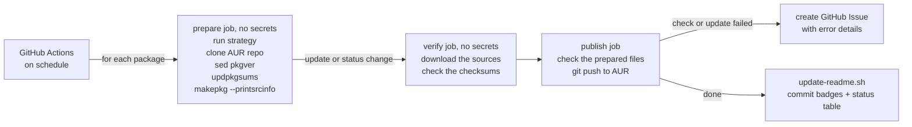

# aurtomator

<!-- BADGES:START -->
    
<!-- BADGES:END -->

Automated AUR package updates from a single GitHub repo.  
[Fork it](https://github.com/staticwire/aurtomator/fork), drop in your packages, let CI handle the rest.

## Packages

<!-- PACKAGES:START -->

| Package | Version | Strategy | Updated | Status |
|---------|---------|----------|---------|--------|
| *No packages configured* | — | — | — | — |
<!-- PACKAGES:END -->

*Auto-generated by CI after each run.*

## How it works

Each package has a YAML config pointing to an upstream source. When a new version is detected, aurtomator clones the existing AUR repo, bumps `pkgver`, regenerates checksums and `.SRCINFO`, and pushes. A PKGBUILD is code, so these steps run in a job without secrets. A second job without secrets downloads the sources and checks the checksums, and the job that pushes checks the result once more. It does not generate PKGBUILDs or modify anything else. If anything fails, a GitHub Issue is opened automatically.

## Quick start

1. Fork this repo (or use as template)
2. Enable Actions and Issues in your fork's Settings ([why?](docs/SETUP.md#after-forking))
3. Run `./scripts/setup.sh` ([detailed guide](docs/SETUP.md))
4. Add a package: `cp packages/example.yml.sample packages/<name>.yml`
5. Validate: `./scripts/validate-pkg.sh <name>`
6. Push and let CI handle the rest

The setup script configures your identity (git author for AUR commits), SSH access, and GitHub Secrets. With [gh CLI](https://cli.github.com/) it sets the secrets itself. Without it, the script prints manual instructions. GPG commit signing is optional.

## Strategies

14 built-in version detection strategies:

| Strategy           | Source              | Use for                              |
|--------------------|---------------------|--------------------------------------|
| `github-release`   | GitHub Releases API | GitHub-hosted projects with releases |
| `github-tag`       | GitHub Tags API     | GitHub projects without releases     |
| `github-nightly`   | GitHub Releases API | Nightly/prerelease builds (4 patterns) |
| `github-asset`     | GitHub Releases API | Assets re-uploaded on a fixed tag    |
| `gitlab-tag`       | GitLab Tags API     | Any GitLab instance                  |
| `gitea-tag`        | Gitea/Forgejo API   | Codeberg, self-hosted Gitea          |
| `git-latest`       | `git clone --bare`  | `-git` packages, any git repo        |
| `pypi`             | PyPI JSON API       | Python packages                      |
| `npm`              | npm registry        | Node.js packages                     |
| `crates`           | crates.io API       | Rust crates                          |
| `repology`         | Repology API        | Universal fallback (120+ repos)      |
| `archpkg`          | Arch repos API      | Rebuild triggers, dependency tracking |
| `webpage-scrape`   | URL + regex         | Anything not covered above           |
| `kde-tarball`      | download.kde.org    | KDE/Plasma packages                  |

See [docs/WORKFLOW.md](docs/WORKFLOW.md) for strategy details, YAML examples, and how to write custom strategies.

## Limitations

aurtomator only updates `pkgver`, checksums, and `.SRCINFO`. It does not build packages or check dependencies. These cases are detected and blocked:

- **Split packages**: `pkgname=(...)` arrays
- **`pkgver()` with the wrong strategy**: use `git-latest` for VCS packages
- **Mixed SKIP and real checksums**: `updpkgsums` is all-or-nothing
- **Source URLs returning HTML**: detected by the `Content-Type` check

Patches in `source=()` trigger a warning and are not blocked.

[docs/SUPPORTED-PACKAGES.md](docs/SUPPORTED-PACKAGES.md) has the full breakdown, including safe and unsafe failure modes and a comparison with other tools.

## Downgrades

aurtomator follows upstream when it publishes a version older than the tracked one, for example after a tag is deleted and recreated. Upstream is the source of truth. A downgrade is logged with the literal keyword `DOWNGRADE` and shown in the package table with a `⬇️` icon. It counts as a successful run, so the badge stays green. Details are in [docs/WORKFLOW.md section 4.3](docs/WORKFLOW.md#43-downgrade-behavior).

## Resource usage

All packages run in one workflow: one Arch container and one SSH and GPG setup per run. A version check is a few API requests per package, or a bare clone for `git-latest`.

## Documentation

- [Setup guide](docs/SETUP.md): first-time configuration, prerequisites, troubleshooting
- [Supported packages](docs/SUPPORTED-PACKAGES.md): what works, what does not, safety rules
- [Workflow reference](docs/WORKFLOW.md): strategies, update process, CI pipeline, local testing, custom strategies

## Alternatives

| Tool              | Best for                 | Approach                                         |
|-------------------|--------------------------|--------------------------------------------------|
| [nvchecker]       | Version detection only   | Python, 40+ sources, no AUR push                 |
| [lilac]           | Large repos (archlinuxcn)| Full build bot, needs own infra                  |
| [aur-auto-update] | Centralized service      | Requires bot co-maintainer on AUR                |
| [Renovate]        | Multi-ecosystem          | Enterprise-grade, heavy config                   |
| **aurtomator**    | Individual maintainers   | Fork and go, bash, zero dependencies beyond Arch |

[nvchecker]: https://github.com/lilydjwg/nvchecker
[lilac]: https://github.com/archlinuxcn/lilac
[aur-auto-update]: https://github.com/arch4edu/aur-auto-update
[Renovate]: https://docs.renovatebot.com/user-stories/maintaining-aur-packages-with-renovate/

## License

BSD-3-Clause
