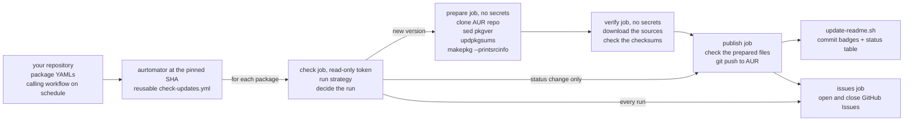

# aurtomator

    

Automated AUR package updates from a single GitHub repo.  
Create a repository from the template [staticwire/aurtomator-seed](https://github.com/staticwire/aurtomator-seed) and drop in your packages. Its workflows call the pipeline of aurtomator at a pinned commit.

## Packages

<!-- PACKAGES:START -->
<table>
<tr><th>Package</th><th>Version</th><th>Strategy</th><th>Updated</th><th>Status</th></tr>
<tr><td><em>No packages configured</em></td><td>-</td><td nowrap>-</td><td nowrap>-</td><td nowrap>-</td></tr>
</table>

aurtomator 0.7.1 <!-- x-release-please-version -->
<!-- PACKAGES:END -->

*Auto-generated by CI after each run.*

## How it works

Each package has a YAML config pointing to an upstream source. Your repository holds these configs and calls the pipeline of aurtomator. A first job runs the strategies and decides what the run does. When a new version is detected, aurtomator clones the existing AUR repo, bumps `pkgver`, regenerates checksums and `.SRCINFO`, and pushes. A PKGBUILD is code, so these steps run in a job without secrets, and the jobs after it take the statuses from the first job. A second job without secrets downloads the sources and checks the checksums, and the job that pushes checks the result once more. It does not generate PKGBUILDs or modify anything else. A package that starts failing gets a GitHub Issue, and so does a failed run of the workflow.

## Quick start

1. Create a repository from [staticwire/aurtomator-seed](https://github.com/staticwire/aurtomator-seed) with "Use this template"
2. Make sure Issues are on in the Settings of the new repository ([why?](docs/SETUP.md#after-creating-the-repository))
3. Clone aurtomator for the scripts, at the tag the calling workflows pin: `git clone https://github.com/staticwire/aurtomator ~/src/aurtomator` and `git -C ~/src/aurtomator checkout vX.Y.Z`, where `vX.Y.Z` is the version in the `# vX.Y.Z` comment of those workflows
4. Clone the new repository and run `~/src/aurtomator/scripts/setup.sh` from inside it ([detailed guide](docs/SETUP.md))
5. Add a package: `cp ~/src/aurtomator/packages/example.yml.sample packages/<name>.yml`, where `<name>` is the pkgbase on the AUR
6. Edit the copy: set `name: <name>`, a `strategy` and its `upstream` fields, see [Strategies](#strategies)
7. Validate from inside the new repository: `~/src/aurtomator/scripts/validate-pkg.sh <name>`
8. Push and let CI handle the rest

The setup script configures your identity (git author for AUR commits), SSH access, and GitHub Secrets. With [gh CLI](https://cli.github.com/) it sets the secrets itself. Without it, the script prints manual instructions. GPG commit signing is optional.

## Strategies

15 built-in version detection strategies:

| Strategy           | Source              | Use for                                |
|--------------------|---------------------|----------------------------------------|
| `github-release`   | GitHub Releases API | GitHub-hosted projects with releases   |
| `github-tag`       | `git ls-remote`     | GitHub projects without releases       |
| `github-nightly`   | GitHub Releases API | Nightly/prerelease builds (4 patterns) |
| `github-asset`     | GitHub Releases API | Assets re-uploaded on a fixed tag      |
| `gitlab-tag`       | GitLab Tags API     | Any GitLab instance                    |
| `gitea-tag`        | Gitea/Forgejo API   | Codeberg, self-hosted Gitea            |
| `git-tag`          | `git ls-remote`     | Any HTTPS git host, such as sourcehut  |
| `git-latest`       | `git clone --bare`  | `-git` packages, any HTTPS git repo    |
| `pypi`             | PyPI JSON API       | Python packages                        |
| `npm`              | npm registry        | Node.js packages                       |
| `crates`           | crates.io API       | Rust crates                            |
| `repology`         | Repology API        | Universal fallback (120+ repos)        |
| `archpkg`          | Arch repos API      | The pkgver of an official package      |
| `webpage-scrape`   | URL + regex         | Anything not covered above             |
| `kde-tarball`      | download.kde.org    | KDE projects, Plasma and Gear too      |

See [docs/WORKFLOW.md](docs/WORKFLOW.md) for strategy details, YAML examples, and how to write custom strategies.

## Limitations

aurtomator only sets `pkgver` and `pkgrel`, updates checksums and `.SRCINFO`, and sets a value from a release asset name where the package YAML asks for one. `pkgrel` goes back to 1 for a new version, and a rebuild with a new asset value raises it by one. It does not build packages or check dependencies. These cases are detected and blocked:

- **`pkgver()` with the wrong strategy**: use `git-latest` for VCS packages
- **A `SKIP` next to a real checksum of a remote source**: `updpkgsums` runs for the real checksum and would turn such a `SKIP` into a hash, which the check of the prepared files refuses. A `SKIP` that makepkg gives itself does not count: that of a signature (`.sig`, `.sign`, `.asc`), of an svn source, and of a git, hg or bzr source without a pin makepkg hashes, see [docs/SUPPORTED-PACKAGES.md](docs/SUPPORTED-PACKAGES.md#mixed-skip-and-real-checksums-blocked)
- **Sources that do not follow `pkgver`**: when a download has a real checksum or a VCS source is pinned, a bump has to change a source URL or a checksum for each architecture, or the new version would hold the old files. Make `pkgver` the literal and derive the other variable from it
- **Source URLs returning HTML** or an error status: a HEAD request checks every `http` and `https` source, also one with a `SKIP` checksum

Patches in `source=()` trigger a warning and are not blocked.

[docs/SUPPORTED-PACKAGES.md](docs/SUPPORTED-PACKAGES.md) has the full breakdown, including safe and unsafe failure modes and a comparison with other tools.

## Downgrades

aurtomator publishes a version older than the tracked one only when the package YAML sets `allow_downgrade: true`. Without it, the downgrade is skipped: the latest release of a GitHub project can be a maintenance release of an older line. A downgrade is logged with the literal keyword `DOWNGRADE` and shown in the package table with a `🔻` icon. It counts as a successful run, so the badge stays green. Details are in [docs/WORKFLOW.md section 4.3](docs/WORKFLOW.md#43-downgrade-behavior).

An update whose first number has at least two digits more than that of the tracked version, such as `13 → 2026102100`, is skipped the same way unless the package YAML sets `allow_version_jump: true`. Such a step is more often another version scheme of the upstream, as build tags next to release tags, than a release. It is shown with a `🔺` icon.

## Update alerts

A package YAML can name the versions that need a hand edit of the PKGBUILD, such as a new major that needs a newer build dependency. An alert with `hold: true` pauses the update at such a version, shown with a `✋` icon, and opens an issue with the note until the maintainer publishes the version by hand. Without `hold`, the update goes on, and an issue with the note opens after the push. Details are in [docs/WORKFLOW.md section 4.5](docs/WORKFLOW.md#45-update-alerts).

## Values from release asset names

Some upstreams name a release asset with more than the version and rebuild a release under a new name, as liquidsoap does with `liquidsoap_2.4.6-debian-forky-ocaml5.4.0-3_amd64.deb`. With `upstream.asset_regex` and `upstream.asset_var`, a run takes that value from the release of the new version and writes it to its line in the PKGBUILD. A new value of the current version is pushed as a rebuild with the next `pkgrel`, shown with a `🔨` icon. While the release or its asset is not out yet, the package shows `⏳` for up to a day. Details are in [docs/WORKFLOW.md section 4.6](docs/WORKFLOW.md#46-values-from-release-asset-names).

## Updates of aurtomator

The line under the package table shows the version a run uses, which is `VERSION` of aurtomator at the SHA the calling workflows pin. Dependabot opens the pull request that moves the pin. A newer release also gets an issue and a link on that line. A run closes the issue once the pin of the calling workflows names that release, or once a newer release is out. Details are in [docs/WORKFLOW.md section 5.8](docs/WORKFLOW.md#58-version-of-aurtomator).

## Resource usage

All packages run in one workflow run. `check` and `issues` run every time, `prepare` and `verify` only for a new version, and `publish` for a new version or a change in the status table. Each of these jobs starts its own Arch container and installs its packages. SSH and GPG are set up once per run, in `publish`. A version check is a few API requests per package, or a bare clone for `git-latest`.

## Documentation

- [Setup guide](docs/SETUP.md): first-time configuration, prerequisites, troubleshooting
- [Supported packages](docs/SUPPORTED-PACKAGES.md): what works, what does not, safety rules
- [Workflow reference](docs/WORKFLOW.md): strategies, update process, CI pipeline, local testing, custom strategies

## Alternatives

| Tool              | Best for                  | Approach                          |
|-------------------|---------------------------|-----------------------------------|
| [nvchecker]       | Version detection only    | Python, 40+ sources, no AUR push  |
| [lilac]           | Large repos (archlinuxcn) | Full build bot, needs own infra   |
| [aur-auto-update] | Centralized service       | Requires bot co-maintainer on AUR |
| [Renovate]        | Multi-ecosystem           | Enterprise-grade, heavy config    |
| **aurtomator**    | Individual maintainers    | Template and a pinned workflow    |

[nvchecker]: https://github.com/lilydjwg/nvchecker
[lilac]: https://github.com/archlinuxcn/lilac
[aur-auto-update]: https://github.com/arch4edu/aur-auto-update
[Renovate]: https://docs.renovatebot.com/user-stories/maintaining-aur-packages-with-renovate/

## License

BSD-3-Clause
