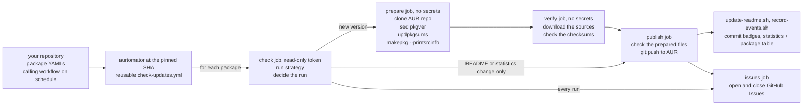

<p align="center">
  <picture><source media="(prefers-color-scheme: dark)" srcset="assets/logo-dark.svg"><source media="(prefers-color-scheme: light)" srcset="assets/logo-light.svg"></picture>
</p>

<p align="center">Automated AUR package updates</p>

aurtomator does the routine work of an AUR maintainer: it finds a new upstream version, bumps `pkgver`, updates the checksums and `.SRCINFO` and pushes to the AUR. It runs a few times a day in GitHub Actions of your own repository, made from the template [staticwire/aurtomator-seed](https://github.com/staticwire/aurtomator-seed), where each package is one YAML file. A package it cannot update gets an issue.

<p align="center">
  <a href="https://github.com/staticwire/aurtomator/actions/workflows/ci.yml"></a>
  <a href="https://codecov.io/github/staticwire/aurtomator"></a>
  <a href="https://github.com/staticwire/aurtomator/releases"></a>
  <a href="LICENSE"></a>
  <a href="https://www.gnu.org/software/bash/"></a>
  <a href="https://aurtomator.dev/setup/#the-calling-workflows"></a>
</p>

<p align="center">
  <a href="#quick-start"><picture><source media="(prefers-color-scheme: dark)" srcset="assets/button-quick-start-dark.svg"><source media="(prefers-color-scheme: light)" srcset="assets/button-quick-start-light.svg"></picture></a>
  <a href="https://aurtomator.dev/setup/"><picture><source media="(prefers-color-scheme: dark)" srcset="assets/button-setup-guide-dark.svg"><source media="(prefers-color-scheme: light)" srcset="assets/button-setup-guide-light.svg"></picture></a>
  <a href="https://aurtomator.dev/supported-packages/"><picture><source media="(prefers-color-scheme: dark)" srcset="assets/button-supported-packages-dark.svg"><source media="(prefers-color-scheme: light)" srcset="assets/button-supported-packages-light.svg"></picture></a>
  <a href="https://aurtomator.dev/overview/"><picture><source media="(prefers-color-scheme: dark)" srcset="assets/button-workflow-reference-dark.svg"><source media="(prefers-color-scheme: light)" srcset="assets/button-workflow-reference-light.svg"></picture></a>
</p>

## How it works



Your repository holds one YAML per package, which names its upstream source, and calls the pipeline of aurtomator. The first job runs the strategies and decides the run. For a new version, a job without secrets clones the AUR repository, bumps `pkgver` and regenerates the checksums and `.SRCINFO`, since a PKGBUILD is code. A second job without secrets downloads the sources and checks the checksums, and the job that pushes checks the result once more. [Limitations](#limitations) lists the lines of a PKGBUILD that aurtomator changes. A package that starts failing gets an issue, and so does a failed run.

## Quick start

1. Create your repository from the template [staticwire/aurtomator-seed](https://github.com/staticwire/aurtomator-seed) with [Use this template](https://github.com/staticwire/aurtomator-seed/generate). Check that Issues are enabled in its settings, and that `Check AUR Package Updates` and `Validate packages` are enabled in its Actions tab ([details](https://aurtomator.dev/setup/#after-creating-the-repository)).
2. Clone your repository:

   ```bash
   git clone https://github.com/<you>/<repository>
   cd <repository>
   ```

3. Set up the git identity of your AUR commits, the AUR SSH key and the GitHub secrets ([details](https://aurtomator.dev/setup/)):

   ```bash
   ./aurtomator.sh setup
   ```

4. Add a package. `<name>` is the pkgbase on the AUR:

   ```bash
   ./aurtomator.sh draft <name>
   ```

   

   It reads the `.SRCINFO` of the package in the AUR, writes `packages/<name>.yml` with a strategy and its `upstream` fields, and checks the file, see [Draft a package](https://aurtomator.dev/add-a-package/#draft-a-package). When no rule matches the package, write the file from the sample, see [Strategies](#strategies), and check it:

   ```bash
   ./aurtomator.sh sample > packages/<name>.yml
   ./aurtomator.sh validate-pkg <name>
   ```

5. Commit and push. The schedule starts a run a few times a day, and Actions > Check AUR Package Updates > Run workflow starts one at once.

`./aurtomator.sh` runs the scripts of aurtomator at the version your workflows pin, see [The aurtomator.sh script](https://aurtomator.dev/setup/#the-aurtomatorsh-script). Without [gh CLI](https://cli.github.com/), `setup` prints how to set the secrets by hand. GPG signing of the AUR commits is optional.

## Strategies

16 built-in version detection strategies:

| Strategy           | Source              | Use for                                |
|--------------------|---------------------|----------------------------------------|
| `github-release`   | GitHub Releases API | GitHub-hosted projects with releases   |
| `github-tag`       | `git ls-remote`     | GitHub projects without releases       |
| `github-nightly`   | GitHub Releases API | Nightly/prerelease builds (4 patterns) |
| `github-asset`     | GitHub Releases API | Assets re-uploaded on a fixed tag      |
| `gitlab-tag`       | GitLab Tags API     | Any GitLab instance                    |
| `gitea-tag`        | Gitea/Forgejo API   | Codeberg, self-hosted Gitea            |
| `gitea-release`    | Gitea/Forgejo API   | Releases on Codeberg or a Gitea host   |
| `git-tag`          | `git ls-remote`     | Any HTTPS git host, such as sourcehut  |
| `git-latest`       | `git clone --bare`  | `-git` packages, any HTTPS git repo    |
| `pypi`             | PyPI JSON API       | Python packages                        |
| `npm`              | npm registry        | Node.js packages                       |
| `crates`           | crates.io API       | Rust crates                            |
| `repology`         | Repology API        | Fallback across distribution repos     |
| `archpkg`          | Arch repos API      | The pkgver of an official package      |
| `webpage-scrape`   | URL + regex         | Anything not covered above             |
| `kde-tarball`      | download.kde.org    | KDE projects, Plasma and Gear too      |

See [Strategies](https://aurtomator.dev/strategies/) for strategy details and YAML examples, and [Custom strategies](https://aurtomator.dev/custom-strategies/) for how to write one.

## Limitations

In a PKGBUILD, aurtomator changes these lines and no others:

- `pkgver`, to the new version
- `pkgrel`, to 1 for a new version, or one up when upstream rebuilds the same version under a new file name
- the checksums
- the variable that `upstream.asset_var` names, when upstream puts more than the version into its file names, as liquidsoap does in `liquidsoap_2.4.6-debian-forky-ocaml5.4.0-3_amd64.deb`
- `arch=()`, when a release lacks the archive of an arch other than `x86_64`

It writes `.SRCINFO` from the result with `makepkg --printsrcinfo`. It does not build packages or check dependencies. These cases are detected and blocked:

- [`pkgver()` with the wrong strategy](https://aurtomator.dev/supported-packages/#pkgver-with-the-wrong-strategy-blocked)
- [A `SKIP` next to a real checksum of a remote source](https://aurtomator.dev/supported-packages/#mixed-skip-and-real-checksums-blocked)
- [Sources that do not follow `pkgver`](https://aurtomator.dev/supported-packages/#sources-that-do-not-follow-pkgver-blocked)
- [Lines the check cannot read from the PKGBUILD](https://aurtomator.dev/supported-packages/#lines-the-check-cannot-read-from-the-pkgbuild-blocked)
- [Source URLs returning HTML or an error status](https://aurtomator.dev/supported-packages/#source-url-returns-html-blocked)
- [Checksums verify cannot compute](https://aurtomator.dev/supported-packages/#checksums-verify-cannot-compute-blocked)

Patches in `source=()` get a warning. [Supported packages](https://aurtomator.dev/supported-packages/) lists every case.

## Features

- [Downgrades](https://aurtomator.dev/features/downgrades/): a version older than the tracked one goes out only with `allow_downgrade: true`, and a version whose first number has at least two digits more only with `allow_version_jump: true`.
- [Update alerts](https://aurtomator.dev/features/update-alerts/): an alert in the package YAML names a version that needs a hand edit of the PKGBUILD, and holds the update there or opens an issue with its note after the push.
- [Values from release asset names](https://aurtomator.dev/features/asset-values/): for an upstream that puts more than the version into its file names, a run writes that part to its variable in the PKGBUILD, and a new value of the same version goes out as a rebuild.
- [Cooldown](https://aurtomator.dev/features/cooldown/): a push of a `git-latest` package waits 7 days after the last one, and `cooldown_days` sets other days for any strategy.
- [Versions without some arches](https://aurtomator.dev/features/missing-arches/): a release that lacks the archive of an arch other than `x86_64` goes out without that arch after 24 hours, and a run puts the arch back once its archive is out.
- [Updates of aurtomator](https://aurtomator.dev/features/aurtomator-updates/): Dependabot opens the pull request that moves the pin of your workflows to a new release, and a newer release also gets an issue.
- [Statistics](https://aurtomator.dev/features/statistics/): your repository keeps a journal of every change of state of its packages, and its README shows a card drawn from it.
- [Resource usage](https://aurtomator.dev/internals/workflow/#permissions-and-container): all packages share one workflow run, and only a new version or a rebuild starts the jobs that prepare and verify a package.

## Alternatives

| Tool              | Best for                  | Approach                          |
|-------------------|---------------------------|-----------------------------------|
| [nvchecker]       | Version detection only    | Python, 40+ sources, no AUR push  |
| [lilac]           | Large repos (archlinuxcn) | Full build bot, needs own infra   |
| [aur-auto-update] | Centralized service       | Requires bot co-maintainer on AUR |
| [Renovate]        | Multi-ecosystem           | Enterprise-grade, heavy config    |
| **aurtomator**    | Individual maintainers    | Template and a pinned workflow    |

[nvchecker]: https://github.com/lilydjwg/nvchecker
[lilac]: https://github.com/archlinuxcn/lilac
[aur-auto-update]: https://github.com/arch4edu/aur-auto-update
[Renovate]: https://docs.renovatebot.com/user-stories/maintaining-aur-packages-with-renovate/

## License

BSD-3-Clause
