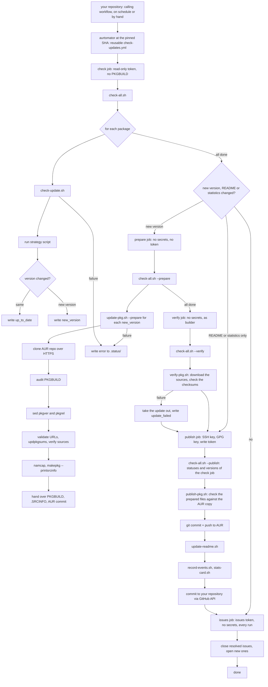

# Aurtomator Workflow Reference

## Table of Contents

1. [Overview](#1-overview)
2. [Package YAML Format](#2-package-yaml-format)
3. [Strategies](#3-strategies)
4. [Update Process](#4-update-process)
5. [CI Workflow: check-updates.yml](#5-ci-workflow-check-updatesyml)
6. [CI Quality Gate: ci.yml](#6-ci-quality-gate-ciyml)
   - [6.1 Lint job](#61-lint-job)
   - [6.2 Test job](#62-test-job)
   - [6.3 CI image updates](#63-ci-image-updates)
   - [6.4 Validate and pipeline jobs](#64-validate-and-pipeline-jobs)
   - [6.5 Runner probe](#65-runner-probe)
7. [Local Testing](#7-local-testing)
8. [Writing Custom Strategies](#8-writing-custom-strategies)

## 1. Overview

aurtomator bumps the version of AUR packages you already maintain. It does **not** generate PKGBUILDs: it changes `pkgver` and `pkgrel` in the existing PKGBUILD on the AUR, regenerates checksums and `.SRCINFO`, and pushes the update.

### End-to-end flow

A run involves two repositories. Your repository, created from the template `staticwire/aurtomator-seed`, holds the package YAMLs, the README with the package table and two calling workflows, `.github/workflows/check-updates.yml` and `.github/workflows/validate.yml`. aurtomator holds the scripts, the strategies and the reusable workflows `check-updates.yml`, `notify-failure.yml` and `validate.yml`, and the calling workflows run them at the SHA they pin, see [5.1](#51-trigger). A run pushes the new versions to the AUR and commits the changed package YAMLs, the README and the files of `stats/` to your repository.



### Key design decisions

- **One YAML per package.** Adding or removing a package is one file.
- **Strategy-based version detection.** Each type of upstream source has its own script. A new source is a new script plus the checks of its fields in `scripts/validate-pkg.sh`.
- **Patch, do not generate.** aurtomator trusts your PKGBUILD and changes only `pkgver`, `pkgrel`, checksums, `.SRCINFO` and, for a package with `upstream.asset_var`, the line of that variable, see [4.6](#46-values-from-release-asset-names). Build steps, dependencies and install files stay untouched.
- **Five jobs, one with secrets.** A PKGBUILD is code, and an update executes it from the audit to `makepkg --printsrcinfo`. `check` runs the strategies with the read-only workflow token, executes no PKGBUILD and decides what the run does. The jobs after it take the status of every package from `check`. `prepare` runs the PKGBUILD steps without secrets and without a token, and hands over only prepared files and update failures, because code from one PKGBUILD can write the files of every package there. `verify` downloads the sources of each prepared update and checks its checksums, without secrets and as an unprivileged user, so code from one PKGBUILD cannot forge the checksums of another package. `publish` holds the SSH key, the GPG key and the write token, never executes a PKGBUILD, runs no strategy and never downloads a source, and checks what `verify` passes on before it pushes. See [4.4](#44-prepare-and-publish). `issues` opens and closes the issues in every run, with a token that writes issues and nothing else, see [5.6](#56-issues).
- **Failure isolation.** A broken package does not block the others. Each failure is logged for its package, and a package that starts failing gets a GitHub Issue, see [5.6](#56-issues). Each package has a time budget, so one that hangs does not hold up the run either.

## 2. Package YAML Format

Each package has a file at `packages/<name>.yml`. The file name, the `name` field and the `pkgbase` on the AUR are the same. A run finds the file of a package by its `name`, so `validate-pkg.sh` refuses a `name` other than the file name. The `pkgbase` names the AUR git repository, and it is the package name, except for a split package such as `pkgbase=liblinear` with `pkgname=(liblinear python-liblinear)`.

| Field          | Required | Description                                                                 |
|----------------|----------|-----------------------------------------------------------------------------|
| `name`         | yes      | `pkgbase` on the AUR, equal to the file name without `.yml`                 |
| `strategy`     | yes      | Version detection strategy: a script name in `strategies/` without `.sh`    |
| `upstream`     | depends  | Strategy-specific settings. `archpkg`, `repology` and `kde-tarball` need none. |
| `current`      | no       | Currently tracked version. Written after every push.                        |
| `last_updated` | no       | Date of the last push, `YYYY-MM-DD`. Written after every push. The cooldown counts from it, see [4.7](#47-cooldown). |
| `current_asset` | no      | The value from a release asset name that the AUR has, for a package with `upstream.asset_var`. Written after every push, see [4.6](#46-values-from-release-asset-names) |
| `allow_downgrade` | no    | `true` publishes an upstream version lower than `current`. Default `false`, see [4.3](#43-downgrade-behavior). |
| `allow_version_jump` | no | `true` publishes a version whose first number has at least two digits more than the first number of `current`. Default `false`, see [4.3](#43-downgrade-behavior). |
| `cooldown_days` | no      | The days a push waits after the last one, from 0 to 365. Default 7 for `git-latest` and 0 for the other strategies, and `0` turns the wait off, see [4.7](#47-cooldown). |
| `pkgver_dash`  | no       | `_`, `.` or `''`: the character that stands for each `-` of the upstream version, or none, see below |
| `pkgver_format` | no      | The upstream version with a fixed text around it, `%s` in its place, as `4.%s`, see below |
| `alerts`       | no       | Rules for steps of upstream that need a hand edit: each pauses the update or reports a note, see [4.5](#45-update-alerts) |

`validate-pkg.sh` refuses a key that is not in this table, and an `upstream` key that the strategy does not read, so a misspelled key does not go unread. A misspelled `allow_downgrade` gives `packages/<name>.yml: unknown key: allow_downgrades`. The `upstream` keys of each strategy are its line of `UPSTREAM_KEYS` in `scripts/validate-pkg.sh`, and the error names the strategies that read the key, as in `upstream.branch applies to the git-latest strategy only`. A key that no strategy reads gives `upstream.projet is not a field of any strategy`. A file that is not a map of fields is refused before these checks, and an `upstream` that is not a map before the check of its keys. It also refuses a `current` with a character outside `A-Za-z0-9._+` or without a digit, the form of a version in every script.

Example:

```yaml
name: my-package
strategy: github-release
upstream:
  project: owner/repo
current: "2.1.0"
```

`pkgver` cannot hold a dash, so `check-update.sh` refuses a version such as `1.9.0-1` from npm or `1.0.0-beta.24` from crates.io. With `pkgver_dash`, it replaces every `-` in the output of the strategy before that check. The PKGBUILD turns the character back where a source URL needs the dash, as `${pkgver//_/-}` does for `_`, and the `.SRCINFO` check of verify and publish counts such a form as the version, see step 5 of publish in [4.4](#44-prepare-and-publish). `vercmp` reads `_` and `.` the same. `.` fits a PKGBUILD that already writes the dash as a dot, such as pijul with `_pkgver=${pkgver/.beta/-beta}`. A version given to `update-pkg.sh` by hand is taken as it is.

A pre-release mapped to `_` or `.` sorts above its final release: `vercmp 1.0.0.beta.24 1.0.0` and `vercmp 0.60.0_RC1 0.60.0` are both `1`, while a pre-release glued to the number, `1.0.0beta.24`, sorts below `1.0.0`. When the final release comes out, the check skips it as a downgrade, see [4.3](#43-downgrade-behavior), and the AUR package needs an `epoch`, which aurtomator does not write.

`pkgver_dash: ''` drops the dash and so glues the pre-release to the number: `2.5.0-rc1` becomes `2.5.0rc1`, which `vercmp` puts below `2.5.0` and above `2.4.6`, and the final release updates the package without an epoch. The PKGBUILD puts the dash back where a URL needs it, as `${pkgver/rc/-rc}` does, and the `.SRCINFO` check counts a form of the version with a dash between two of its characters as the version. A pre-release that starts with a digit stays above its release: `1.9.0-1` becomes `1.9.01`, and `vercmp 1.9.01 1.9.0` is `1`. A package that moves to `''` from `_` or `.` gets a lower pkgver for `vercmp`, `2.5.0rc2` below `2.5.0_rc1`, so the move needs an epoch once.

With `pkgver_format`, `pkgver` is the upstream version with a fixed text around it: `'4.%s'` turns build `4215` into `4.4215`. `check-update.sh` puts the output of the strategy in place of `%s`, after `pkgver_dash`, so `current` holds the formatted version. The PKGBUILD cuts the text off where a source URL needs the upstream version, as `${pkgver#4.}` does, and the `.SRCINFO` check of verify and publish counts that form as the version, see step 5 of publish in [4.4](#44-prepare-and-publish). `validate-pkg.sh` refuses a format without exactly one `%s` or with a character outside `A-Za-z0-9._+` around it, and a `current` that does not fit the format.

```yaml
name: my-package
strategy: webpage-scrape
upstream:
  url: https://example.com/updates.json
  pattern: '"latest_version": ([0-9]+)'
pkgver_format: '4.%s'
current: "4.4215"
```

## 3. Strategies

aurtomator ships 16 strategies. A strategy is a bash script in `strategies/`. It takes the package name, reads its settings from the package YAML, queries the upstream, and prints one version string on stdout. On failure it prints an error to stderr and exits non-zero. The HTTP-based strategies use `curl` with a 30-second timeout, and the tag-based ones strip a leading `v`.

### 3.1 github-release

**Upstream:** GitHub Releases API: `/repos/{owner}/{repo}/releases/latest`, or the release list with `tag_version_regex`.

**When to use:** GitHub projects that publish releases.

**YAML fields:**

| Field                        | Required | Description                         |
|------------------------------|----------|-------------------------------------|
| `upstream.project`           | yes      | `owner/repo` format                 |
| `upstream.tag_version_regex` | no       | ERE whose first capture group is the version, see below |
| `upstream.tag_version_replace` | no     | The version built from the groups of `tag_version_regex` (default: `\1`), see below |
| `upstream.asset_regex`       | no       | ERE whose one capture group is a value from an asset name of the release, see [4.6](#46-values-from-release-asset-names) |
| `upstream.asset_var`         | with `asset_regex` | The PKGBUILD variable that holds that value, see [4.6](#46-values-from-release-asset-names) |

**Version:** reads `.tag_name` of the latest release and strips a leading `v`. The endpoint skips drafts and pre-releases. When it answers 404, the strategy reads the release list to say why: a list of pre-releases only gets a message that names `github-nightly` with `nightly_tag_regex`, an empty list one that names `github-tag`.

With `tag_version_regex`, the strategy reads the release list instead, 100 releases a page, until the list ends, at most 10 pages. The API lists releases by the date of the tagged commit, so the newest version can stand on any of them. It takes the highest version among the matches by `vercmp`, as [github-tag](#32-github-tag) does, and leaves out drafts and pre-releases, so a fix release of an older line published after the newest one is no downgrade. A repository that releases several products then gives the release of the product the regex names, whatever `/releases/latest` returns. tutao/tutanota publishes its web, desktop and mobile apps as separate releases:

```yaml
name: tutanota-desktop-bin
strategy: github-release
upstream:
  project: tutao/tutanota
  tag_version_regex: '^tutanota-desktop-release-(.*)$'
```

**Authentication:** when `GITHUB_TOKEN` is set in the environment, it is sent as a Bearer token. curl reads the header from stdin, so the token does not appear on a command line. The `check-updates` workflow sets it to the workflow token, which allows 1,000 requests per hour per repository. Without it, for example in a local run, the limit is 60 requests per hour.

**Example YAML:**

```yaml
name: my-package
strategy: github-release
upstream:
  project: owner/repo
```

**Custom tag format:** for tags like `MeshLab-2025.07` or `0.1.8-stable`, set `tag_version_regex`. The text of its first capture group becomes the version. bash `[[ =~ ]]` takes the group, so the regex may hold `|`. Without `tag_version_replace`, a group of alternatives has to come after the version, as in `^v?([0-9.]+)(-stable|)$`, because bash knows no group that does not capture: `^(mesa-)?([0-9.]+)$` gives `mesa-`.

```yaml
name: meshlab-bin
strategy: github-release
upstream:
  project: cnr-isti-vclab/meshlab
  tag_version_regex: 'MeshLab-(.*)'
```

`tag_version_replace` builds the version from more than one group. `\1` to `\9` stand for the groups of `tag_version_regex`, and every other character is copied. The tag `2026-09-10` gives `2026.09.10` here:

```yaml
name: whitesur-icon-theme
strategy: github-release
upstream:
  project: vinceliuice/WhiteSur-icon-theme
  tag_version_regex: '^([0-9]{4})-([0-9]{2})-([0-9]{2})$'
  tag_version_replace: '\1.\2.\3'
```

`validate-pkg.sh` refuses `tag_version_replace` without `tag_version_regex`, with a character other than `A-Za-z0-9._+` outside `\1` to `\9`, or with a group the regex does not have. Both fields also work with `github-tag`, `github-nightly`, `gitlab-tag`, `gitea-tag`, `gitea-release` and `git-tag`. `validate-pkg.sh` refuses `tag_version_regex` with any other strategy.

### 3.2 github-tag

**Upstream:** the tags of the repository, read with `git ls-remote --tags --refs https://github.com/{owner}/{repo}.git`.

**When to use:** GitHub projects with tags and no releases.

**YAML fields:**

| Field                        | Required | Description                              |
|------------------------------|----------|------------------------------------------|
| `upstream.project`           | yes      | `owner/repo` format                      |
| `upstream.tag_version_regex` | no       | ERE whose first capture group is the version, replaces the default filter |
| `upstream.tag_version_replace` | no     | The version built from the groups of `tag_version_regex`, see [3.1](#31-github-release) |
| `upstream.asset_regex`       | no       | ERE whose one capture group is a value from an asset name of the release of the tag, see [4.6](#46-values-from-release-asset-names) |
| `upstream.asset_var`         | with `asset_regex` | The PKGBUILD variable that holds that value, see [4.6](#46-values-from-release-asset-names) |

**Version:** reads every tag in one request, outside the API rate limit. Without `tag_version_regex`, it keeps the tags of the form `v1.2.3` or `1.2.3`, so `latest`, `1.0.0-rc1` and `1.0.0rc1` are left out, and a project without such a tag fails the check with a message that names the field. `tag_version_regex` keeps the tags it matches instead. The strategy strips a leading `v`, or applies `tag_version_regex` and `tag_version_replace`, and returns the newest version by `vercmp`, the order of pacman: `1.0.0rc1` is below `1.0.0`. The comparison drops a dash before a letter, as `pkgver_dash: ''` does, so `1.0.0-rc1` is below `1.0.0` too, and takes any other dash for a dot, so `2025-04-03` compares as `2025.04.03`. With `pkgver_dash` `_` or `.`, pacman puts `1.0.0_rc1` above `1.0.0`, so `1.0.0` then shows as a skipped downgrade, see [section 2](#2-package-yaml-format).

**Authentication:** when `GITHUB_TOKEN` is set in the environment, git sends it to `github.com` as `Authorization: Basic` with the user `x-access-token`, which a private repository needs. The header reaches git through `GIT_CONFIG_*` variables, so the token does not appear on a command line. git allows only `https` and asks for no password on the terminal.

**Example YAML:**

```yaml
name: my-package
strategy: github-tag
upstream:
  project: owner/repo
```

A package that follows one release line pins it with the regex. kubernetes gives `1.36.5` here, and `1.37.1` without the field:

```yaml
name: my-kubectl-1.36
strategy: github-tag
upstream:
  project: kubernetes/kubernetes
  tag_version_regex: '^v(1\.36\.[0-9]+)$'
```

### 3.3 github-nightly

**Upstream:** GitHub releases of nightly or prerelease builds, in 4 patterns. The fields select the pattern:

- **Pattern A, fixed tag** (default): `nightly_tag` names one tag that moves, as in neovim, ghostty or yazi.
- **Pattern B, dated tags**: `nightly_tag` is a prefix with a dash, such as `nightly-`. Of the first 20 releases the API lists, the first whose tag contains it wins (ruffle). With `nightly_tag_regex` in place of `nightly_tag`, the strategy reads up to 3 pages of 100 releases and takes the release published last among those whose tag matches the ERE (servo).
- **Pattern C, separate nightly repo**: `nightly_tag: latest` reads `/releases/latest` of a dedicated build repo (yt-dlp).
- **Pattern D, channel filter**: of the first 20 releases the API lists, the first whose name contains `channel` wins (brave).

Patterns B and C depend on how a repository files its releases. `/releases/latest` skips pre-releases, and ruffle-rs/ruffle files its nightlies as pre-releases, so pattern C gives its stable `v0.7.1`. `/releases/latest` also sorts by `created_at`, which GitHub sets to the date of the tagged commit, not of the release. Every release of servo/servo-nightly-builds carries `2024-02-14` there, and its release list starts with 12 `v0.x` rc releases, so `nightly_tag: '-'` picks `v0.7.0-rc1`. `nightly_tag_regex` ranks the matches by `published_at` and depends on neither order. A page with fewer than 100 releases, an empty one included, is the last page it reads.

Pattern A:

```yaml
name: myapp-nightly-bin
strategy: github-nightly
upstream:
  project: owner/repo
  nightly_tag: nightly
  version_source: release_body
  version_pattern: 'APP v\K\S+'
```

Pattern B:

```yaml
name: myapp-nightly-bin
strategy: github-nightly
upstream:
  project: owner/repo
  nightly_tag: "nightly-"
  version_source: tag_date
```

Pattern C:

```yaml
name: myapp-nightly-bin
strategy: github-nightly
upstream:
  project: owner/nightly-builds
  nightly_tag: latest
  version_source: tag
```

Pattern D:

```yaml
name: myapp-nightly-bin
strategy: github-nightly
upstream:
  project: owner/repo
  channel: Nightly
  version_source: tag
```

**YAML fields:**

| Field | Required | Description |
|-------|----------|-------------|
| `upstream.project` | yes | `owner/repo` |
| `upstream.nightly_tag` | no | Tag name or prefix (default: `"nightly"`, `"latest"` for pattern C) |
| `upstream.nightly_tag_regex` | no | ERE for the tag in pattern B, in place of `nightly_tag` and `channel` |
| `upstream.version_source` | no | `"tag"` (default), `"release_body"`, `"tag_date"`, `"published_date"` |
| `upstream.version_pattern` | for `release_body` | Perl regex for the version in the release body. Dashes in the match become `+`. |
| `upstream.tag_version_regex` | no | ERE whose first capture group is the version, for `version_source: tag` |
| `upstream.tag_version_replace` | no | The version built from the groups of `tag_version_regex`, see [3.1](#31-github-release) |
| `upstream.date_format` | no | Format of `date` for `tag_date` and `published_date` (default: `%Y.%m.%d`) |
| `upstream.channel` | for pattern D | Text that the release name must contain |

`tag_date` takes the `YYYY-MM-DD` date in the tag and `published_date` the UTC date of `published_at`. `date -u` renders both with `date_format`, `YYYY.MM.DD` by default. The two dates can differ: the servo release `2026-10-21` was published at `2026-10-22T00:25:00Z`.

A package whose `pkgver` has the form `20251213` needs `date_format: '%Y%m%d'`, because `vercmp` ranks `20251213` above `2026.10.21` and the default form never counts as newer:

```yaml
name: servo-nightly-bin
strategy: github-nightly
upstream:
  project: servo/servo-nightly-builds
  nightly_tag_regex: '^[0-9]{4}-[0-9]{2}-[0-9]{2}$'
  version_source: tag_date
  date_format: '%Y%m%d'
```

`validate-pkg.sh` refuses `date_format` with another `version_source` and a format whose output is not a valid version, such as `%Y-%m-%d`. It refuses `nightly_tag_regex` next to `nightly_tag` or `channel`, and one that bash cannot compile. It refuses `tag_version_regex` and `tag_version_replace` with a `version_source` other than `tag`. It refuses a `version_source` other than `tag`, `release_body`, `tag_date` or `published_date`, `release_body` without `version_pattern`, a `version_pattern` that `grep -P` cannot compile, and `version_pattern` with another `version_source`. It refuses `tag_date` with the fixed tag of pattern A: such a tag has no dash and so no `YYYY-MM-DD` date. It refuses `nightly_tag` next to `channel`: `nightly_tag: latest` leaves `channel` unread, and `channel` leaves any other `nightly_tag` unread.

**Authentication:** same as `github-release`.

### 3.4 github-asset

**Upstream:** one GitHub release by tag (`/repos/{owner}/{repo}/releases/tags/{tag}`) and the `updated_at` of the assets listed in the package YAML.

**When to use:** releases whose tag never moves while the assets behind it are replaced, such as a model zoo or a rolling download tag. A PKGBUILD for such a release points at fixed URLs, so an update changes `pkgver`, `pkgrel` and the checksums and nothing else. Nightly binaries fit as well, such as the `nightly` tag of `wezterm/wezterm`. The PKGBUILD has no `pkgver()`, because the audit blocks one with this strategy, and `pkgver` holds the date, see [pkgver() with the wrong strategy](SUPPORTED-PACKAGES.md#pkgver-with-the-wrong-strategy-blocked).

**YAML fields:**

| Field              | Required | Description                                  |
|--------------------|----------|----------------------------------------------|
| `upstream.project` | yes      | `owner/repo` format                          |
| `upstream.tag`     | yes      | Release tag that carries the assets          |
| `upstream.assets`  | yes      | List of exact asset file names, at least one |

**Version:** every listed asset must be present in the release, otherwise the strategy fails and names the missing one. The newest `updated_at` among them becomes the version, rendered as `YYYYMMDD` (for example `20251202`). A re-upload of any listed asset moves the date forward. The release object lists only assets in state `uploaded`, so one request covers every downloadable asset.

**Authentication:** same as `github-release`.

**Example YAML:**

```yaml
name: sherpa-onnx-piper-voices-ru
strategy: github-asset
upstream:
  project: k2-fsa/sherpa-onnx
  tag: tts-models
  assets:
    - vits-piper-ru_RU-denis-medium.tar.bz2
    - vits-piper-ru_RU-dmitri-medium.tar.bz2
```

### 3.5 gitlab-tag

**Upstream:** GitLab Tags API (`/api/v4/projects/{id}/repository/tags`).

**When to use:** any GitLab instance: gitlab.com, invent.kde.org, self-hosted.

**YAML fields:**

| Field                  | Required | Description                                           |
|------------------------|----------|-------------------------------------------------------|
| `upstream.host`        | yes      | GitLab hostname (e.g. `invent.kde.org`, `gitlab.com`) |
| `upstream.project`     | yes      | Project path (e.g. `network/my-kde-app`)              |
| `upstream.tag_version_regex` | no | ERE whose first capture group is the version, replaces the default filter, see [3.1](#31-github-release) |
| `upstream.tag_version_replace` | no | The version built from the groups of `tag_version_regex`, see [3.1](#31-github-release) |

**Version:** URL-encodes the project path (`/` becomes `%2F`) and fetches the first 100 tags; [git-tag](#315-git-tag) with the `.git` URL of the project reads every tag. An answer that is not JSON, such as the page of a bot check, fails the check with the URL of that page, see [Upstreams behind a bot check](SUPPORTED-PACKAGES.md#upstreams-behind-a-bot-check). Without `tag_version_regex`, it keeps the tags of the form `v1.2.3` or `1.2.3`, and a project without such a tag fails the check with a message that names the field. It strips a leading `v`, or applies `tag_version_regex` and `tag_version_replace`, and returns the newest version by `vercmp`, as [github-tag](#32-github-tag) does. There is no authentication, so private projects cannot be queried.

**Example YAML:**

```yaml
name: my-kde-app
strategy: gitlab-tag
upstream:
  host: invent.kde.org
  project: network/my-kde-app
```

Mesa names its releases `mesa-26.2.5`:

```yaml
name: my-mesa
strategy: gitlab-tag
upstream:
  host: gitlab.freedesktop.org
  project: mesa/mesa
  tag_version_regex: '^mesa-([0-9.]+)$'
```

### 3.6 gitea-tag

**Upstream:** Gitea/Forgejo Tags API (`/api/v1/repos/{owner}/{repo}/tags`).

**When to use:** Codeberg and self-hosted Gitea or Forgejo instances.

**YAML fields:**

| Field                  | Required | Description                              |
|------------------------|----------|------------------------------------------|
| `upstream.host`        | yes      | Instance hostname (e.g. `codeberg.org`)  |
| `upstream.project`     | yes      | `owner/repo` format                      |
| `upstream.tag_version_regex` | no | ERE whose first capture group is the version, replaces the default filter, see [3.1](#31-github-release) |
| `upstream.tag_version_replace` | no | The version built from the groups of `tag_version_regex`, see [3.1](#31-github-release) |

**Version:** fetches up to 50 tags without pagination; [git-tag](#315-git-tag) with the `.git` URL of the project reads every tag. An answer that is not JSON, such as the page of a bot check, fails the check with the URL of that page, see [Upstreams behind a bot check](SUPPORTED-PACKAGES.md#upstreams-behind-a-bot-check). Without `tag_version_regex`, it keeps the tags of the form `v1.2.3` or `1.2.3`, and a project without such a tag fails the check with a message that names the field. It strips a leading `v`, or applies `tag_version_regex` and `tag_version_replace`, and returns the newest version by `vercmp`, as [github-tag](#32-github-tag) does.

**Example YAML:**

```yaml
name: my-package
strategy: gitea-tag
upstream:
  host: codeberg.org
  project: owner/repo
```

### 3.7 git-latest

**Upstream:** any git repository with an HTTPS URL, through a bare clone.

**When to use:** `-git` AUR packages that track the latest commit.

**YAML fields:**

| Field              | Required | Description                                  |
|--------------------|----------|----------------------------------------------|
| `upstream.type`    | yes      | One of: `github`, `gitlab`, `git`            |
| `upstream.host`    | depends  | Required for the `gitlab` type               |
| `upstream.project` | depends  | Required for the `github` and `gitlab` types |
| `upstream.url`     | depends  | Required for the `git` type: full clone URL, `https://` only |
| `upstream.branch`  | no       | The branch of a source pinned to `#branch=`. Default: the default branch of the repository |
| `upstream.describe` | no      | `tags` or `annotated`: print the form of `git describe` instead of `r<count>.<hash>` |
| `upstream.tag_prefix` | no    | Text cut from the start of the tag with `upstream.describe`, such as `v` |

Each type reads only its own of `host`, `project` and `url`, and `validate-pkg.sh` refuses the others: `host` with `github` or `git`, `project` with `git`, and `url` with `github` or `gitlab`.

**Version:** makes a bare clone into a temporary directory, counts the commits on `HEAD` (`git rev-list --count HEAD`), takes the hash of `HEAD` and prints the usual `-git` format `r<count>.<hash>`, for example `r431.66db9ce`. The clone takes `--filter=tree:0` and holds commits and tags only, because the strategy reads no files: a full bare clone of `googleapis/mcp-toolbox`, 1.4 GB by the GitHub API, timed out after the 120 s of a check. A server without partial clone ignores the filter with a warning and sends the whole repository. With `upstream.branch`, the clone takes `--branch`, and `HEAD` is that branch, as makepkg checks it out for `#branch=`: sharkdp/fd gives `r2061.9e90463` on `master` and `r1925.cf8a48a` with `branch: abort-on-panic`. A branch the repository does not have fails the clone. `validate-pkg.sh` refuses a name that `git check-ref-format --branch` refuses, such as one that starts with `-`. The hash has as many characters as the hash in `current`, and 7 when `current` is empty. `git rev-parse --short` in a `pkgver()` gives more characters as the repository grows: fabric-git is `r2173.ef2e985d` on the AUR, and `vercmp` reads `r2173.ef2e985` of the same commit as newer, so a hash of 7 characters would publish that commit again.

With `upstream.describe`, the strategy prints what the `git describe` recipes of the [Arch package guidelines for VCS packages](https://manual.archlinux.page/package-guidelines/vcs/) print: `git describe --long --abbrev=<n>`, with `--tags` for `describe: tags` and without it for `describe: annotated`, which takes annotated tags only. `upstream.tag_prefix` is cut from the start of the tag first, as `sed 's/^v//'` does, and then `sed 's/\([^-]*-g\)/r\1/;s/-/./g'` turns `v1.2.0-rc1-47-g0bbf5ad` into `1.2.0.rc1.r47.g0bbf5ad`. On a tagged commit, `--long` still gives `r0` and the hash. The hash takes at least as many characters as the hash after `.g` in `current`, and at least 7 when `current` is empty: `git describe` adds characters when the shorter hash is not unique. A repository without a tag reachable from `HEAD` fails with `git describe finds no tag reachable from HEAD of <url>`. `validate-pkg.sh` refuses a `describe` other than `tags` or `annotated`, a `tag_prefix` without `describe`, and a `tag_prefix` with a character outside `A-Za-z0-9._+/-`.

`current` must be empty or of the form the strategy prints: `r<count>.<hash>`, or `<tag>.r<count>.g<hash>` with `upstream.describe`. `validate-pkg.sh` refuses any other. `vercmp` reads `1.4.0.r47.g0bbf5ad` as newer than every `r<count>.<hash>`. Without `upstream.describe`, a `current` of the `git describe` form would make each check a downgrade, and the package would never update. With `upstream.describe`, a `current` of the form `r<count>.<hash>` would make the next check an update, even on the same commit.

Every new commit upstream is a new version. A push of a `git-latest` package waits 7 days after the last one, unless `cooldown_days` sets other days, see [4.7](#47-cooldown).

The clone runs with `GIT_ALLOW_PROTOCOL=https`. A URL in a package YAML that comes with a pull request therefore cannot read a local repository or connect to an ssh host with the SSH key of the machine that runs the check, and a redirect cannot move the clone to http.

**Example YAML (GitHub):**

```yaml
name: my-package-git
strategy: git-latest
upstream:
  type: github
  project: owner/repo
```

**Example YAML (GitLab):**

```yaml
name: my-package-git
strategy: git-latest
upstream:
  type: gitlab
  host: invent.kde.org
  project: network/my-kde-app
```

**Example YAML (the form of `git describe`):** lightdm-git counts with `git describe --long --tags | sed 's/\([^-]*-g\)/r\1/;s/-/./g'`, and git gives its hash 8 characters. The AUR version as `current` keeps that length:

```yaml
name: lightdm-git
strategy: git-latest
upstream:
  type: github
  project: CanonicalLtd/lightdm
  describe: tags
current: '1.30.0.r9.g03f21898'
```

**Example YAML (any HTTPS git URL):**

```yaml
name: my-package-git
strategy: git-latest
upstream:
  type: git
  url: "https://git.sr.ht/~user/repo"
```

### 3.8 pypi

**Upstream:** PyPI JSON API (`https://pypi.org/pypi/{package}/json`).

**When to use:** Python packages published on PyPI.

**YAML fields:**

| Field               | Required | Description                                  |
|---------------------|----------|----------------------------------------------|
| `upstream.registry` | yes      | PyPI package name (e.g. `requests`, `flask`) |

**Version:** reads `.info.version`, the latest stable release on PyPI.

**Example YAML:**

```yaml
name: python-requests
strategy: pypi
upstream:
  registry: requests
```

### 3.9 npm

**Upstream:** npm registry (`https://registry.npmjs.org/{package}/latest`).

**When to use:** Node.js packages published on npm.

**YAML fields:**

| Field               | Required | Description                                  |
|---------------------|----------|----------------------------------------------|
| `upstream.registry` | yes      | npm package name (e.g. `express`, `webpack`) |

**Version:** reads `.version` of the `latest` tag.

**Example YAML:**

```yaml
name: nodejs-express
strategy: npm
upstream:
  registry: express
```

### 3.10 crates

**Upstream:** crates.io API (`https://crates.io/api/v1/crates/{crate}`).

**When to use:** Rust crates published on crates.io.

**YAML fields:**

| Field               | Required | Description                        |
|---------------------|----------|------------------------------------|
| `upstream.registry` | yes      | Crate name (e.g. `serde`, `tokio`) |
| `upstream.prerelease` | no     | `true` reads `max_version`, pre-releases included. Needs `pkgver_dash`. Default `false`. |

**Version:** reads `.crate.max_stable_version`, which excludes pre-releases, or `.crate.max_version` with `prerelease: true`. The request sends `User-Agent: aurtomator/1.0`, as the crates.io API policy requires.

**Example YAML:**

```yaml
name: rust-serde
strategy: crates
upstream:
  registry: serde
```

A semver pre-release such as `1.0.0-beta.24` holds a dash, so `validate-pkg.sh` refuses `prerelease: true` without `pkgver_dash`, see [section 2](#2-package-yaml-format). pijul gives `1.0.0.beta.24` with:

```yaml
name: pijul
strategy: crates
upstream:
  registry: pijul
  prerelease: true
pkgver_dash: .
```

`1.0.0` sorts below `1.0.0.beta.24`, so when pijul 1.0.0 comes out, the check skips it as a downgrade, see the note on pre-releases in [section 2](#2-package-yaml-format). With `pkgver_dash: ''`, pijul gives `1.0.0beta.24`, which `vercmp` puts below `1.0.0`.

### 3.11 repology

**Upstream:** Repology API (`https://repology.org/api/v1/project/{name}`).

**When to use:** as a fallback when no other strategy fits. Repology tracks versions across many distribution repositories.

**YAML fields:**

| Field               | Required | Description                                                  |
|---------------------|----------|--------------------------------------------------------------|
| `upstream.repology` | no       | Repology project name. Defaults to the package `name`.       |

**Version:** returns the version of the first entry with `status == "newest"` outside the AUR. The AUR entries are left out, because for a package of ours they hold our own version. When only the AUR is newest, the strategy returns the newest `outdated` version outside the AUR by `vercmp`, and a `current` above it reads as a downgrade, see [4.3](#43-downgrade-behavior). The version is the normalized `version` field of Repology: the OpenBSD entry of qodem gives `1.0.1`, and its `origversion` is `1.0.1p1`. The request sends `User-Agent: aurtomator/1.0`, as Repology asks.

The version lags behind upstream until a distribution other than the AUR packages the new release. A project that Repology does not know, such as `wingide` in place of `wing-ide`, fails the check with `Project <name> not found on Repology`. A project with no `newest` or `outdated` entry outside the AUR fails with `No version found on Repology for <name> outside the AUR`.

Repology names a library of Python, Ruby, Perl or Haskell `<language>:<name>`, as `python:requests`, `ruby:rmagick`, `perl:mojolicious` and `haskell:haxml`. The AUR package name, such as `ruby-rmagick`, is then no Repology project, and the default fails with `Project ruby-rmagick not found on Repology`. The name without the prefix can be another project: `rmagick` holds one stale entry, `1.15.4`, which reads as a downgrade. The search at `https://repology.org/projects/?search=rmagick` lists `ruby:rmagick`:

```yaml
name: ruby-rmagick
strategy: repology
upstream:
  repology: ruby:rmagick
```

**Example YAML:**

```yaml
name: my-package
strategy: repology
upstream:
  repology: my-package
```

Without `upstream.repology`, the package name is used:

```yaml
name: my-package
strategy: repology
```

### 3.12 archpkg

**Upstream:** Arch Linux package search API (`https://archlinux.org/packages/search/json/?name={name}`).

**When to use:** AUR packages that follow the `pkgver` of an official Arch package, for example an addon released together with it.

**YAML fields:**

| Field              | Required | Description                                                    |
|--------------------|----------|----------------------------------------------------------------|
| `upstream.archpkg` | no       | Package name in the official repos. Defaults to the package `name`. |
| `upstream.testing` | no       | `true` also reads `core-testing`, `extra-testing` and `multilib-testing`. Default `false`. |

**Version:** reads the entries of `core`, `extra` and `multilib` and takes the newest by `vercmp`, the epoch included. It prints its `pkgver`, the version without `epoch` and `pkgrel`: ffmpeg `2:9.0.2-2` gives `9.0.2`. When the official package raises its epoch, as `1:2.0` to `2:1.0`, the strategy gives `1.0` after `2.0`, and the check skips it as a downgrade, see [4.3](#43-downgrade-behavior). aurtomator does not write an `epoch`: the maintainer raises it in the AUR package, publishes `1.0` by hand and sets `current` to it. A package without an entry in these repositories fails with `Package not found in core, extra, multilib: <name>`. A rebuild in the official repos raises only `pkgrel`, so it gives no new version, and an update of this strategy never raises `pkgrel` alone, see [SUPPORTED-PACKAGES.md](SUPPORTED-PACKAGES.md#packages-needing-a-pkgrel-bump).

With `testing: true` the strategy also reads `core-testing`, `extra-testing` and `multilib-testing`. It takes the build in testing while that build is newer than the stable one, and the stable build otherwise. A build that moves from testing to the stable repository keeps its version and gives no new update. `gnome-unstable` and `kde-unstable` stay out. `validate-pkg.sh` refuses a `testing` that is not `true` or `false`, and `testing` with another strategy.

**Example YAML:**

```yaml
name: my-qt6-addon
strategy: archpkg
upstream:
  archpkg: qt6-base
```

### 3.13 webpage-scrape

**Upstream:** any HTTPS page, with a regex that matches the version.

**When to use:** upstreams without a structured API: download pages, directory listings, changelogs.

**YAML fields:**

| Field              | Required | Description                                          |
|--------------------|----------|------------------------------------------------------|
| `upstream.url`     | yes      | HTTPS URL of the page                                |
| `upstream.pattern` | yes      | ERE whose first capture group is the version         |
| `upstream.user_agent` | no    | User-Agent in place of `aurtomator/1.0`, printable ASCII |

**Version:**

1. Fetches the page: HTTPS only, at most 5 redirects and 5 MB, with the User-Agent `aurtomator/1.0` or `upstream.user_agent`. SourceForge answers a bare `Mozilla/5.0` with HTTP 403. `validate-pkg.sh` refuses a `user_agent` with a character outside printable ASCII, because curl sends the text after a line break as a header of its own.
2. Finds every match with `grep -oE`.
3. Takes the first capture group of each match with bash `[[ =~ ]]`, so the pattern may hold any character, `/` included.
4. Returns the newest version by `vercmp`, as [github-tag](#32-github-tag) does.

`validate-pkg.sh` compiles the pattern with bash, which refuses some patterns that `grep -E` takes, `(?:...)` among them. It also refuses a pattern without a capture group.

**Example YAML:**

```yaml
name: my-scrape-pkg
strategy: webpage-scrape
upstream:
  url: "https://www.example.com/~maintainer/my-scrape-pkg/"
  pattern: "my-scrape-pkg-([0-9.]+)\\.tar\\.gz"
```

A version file that a project publishes as a release asset is read through its download URL, which redirects to the file. `jpenilla/ghostty-nightly-bin` publishes the version of each Ghostty nightly build as `ghostty-nightly-version.txt`:

```yaml
name: ghostty-nightly-bin
strategy: webpage-scrape
upstream:
  url: https://github.com/jpenilla/ghostty-nightly-bin/releases/download/nightly/ghostty-nightly-version.txt
  pattern: '^([0-9]{8}\.r[0-9]+\.g[0-9a-f]+)$'
```

**Common patterns:**

```text
# Standard tarball naming
"mypackage-([0-9]+\\.[0-9]+\\.[0-9]+)\\.tar\\.gz"

# With optional patch version
"mypackage-([0-9]+\\.[0-9]+(\\.[0-9]+)?)\\.tar\\.xz"

# Version in URL path
"/download/v([0-9.]+)/"
```

### 3.14 kde-tarball

**Upstream:** the KDE download server listing (`https://download.kde.org/{path}/`), and the newest version directory in it.

**When to use:** KDE projects that publish release tarballs on download.kde.org, in one directory, such as `stable/kio-s3/kio-s3-1.0.2.tar.xz`, or in a directory per version or per series: Plasma under `stable/plasma/6.8.1/`, Frameworks under `stable/frameworks/6.31/`, KDE Gear under `stable/release-service/26.08.2/src/`, krita under `stable/krita/6.0.4.1/`.

**YAML fields:**

| Field              | Required | Description                                                  |
|--------------------|----------|--------------------------------------------------------------|
| `upstream.project` | no       | Tarball name. Defaults to the package `name`.                |
| `upstream.path`    | no       | Directory on download.kde.org. Defaults to `stable/{project}`. |

**Version:** matches `{project}-{version}.tar.xz` links on the listing, where the version is digits and dots (`[0-9]+\.[0-9]+(\.[0-9]+)*`). When the listing also holds directories named by digits and dots, it reads the newest of them by `sort -V`, and the `src/` in it when there is one, as for KDE Gear. The highest version of both listings wins by `sort -Vu`, so older tarballs beside the directories do not hide a newer release. A newest directory without a tarball of the project stops the strategy with that directory in the message, so a project dropped from Plasma is not followed into an older directory. A dot or a plus in `project` matches itself. `validate-pkg.sh` refuses a `project` that does not start with a letter or a digit or that holds a character outside `A-Za-z0-9@._+-`, and a `path` with an empty segment, a segment that starts with a dot, or a character outside `A-Za-z0-9._+-`.

**Example YAML:**

```yaml
name: my-kde-app
strategy: kde-tarball
```

The Oxygen theme comes with Plasma, so its tarball sits in the directory of each Plasma release:

```yaml
name: xcursor-oxygen
strategy: kde-tarball
upstream:
  project: oxygen
  path: stable/plasma
```

The pre-releases of alkimia, `8.2.70` at the time of writing, live in `unstable/alkimia/`:

```yaml
name: alkimia-unstable
strategy: kde-tarball
upstream:
  project: alkimia
  path: unstable/alkimia
```

### 3.15 git-tag

**Upstream:** the tags of any git repository, read with `git ls-remote --tags --refs {url}`.

**When to use:** hosts without a tags API, such as sourcehut, kernel.org and Savannah, and a GitLab or Gitea project with more tags than `gitlab-tag` or `gitea-tag` read.

**YAML fields:**

| Field                        | Required | Description                              |
|------------------------------|----------|------------------------------------------|
| `upstream.url`               | yes      | HTTPS URL of the repository              |
| `upstream.tag_version_regex` | no       | ERE whose first capture group is the version, replaces the default filter |
| `upstream.tag_version_replace` | no     | The version built from the groups of `tag_version_regex`, see [3.1](#31-github-release) |

**Version:** reads every tag in one request, as `github-tag` does, and picks the version the same way: without `tag_version_regex`, the tags of the form `v1.2.3` or `1.2.3`, without a leading `v`, the newest by `vercmp`. git allows only `https`, asks for no password on the terminal and sends no `GITHUB_TOKEN`, so only a public repository works. `validate-pkg.sh` refuses a `url` that does not start with `https://`. A repository behind the bot check of its site fails with the message of git, which names the page of the redirect.

**Example YAML:**

```yaml
name: my-package
strategy: git-tag
upstream:
  url: https://git.sr.ht/~owner/repo
```

The `.git` URL of a GitLab or Gitea project works the same way:

```yaml
name: my-package
strategy: git-tag
upstream:
  url: https://gitlab.gnome.org/GNOME/gtk.git
```

### 3.16 gitea-release

**Upstream:** Gitea/Forgejo Releases API (`/api/v1/repos/{owner}/{repo}/releases/latest`, and `/releases` with `tag_version_regex`).

**When to use:** a project on Codeberg or another Gitea or Forgejo host that publishes releases and also pushes tags that are no release, which [gitea-tag](#36-gitea-tag) reads as well.

**YAML fields:**

| Field                  | Required | Description                              |
|------------------------|----------|------------------------------------------|
| `upstream.host`        | yes      | Instance hostname (e.g. `codeberg.org`)  |
| `upstream.project`     | yes      | `owner/repo` format                      |
| `upstream.tag_version_regex` | no | ERE whose first capture group is the version; the release list replaces `/releases/latest`, see [3.1](#31-github-release) |
| `upstream.tag_version_replace` | no | The version built from the groups of `tag_version_regex`, see [3.1](#31-github-release) |

**Version:** without `tag_version_regex`, it takes the tag of `/releases/latest`, the newest release by date that is neither a draft nor a pre-release, and strips a leading `v`. Gitea answers 404 when there is no such release, and the check then reads the release list to say whether the project has no release at all or pre-releases only. With `tag_version_regex`, it reads the release list, up to 10 pages of 50 releases and up to the first empty page, leaves out drafts and pre-releases, and returns the newest version by `vercmp` among the tags that the regex matches, as [gitea-tag](#36-gitea-tag) does. This fits a repository that publishes the releases of several products. An answer that is not JSON, such as the page of a bot check, fails the check with the URL of that page, see [Upstreams behind a bot check](SUPPORTED-PACKAGES.md#upstreams-behind-a-bot-check).

**Example YAML:**

```yaml
name: my-package
strategy: gitea-release
upstream:
  host: codeberg.org
  project: owner/repo
```

## 4. Update Process

`check-all.sh --update` calls `update-pkg.sh` for every package with a new version. `--prepare`, `--verify` and `--publish` split the same update into three runs, see [4.4](#44-prepare-and-publish).

Outside `--update`, `check-all.sh` gives each package a time budget: 120 seconds for `check-update.sh`, and 300 seconds each for `update-pkg.sh`, `verify-pkg.sh` and `publish-pkg.sh`. `timeout` ends the script together with everything it started, makepkg, git and curl included, and the package gets `check_failed: timed out after 120 s` or `update_failed: timed out after 300 s`. `AURTOMATOR_CHECK_TIMEOUT` and `AURTOMATOR_UPDATE_TIMEOUT` change the budgets. `--update` has none, because it runs on a terminal, where git and ssh may ask for a passphrase, and a command under `timeout` cannot read the terminal.

Without a mode and with `--update`, a package whose check failed within its budget is checked once more after all the others, following a pause of 60 seconds, and the second result counts. A check that ran out of its budget is not repeated, so a run without network does not take twice as long. `AURTOMATOR_RECHECK_DELAY` changes the pause, and the tests set it to 0.

### 4.1 Arguments

```text
update-pkg.sh <package-name> <new-version> [--asset <value>] [--dry-run] [--prepare <dir>]
verify-pkg.sh <package-name> <version> <prepared-dir> [--asset <value>]
publish-pkg.sh <package-name> <version> <prepared-dir> [--asset <value>] [--dry-run]
check-asset.sh <package-name> <pkgver>
check-all.sh [--update | --prepare <dir> | --verify <dir> | --publish <dir>] [--dry-run]
```

### 4.2 Step-by-step

1. Read `.aurtomator.conf` when it exists, as data, see [SETUP.md](SETUP.md#configuration-file). In CI, `GIT_AUTHOR_NAME`, `GIT_AUTHOR_EMAIL` and `GPG_KEY_ID` come from the workflow environment.
2. Wait 2 seconds, then clone `ssh://aur@aur.archlinux.org/<package-name>.git` into a temporary directory, with up to 3 attempts 5 seconds apart. A clone without a PKGBUILD stops the update.
3. When the clone lands on a detached `HEAD`, reset `master` to `origin/master`, so the push is a fast-forward.
4. Warn when the PKGBUILD has no `# Maintainer:` line.
5. Audit the PKGBUILD. `pkgver()` with the wrong strategy and mixed checksums block the update. Patches and an `epoch` other than 0 only warn. See [SUPPORTED-PACKAGES.md](SUPPORTED-PACKAGES.md).
6. Set `pkgver` with `sed` and `pkgrel` to 1, or to the `pkgrel` of the AUR when the AUR has this version already, as for a package added without `current`. For a package with `upstream.asset_var`, also write the value of `--asset` to its line and set `pkgrel` as [4.6](#46-values-from-release-asset-names) says. When `pkgver` and `pkgrel` of the AUR PKGBUILD already hold these values, read as bash reads them, so past quotes and a comment, the AUR already has this version: the script changes no line, writes the version to `current` and the value to `current_asset`, and exits with code 2. A dry run writes neither.
7. Validate every `http` and `https` source URL, whatever its checksum. Unless a checksum array holds a `SKIP` other than that of a signature and no remote source has a real hash, run `updpkgsums`, and verify the result with `makepkg --verifysource --skippgpcheck`. A signature is a source whose file name ends in `.sig`, `.sign` or `.asc`, and makepkg gives it `SKIP` itself. makepkg also gives `SKIP` to every `svn` source and to a `git`, `hg` or `bzr` source without the pin it hashes: `#commit=` or `#tag=` for git, `#tag=` or `#revision=` for hg, and `#revision=` for bzr. A `fossil` source is hashed as a download. Step 5 allows a real remote hash only next to such a `SKIP`, and `makepkg` clones the repository of a VCS source to run `updpkgsums`. Any failure stops the update.
8. Run `namcap` when it is installed. Errors stop the update. Warnings are printed.
9. Regenerate `.SRCINFO` with `makepkg --printsrcinfo`.
10. Check `PKGBUILD` and `.SRCINFO` against the files of the clone's `HEAD`, as publish does in steps 4 and 5 of [4.4](#44-prepare-and-publish). A refused file stops the update.
11. With `--dry-run`, print the PKGBUILD diff and stop.
12. Commit `PKGBUILD` and `.SRCINFO` as `<new-version> release from <strategy>`, or `<new-version>-<pkgrel> release from <strategy>` for a rebuild, authored by `GIT_AUTHOR_NAME` and `GIT_AUTHOR_EMAIL`, by default `aurtomator` and `aurtomator@users.noreply.github.com`. With `GPG_KEY_ID` set, the commit is amended with a signature. When signing fails, the commit is pushed unsigned.
13. Push, with up to 3 attempts 5 seconds apart.
14. Write `current`, `current_asset` for a package with `upstream.asset_var`, and `last_updated` to the package YAML.

`AURTOMATOR_CLONE_DELAY` and `AURTOMATOR_RETRY_DELAY` change the 2 and the 5 seconds. The tests set both to 0. The anonymous HTTPS clones of prepare and verify, see [4.4](#44-prepare-and-publish), start without the 2 seconds.

### 4.3 Downgrade behavior

An upstream version lower than `current` reaches the AUR only when the package YAML sets `allow_downgrade: true`. Without it, `check-all.sh` skips the version, writes `downgrade_skipped: <version>` and pushes nothing. A skipped downgrade opens no issue and does not count as a failure. `--prepare` and `--publish` apply the same rule, so a downgrade of a package without the flag is never prepared or published.

The default guards against a lower version that upstream does not mean as a step back. Without `tag_version_regex`, `github-release` reads `/releases/latest`, and GitHub picks that release by the date of the commit it was made from. The date it was published does not count. A maintenance release of an older line, made from a commit newer than the one of the current release, becomes the latest release. Without the flag, aurtomator would push it as a downgrade and push the newer version again at the next release.

`allow_downgrade: true` fits a package whose upstream does mean it, for example one that rolls back a broken release and the AUR package should follow.

#### When does this happen?

- Upstream publishes a maintenance release of an older line, and `/releases/latest` returns it.
- Upstream deletes and recreates a release tag. In the gap, `/releases/latest` returns the previous release, so a cycle like `v1.2.1 → v1.2.0 → v1.2.1` can take only minutes.
- Upstream rolls back a broken release and removes its tag.
- Upstream marks an older release line as latest again, for example when a 2.x release is pulled and 1.x becomes the newest release.

#### How to detect downgrades in logs

A comparison that finds the current version newer than the latest one (`vercmp "$current" "$latest"` prints `1`) logs the literal token `DOWNGRADE`. In a CI run, `check-all.sh` logs the first line for a package without `allow_downgrade: true`. For a package with it, the second line follows once no alert holds the update, its cooldown is over and, for a package with `upstream.asset_regex`, its asset value is found:

```text
! myapp-bin: DOWNGRADE detected 1.2.1 → 1.2.0, skipped: allow_downgrade is not set
! myapp-bin: DOWNGRADE detected 1.2.1 → 1.2.0 (mirroring upstream)
```

`check-update.sh` run on its own logs:

```text
! myapp-bin: DOWNGRADE 1.2.1 → 1.2.0
```

`grep DOWNGRADE` on a downloaded run log finds both.

#### Status values and README icons

`check-all.sh` writes three status tokens for downgrades to `.status/<pkg>`:

| Token                          | Meaning                                                        |
|--------------------------------|----------------------------------------------------------------|
| `downgrade_skipped: <version>` | A downgrade was found for a package without `allow_downgrade: true`. Nothing is pushed |
| `available_downgrade: <ver>`   | A downgrade the package allows was found and is not pushed yet |
| `downgrade: <version>`         | The downgrade was pushed to the AUR                            |

`update-readme.sh` renders them as:

- `downgrade_skipped: 1.2.0` → `🔻 1.2.0 skipped (downgrade)`
- `available_downgrade: 1.2.0` → `🔻 1.2.0 available (downgrade)`
- `downgrade: 1.2.0` → `🔻 downgraded to 1.2.0`

None of the three is a failure, and the statistics card counts a pushed downgrade as a push, see [5.9](#59-statistics).

#### Version jumps

An update whose first number has at least two digits more than the first number of `current`, such as `13 → 2026102100` or `4.4215 → 4215`, reaches the AUR only when the package YAML sets `allow_version_jump: true`. Such a step is more often another version scheme of the same upstream than a release: GrapheneOS tags the standalone releases of `hardened_malloc` `1` to `14` and its GrapheneOS builds, such as `2026102100`, in the same repository, and the default tag filter keeps both. Without the flag, `check-all.sh` writes `jump_skipped: <version>`, logs the line below and pushes nothing. `--prepare` and `--publish` apply the same rule. A skipped jump opens no issue and does not count among the failing packages of the statistics card, and `update-readme.sh` renders `jump_skipped: 2026102100` as `🔺 2026102100 skipped (version jump)`.

```text
! hardened_malloc: version jump 13 → 2026102100, skipped: allow_version_jump is not set
```

A step such as `9 → 10` or `99 → 100` adds one digit and passes. A package that moves to another scheme on purpose, from `1.9` to `2026.1` for example, sets the flag and can remove it once `current` holds the new scheme. Where a repository carries two schemes, `tag_version_regex` picks one.

### 4.4 Prepare and publish

A PKGBUILD is a bash script, and steps 5 and 7 to 9 of [4.2](#42-step-by-step) execute it: the audit, the check of the source URLs, `updpkgsums`, `makepkg --verifysource`, `namcap` and `makepkg --printsrcinfo`. Whoever can push to the AUR repo of a tracked package, a co-maintainer for example, runs code in those steps. Prepare and publish split the update so that this code never runs where the SSH key, the GPG key or a write token is. Code that runs in prepare can write the prepared files and the statuses of every package, so verify checks the checksums against the sources in between, and publish takes the statuses from the check run, which executes no PKGBUILD.

**Prepare**, `update-pkg.sh --prepare <dir>`, needs no secrets:

1. Clone `https://aur.archlinux.org/<package-name>.git` anonymously.
2. Run steps 3 to 9 of [4.2](#42-step-by-step).
3. Copy `PKGBUILD`, `.SRCINFO` and the commit id of the clone's `HEAD` to `<dir>/<package-name>/` as `PKGBUILD`, `.SRCINFO` and `base`. Nothing is committed and the package YAML does not change. Exit code 2 still means the AUR already has the version.

**Verify**, `verify-pkg.sh <package-name> <version> <dir>/<package-name>`, needs no secrets, never sources the PKGBUILD and never runs `makepkg`:

1. The prepared directory must pass step 1 of publish below.
2. Clone `https://aur.archlinux.org/<package-name>.git` anonymously with `--no-checkout`. When `HEAD` is not `base`, the AUR repo moved after the update was prepared: exit code 3. The entries at the top of `HEAD` are written to a separate directory with `git ls-tree` and `git cat-file`, so git applies none of the links, attributes or filters of the repo: a regular file with its content, a symlink as a link to nowhere, anything else as an empty directory. The steps below read the AUR copy there. Prepared `PKGBUILD` and `.SRCINFO` that equal those of the AUR copy change nothing, and the verify ends there with exit code 0.
3. `PKGBUILD` and `.SRCINFO` in the AUR copy must be regular files. When the AUR copy has `<version>`, the prepared files must be those of the AUR, as in step 3 of publish below, and verify has nothing to check; the files of the AUR for another version stop it with exit code 1. Otherwise the prepared files must hold no NUL byte and pass steps 4 and 5 of publish below, with `<version>` and, for a package with `upstream.asset_var`, the value of `--asset` as the asset value. Such a package needs `--asset`, and any other package refuses it. `check-all.sh --verify` passes the version and the asset value that the check run found, so a prepared update with another `pkgver` or asset value stops before anything is downloaded. From here on, every source URL in the prepared `.SRCINFO` follows from the AUR copy.
4. Each checksum array of the prepared `PKGBUILD` must hold the same values as the same key in the prepared `.SRCINFO`.
5. Every checksum other than `SKIP` must match its source, computed as makepkg does with `<algorithm>sum`. The file is the one makepkg uses. A file in the AUR repo with the name of the source comes first and must be a regular file. Otherwise a remote source is downloaded with curl, retried and with the cookie engine on as makepkg does, over `https` only, redirects included. The AUR copy picks the URL, so curl stops a download past 600 MiB and an attempt that stays below 100 KiB/s for 60 seconds. A checksum of a download over `http` or `ftp` stops the verify: there the network path would pick the file, and with it the checksum, in prepare as in verify. A git source at `#tag=` or `#commit=` is cloned as a mirror over `https` only, and git follows a redirect only to `https`. Its checksum is that of `git archive --format tar` of the tag or commit, with `export-subst` and `export-ignore` turned off, as makepkg computes it. A checksum for any other source, another VCS for example, cannot be checked and stops the verify.
6. Any mismatch stops the verify with exit code 1. Otherwise the exit code is 0.

**Publish**, `publish-pkg.sh <package-name> <version> <dir>/<package-name>`, never sources the PKGBUILD and never runs `makepkg`. It treats the prepared files as untrusted:

1. The prepared directory must not be a symlink, `PKGBUILD`, `.SRCINFO` and `base` must be regular files, and `base` a commit id.
2. Clone over SSH with `--no-checkout`, and write the AUR copy as step 2 of verify does. When `HEAD` is not `base`, the AUR repo moved after the update was prepared: exit code 3. `PKGBUILD` and `.SRCINFO` in the AUR copy must be regular files, not symlinks.
3. When the AUR copy has `<version>`, and for a package with `upstream.asset_var` the value of `--asset`, the prepared files must be those of the AUR, because `update-pkg.sh` hands them over then and only then: the publish ends with exit code 2 and sets `current`, and any other prepared files stop it with exit code 1. The files of the AUR for another version stop it as well. Otherwise the prepared `pkgver` must be `<version>`. `check-all.sh --publish` passes the version the check run found, and the prepare run was given the same one, so another `pkgver` stops the publish with exit code 1.
4. The prepared `PKGBUILD` may differ from the AUR copy only in `pkgver=`, which must be `<version>`, in `pkgrel=`, which must be `1`, or the `pkgrel` of the AUR copy when it has `<version>` already, and in the values of the checksum arrays. A package with `upstream.asset_var` may also change the value of that line, to the value of `--asset`, and takes `pkgrel` from [4.6](#46-values-from-release-asset-names). The arrays keep their names and lengths, hold only quoted hex checksums or `SKIP`, and have a `SKIP` exactly where the AUR copy has one. They stand where the AUR copy has them, or in one block at the place of the first one and in any order, as `updpkgsums` writes them. Comments and line continuations may stand between the checksums, read as bash reads them: a `#` at the start of a line, right after the opening parenthesis, or after a space or a tab comments out the rest of the line, and a backslash that ends a line without a comment, as a word of its own, continues the array on the next line. A comment in or after an array, and an empty line inside one, must be one the arrays of the AUR copy hold, and no more often: `updpkgsums` writes none, so any other one would carry text from the prepare job into the commit. A backslash on the line that closes the array stops the publish, because bash joins the next line to the assignment.
5. The prepared `.SRCINFO` must have as many lines as the AUR copy, not counting empty lines at the end: `makepkg --printsrcinfo` writes none, and some AUR copies end in one, as those `mksrcinfo` v8 wrote do. Each `source` line of the prepared `.SRCINFO`, with or without an arch suffix, must be the line of the AUR copy with the old version replaced by `<version>`. A source that is `SKIP` in every checksum array of its arch may also change the digits in the name it is saved under, the part before `::`, as `neovim-20261014.tar.gz` becomes `neovim-20261016.tar.gz` in a PKGBUILD that names a nightly download by `$(date -u +%Y%m%d)`. Its URL after `::` must still be the AUR URL with the version replaced. Verify never downloads a `SKIP` source, and makepkg takes the sources from the `PKGBUILD`. For a line that is not a source, `pkgver`, `pkgrel` or a checksum, the value of the line in the AUR copy, the part after ` = `, is looked up in the text of the AUR `PKGBUILD` without its `pkgver=` and `pkgrel=` lines, the line of `upstream.asset_var`, its checksum arrays and its comment lines, which start with `#` after any spaces or tabs. When that text holds the value, the prepared line must equal the line of the AUR copy: a license, a dependency or a description can hold the old version without taking it from `pkgver`, as `GPL-2.0` does in a package at version `2.0`. Otherwise the prepared line must be the line of the AUR copy with the version replaced in the same way, as `provides=("demo=${pkgver}")` gives `provides = demo=2.1` at version `2.1`. The replacement also covers three forms a PKGBUILD often derives from `pkgver`: dots and plus signs turned into underscores (`1_86_0`, and `28_21` of `28+21` in the asset names of Temurin early-access builds), the part before the first `+` (`0.13.0` of `0.13.0+dev+1853+g6edb38ca98`), and the version without its last component (`6.19` of `6.19.0`, as in `frameworks/${pkgver%.*}/` of KDE Frameworks). The last form counts only while it keeps a dot. With `pkgver_dash`, a form of the old or the new version with a dash in place of that character counts as the version, as `${pkgver//_/-}` writes `0.0.1-rc.20` for `0.0.1_rc.20`, and with `pkgver_dash: ''` a form with a dash between two of its characters, as `${pkgver/rc/-rc}` writes `2.5.0-rc1` for `2.5.0rc1`. With `pkgver_format`, the upstream version inside the old and the new version counts as a form too, as `${pkgver#4.}` writes `4215` for `4.4215`. Nothing else in the line may differ. Each part of a line is replaced at most once, so `5.1` inside an already replaced `5.10.0` stays. A form counts only where it does not continue another number, with no digit or dot before it and no digit after it, so with `pkgver=0.1` the `0.1` inside `libbar-10.1.tar.gz` stays. A line built from any other form of the version, a lone major version for example, stops the publish, and so does a line that has the version replaced in one place and kept in another. A source of another project whose version equals a form of the version stops it too when the bump changes that form, as `game-data-2.0.tar.gz` next to `pkgver=2.0.1` does on the bump to `2.1.0`, since it cannot be told from a directory derived from `pkgver`. The package then needs a manual update. `pkgver` must be `<version>`, and `pkgrel` and the checksums follow the rules of step 4. When `pkgver` changes and a download over `http`, `https` or `ftp` has a real checksum, or a VCS source is pinned by `#commit=`, `#tag=` or `#revision=`, at least one source URL, the part after `::`, or one checksum has to change as well, for each architecture: the common sources and checksums count for every architecture, and those of `source_<arch>` for that architecture. Otherwise the new version would hold the files of the old one, as it would with `pkgver="${_pkgver//-/.}"` and sources built from `_pkgver`, with a download URL without the version whose file has not changed, with `#commit=$_commit` and a `_commit` the bump leaves alone, or with the archive of a fixed commit saved under a name that holds the version, as `pkgname-$pkgver.zip::$url/archive/$_commit.zip`. A download with a real checksum that is saved under a new name and keeps its URL and its checksum is refused even when another source changes, since it holds the old file. A VCS pin that stays is refused only when no other source or checksum changes, so a submodule pinned to a commit can stay while the main source moves, and a pin next to a file fetched from the tag passes. A VCS source without a pin, on its default branch or on `#branch=`, and a download with a `SKIP` checksum do not count, because makepkg fetches what they hold at build time. For a package with `upstream.asset_var`, each old asset value in a line stands for the new one, see [4.6](#46-values-from-release-asset-names).
6. Any other difference, and a NUL byte in either file, stops the publish with exit code 1. Otherwise the index of the clone takes the tree of `HEAD`, and the two prepared files enter it byte for byte through `git hash-object --no-filters` and `git update-index`, so the commit keeps every other file of the AUR repo. `git add` would pass them through the attributes of the AUR repo, and `working-tree-encoding=UTF-7` there turns `+AAo-` in a comment into a new line that the checks above never saw. Steps 12 to 14 of [4.2](#42-step-by-step) follow. Prepared files that equal the AUR copy pass without steps 3, 4 and 5 when its `pkgver`, read as bash reads it, so past quotes and a comment, is `<version>` and the line of `upstream.asset_var` holds the value of `--asset`: only `current`, and `current_asset` for a package with `upstream.asset_var`, is written to the YAML and the exit code is 2. The prepare run hands over these files when the AUR has the version.

makepkg reads only the PKGBUILD. The AUR stores the description, the URL, the dependencies, the relations and the licenses from `.SRCINFO` and serves them on the package page and through its RPC interface, and yay parses the `.SRCINFO` of every package it clones. Code that runs in prepare can write the `.SRCINFO` of every package updated in the same run, and it comes from whoever can push to the AUR repo of a tracked package, as the first paragraph of this section says. Step 5 therefore takes the form of each line other than `pkgver`, `pkgrel`, `source` and the checksums from the text of the PKGBUILD, which verify and publish read without running it. Code in prepare cannot keep `depends = foo>=1.2` where the PKGBUILD writes `depends=("foo>=${pkgver}")` for version `1.3`.

In three cases the text does not tell how makepkg writes a line that holds the version, and the update stops on a correct line: a value written with an escaped character, `{a,b}` or `$'...'`, a version taken from a variable that does not follow `pkgver`, and a value derived from `pkgver` whose text the PKGBUILD also writes elsewhere outside a comment. Such a package needs a manual update, or a PKGBUILD that writes the value as plain text or derives it from `pkgver`, see [SUPPORTED-PACKAGES.md](SUPPORTED-PACKAGES.md#lines-the-check-cannot-read-from-the-pkgbuild-blocked).

`check-all.sh --prepare <dir>` runs no strategy and needs no `GITHUB_TOKEN`. It takes the versions from the statuses that a check run, `check-all.sh` without a mode, wrote to `.status/` before it, and reads them before the first PKGBUILD runs. It prepares every package with `new_version`, `available_downgrade` or `new_build` into `<dir>/prepared/` and copies the statuses to `<dir>/status/`. A package with `upstream.asset_regex` takes its asset value from `.status/_assets`, keeps `pending`, and becomes `check_failed` without a value, see [4.6](#46-values-from-release-asset-names). A downgrade of a package without `allow_downgrade: true` gets `downgrade_skipped` instead, and a version jump of a package without `allow_version_jump: true` gets `jump_skipped`, see [4.3](#43-downgrade-behavior). An update that an alert with `hold: true` fires on gets `held`, see [4.5](#45-update-alerts), and an update in the cooldown of its package gets `cooldown`, see [4.7](#47-cooldown). A failed preparation becomes `update_failed`, and a package without a status from the check run becomes `check_failed`. The other statuses stay as the check run wrote them.

`check-all.sh --verify <dir>` runs `verify-pkg.sh` for every package in `packages/` that has a directory in `<dir>/prepared/`, and runs no strategy. It takes the version and the asset value from the statuses of the check run in `.status/`, as `--publish` does: the version of `new_version`, `available_downgrade` or `new_build`, and for a package with `upstream.asset_regex` its value in `.status/_assets`. Without them `verify-pkg.sh` does not run, and the package gets `update_failed: no new version from the check run` or `update_failed: no asset value from the check run`. An update that fails is removed from `<dir>/prepared/`, and its status in `<dir>/status/` becomes `update_failed`. Exit code 3 counts as a failure as well: the prepare run writes `base` for every package, so a moved AUR repo looks the same as a wrong `base`. The next run prepares the package again.

`check-all.sh --publish <dir>` takes the statuses of the check run from `.status/`, as `--prepare` does, and writes `.status/` anew. `up_to_date`, `check_failed`, `downgrade_skipped`, `jump_skipped`, `held`, `pending` and `cooldown` stay as they are, and the alerts of a held update are evaluated again to record their notes in `.status/_alerts`. A downgrade of a package without `allow_downgrade: true` gets `downgrade_skipped`, a version jump of a package without `allow_version_jump: true` gets `jump_skipped`, an update that an alert with `hold: true` fires on gets `held`, an update in the cooldown of its package gets `cooldown`, and none of them is published. A missing status, and one the check run does not write, become `check_failed`. For a package with `new_version`, `available_downgrade` or `new_build` and a directory in `<dir>/prepared/`, it publishes the version in that status, with the asset value from `.status/_assets` for a package with `upstream.asset_regex`, and runs no strategy, so nothing contacts an upstream host while the AUR and GPG keys are in place. Exit code 3, an AUR repo that moved, leaves the status at `new_version`, `available_downgrade` or `new_build` without an error, and the next run prepares the package again. A package with one of these statuses and no prepared directory gets the `update_failed` status that the prepare or the verify run wrote for it to `<dir>/status/`, or `update_failed: prepare and verify handed over no update`. A package that `.status/_deferred` names keeps its status without an error instead: the check run left it for a later run, past the 256 packages one run prepares. Nothing else is taken from `<dir>/status/`, and only a regular file without a NUL byte: the prepare run executes PKGBUILDs, and code from one of them can write the files of every package.

### 4.5 Update alerts

Some packages need a hand edit of the PKGBUILD at a known point of the upstream version line, and a bump of `pkgver` alone misses it: a new major of a JDK needs a newer boot JDK in `makedepends`, a release changes the license, or the old major needs a package of its own. `alerts` names such points. Each rule fires on the step from `current` to the new version, and either pauses the update or lets it through with a note for the maintainer.

```yaml
alerts:
  - when: major
    note: Create the package for the old major
  - from: '0.4.0'
    hold: true
    note: License changes to Apache-2.0
  - match: '^29\+'
    hold: true
    note: Raise makedepends java-environment to 28
```

| Field   | Required | Description |
|---------|----------|-------------|
| `when`  | one of `when`, `from`, `match` | `major`: the first number of the new version is greater than the first number of `current`, as in `28+25 → 29+1` |
| `from`  | one of `when`, `from`, `match` | A version: the new version is at or above it, and `current` is below it |
| `match` | one of `when`, `from`, `match` | An ERE: the new version matches it, and `current` does not |
| `note`  | yes      | One line of text for the maintainer. A number, a boolean or a date goes in quotes, as in `note: '2024'` |
| `hold`  | no       | `true` pauses the update. Default `false` |

A rule fires when the new version meets its condition and `current` does not, so it fires once at each crossing. A `from` rule can stay in the file after the release it names, and a `when: major` rule fires again at the next major. The versions are in `pkgver` form, as `current` holds them, after `pkgver_dash` and `pkgver_format`. `vercmp` compares a version with `from` and the first numbers for `when: major`, so `9 → 10` is a new major. A package without `current` fires no rule.

With `hold: true`, `check-all.sh` writes `held: <version>`, logs the first line below and pushes nothing. The maintainer makes the edit, publishes the version by hand and sets `current` in the package YAML to it. The rule then no longer fires, and the next run finds the package up to date. Without `hold`, the update goes on, and `check-all.sh` logs the second line. Every rule that fires logs its own line, so a held update shows the notes of the other rules too.

```text
! myjdk-ea: update 28+25 → 29+1 held: Raise makedepends java-environment to 28
! myjdk-ea-bin: update 28+25 → 29+1 notice: Create the package for the old major
```

A skipped downgrade or version jump comes first, see [4.3](#43-downgrade-behavior). `--prepare` and `--publish` apply the rules again to the version of the check run. A held update does not count among the failing packages of the statistics card, and `update-readme.sh` renders `held: 29+1` as `✋ 29+1 held`.

Every rule that fires writes its note to `.status/_alerts`. The run opens an issue from the notes for a held update and for a published one, see [5.6](#56-issues). A held update gets the issue `✋ <package>: update held` with the notes of every rule that fired, because after the hand publish a rule without `hold` no longer fires. The run closes it once the version is in the AUR. A published update gets the issue `🔔 <package>: <version> notice` with its notes, and the maintainer closes it once the edit is done.

`validate-pkg.sh` refuses an entry with any other key, without exactly one of `when`, `from` and `match`, with `when` other than `major`, with a `from` that is not a version, a `match` that bash does not accept as an ERE, a `note` that is not one line of text, or a `hold` that is not a boolean. It refuses `when: major` together with `pkgver_format`, because the fixed text of a format such as `4.%s` holds the first number of every version. `check-all.sh` reads the rules on every run. A rule it cannot evaluate, or a `note` that is not one line of text, fails the check of the package and never lets a held update through.

### 4.6 Values from release asset names

Some upstreams name a release asset with more than the version and rebuild a published release under a new name. `savonet/liquidsoap` publishes `liquidsoap_2.4.6-debian-forky-ocaml5.4.0-3_amd64.deb`: `debian-forky-ocaml5.4.0` names the build and `3` the Debian revision, which upstream raises when it rebuilds the same version. A PKGBUILD keeps such a value on a line of its own, unquoted, and `upstream.asset_var` in the package YAML names its variable, `_deb` here:

```bash
pkgver=2.4.6
_deb=2.4.6-debian-forky-ocaml5.4.0-3
pkgrel=1
...
source_x86_64=("${_release}/liquidsoap_${_deb}_amd64.deb")
```

`upstream.asset_regex` says where the value comes from. It is an ERE with exactly one capture group, and `github-tag` and `github-release` take it:

```yaml
name: liquidsoap-bin
strategy: github-tag
upstream:
  project: savonet/liquidsoap
  tag_version_regex: '^v([0-9.]+(-rc[0-9]+)?)$'
  asset_regex: '^liquidsoap_([0-9.]+-debian-forky-ocaml5\.[0-9.]+-[0-9]+)_amd64\.deb$'
  asset_var: _deb
pkgver_dash: ''
```

`check-asset.sh <package-name> <pkgver>` finds the value. It reads the tags of `upstream.project` as `github-tag` does, and keeps the one tag that gives the version through `tag_version_regex`, `tag_version_replace`, `pkgver_dash` and `pkgver_format`. It reads the release of that tag from `/repos/{owner}/{repo}/releases/tags/{tag}`, with the tag percent-encoded, and matches `asset_regex` against the names of its assets. Exactly one name has to match, and its capture group is the value. The regex above names the OCaml 5 build, because v2.4.6 also has `liquidsoap_2.4.6-debian-forky-ocaml4.14.2-3_amd64.deb`, and `ocaml[0-9.]+` would match both. No tag or more than one tag for the version, more than one matching asset, and a value outside the characters below fail the check.

A tag appears before its release. liquidsoap uploads the assets of a release to a draft and publishes the draft afterwards, 40 minutes after the tag for `v2.5.0-rc1`, and the API lists a draft only to users who can push. A release without a matching asset is therefore pending for 24 hours after its `published_at`, and a tag without a release for 24 hours after the date of its commit. After that the check fails, and for a release it names the assets. git takes any committer date, so a date more than 24 hours ahead of the run fails the check at once.

`check-all.sh` runs `check-asset.sh` within the budget of a check, after the downgrade, jump and alert checks, so a skipped or held update needs no value. A failure gets the second pass of a failed check. The value goes to `.status/_assets` as the package and the value, split by a tab, and `--prepare` and `--publish` take it from there, as they take the version from the status of the check run. A package that is up to date gets the value of `current` as well, and a value other than `current_asset` is a rebuild of that version. A YAML without `current_asset` gets one in its first run: when the AUR already has the value, publish only writes `current_asset`.

| Status | README | Meaning |
| --- | --- | --- |
| `pending: 2.5.0rc1` | `⏳ 2.5.0rc1 pending` | The release or its asset is not out yet. Nothing is prepared, and no issue opens |
| `new_build: 2.4.6` | `🔨 2.4.6 rebuild available` | A new value of the version the AUR has, not pushed yet |
| `rebuilt: 2.4.6` | `🔨 2.4.6 rebuilt` | The rebuild was pushed to the AUR |

None of the three counts among the failing packages of the statistics card, see [5.9](#59-statistics).

`update-pkg.sh`, `verify-pkg.sh` and `publish-pkg.sh` take the value with `--asset <value>`, and `check-all.sh` passes it. A package with `upstream.asset_var` needs it, and any other package refuses it. The value starts with a letter or a digit and holds only `A-Za-z0-9 . _ + ~ -`, because bash expands a tilde at the start of an assignment: `_deb=~root` gives the home directory of `root`. `update-pkg.sh` writes the value to the line of `upstream.asset_var`. `verify-pkg.sh` and `publish-pkg.sh` refuse a prepared line with another value than their `--asset`, as they refuse a `pkgver` other than `<version>`.

The AUR `PKGBUILD` must hold exactly one line of `upstream.asset_var`, and its value is the old value. `pkgrel` follows from the version and the value:

| `pkgver` against the AUR | Value against the AUR | `pkgrel` |
| --- | --- | --- |
| another version | any | `1` |
| the same version | another value, a rebuild | the AUR `pkgrel` plus one, for an integer AUR `pkgrel` only |
| the same version | the same value | as in the AUR, so publish finds nothing to push |

In `.SRCINFO`, each old value in a line stands for the new one, and the parts of the line between the values follow the rules of the version in step 5 of [4.4](#44-prepare-and-publish). A new value has to change a source URL or a checksum.

The check finds the value by its text. Only the PKGBUILD shows which occurrence of that text is the value, and verify and publish never run it. The text of the value therefore has to occur in a line only where the PKGBUILD writes the value. When it is also the version or other text of the line, as a lone revision `3` would be, the line splits in the wrong places and publish refuses correct updates. The capture group takes enough of the asset name to rule that out. Release v4.0.1 of `kyutai-labs/pocket-tts` names its Linux binary `pocket-tts-3.3.0-x86_64-unknown-linux-gnu.tar.gz`, by the version of its Rust crate. A value of `3.3.0` alone would be the same text as `pkgver` in a release where the two versions are equal, so the group takes the name of the binary with it:

```yaml
name: pocket-tts-bin
strategy: github-release
upstream:
  project: kyutai-labs/pocket-tts
  asset_regex: '^(pocket-tts-[0-9.]+)-x86_64-unknown-linux-gnu\.tar\.gz$'
  asset_var: _bin
```

```bash
pkgver=4.0.1
_bin=pocket-tts-3.3.0
...
_release="${url}/releases/download/v${pkgver}"
source_x86_64=("${pkgname}-${pkgver}-${_bin}-x86_64.tar.gz::${_release}/${_bin}-x86_64-unknown-linux-gnu.tar.gz")
```

The saved name holds `pkgver` because v4.0.0 and v4.0.1 publish different files under this asset name. It starts with `${pkgname}`, since `pocket-tts-${pkgver}` would write the text of the value in a release where both versions are `4.1.0`.

A rebuild commits to the AUR as `<version>-<pkgrel> release from <strategy>`, as in `2.4.6-2 release from github-tag`. `current_asset` in the package YAML gets the value together with `current`, also when the AUR already has it.

A download saved under a name without the value, as in `${pkgname}-${pkgver}-amd64.deb::<url>`, keeps that name through a rebuild. makepkg takes a file of that name from the build directory or from `SRCDEST` and fails on its checksum. The file name therefore holds the value, as the upstream name `liquidsoap_${_deb}_amd64.deb` does.

### 4.7 Cooldown

A `-git` package gets a new version with every upstream commit, and each push makes the AUR helpers of its users build the package again at their next upgrade. The cooldown holds the next push of a package until some days after the last one. The AUR does not expect a VCS package to follow every commit: its form to flag a package out of date asks users not to flag a `-git` package whose version lags the latest commit, and to flag it only when the sources moved or the PKGBUILD needs a change.

`cooldown_days` in the package YAML sets the days, a whole number from 0 to 365. Without it, a package of the `git-latest` strategy waits 7 days, and a package of any other strategy does not wait. `cooldown_days: 0` turns the cooldown off, and a package of any strategy can set days of its own:

```yaml
name: my-package-git
strategy: git-latest
upstream:
  type: github
  project: owner/repo
cooldown_days: 14
```

The days count from `last_updated`, the UTC date that a push writes to the package YAML, see step 14 of [4.2](#42-step-by-step). The next push goes out with the first run on the day `last_updated` plus `cooldown_days`: after a push on 2026-11-05, with 7 days, the next one goes out with the first run on 2026-11-12. A run that finds the version in the AUR already writes `current` and leaves `last_updated` as it is. A package without `last_updated` has no cooldown, so a new package is pushed at once, and that push writes the date.

The cooldown holds every push: a new version, a downgrade that the package allows, and a rebuild for a new asset value. `check-all.sh` applies it after the checks of [4.3](#43-downgrade-behavior) and [4.5](#45-update-alerts), so a skipped downgrade or version jump and a held update keep their statuses. It applies it before it looks up the asset value of a new version, so a waiting package sends no request for that value. The strategy runs in every run, and an upstream repository that was deleted fails the check in the next run, as before. Only the push waits.

A waiting package gets the status `cooldown: <date>`, with the day its push goes out, and `check-all.sh` logs:

```text
→ my-package-git: r2378.06ea49d → r2391.1f3c2a7 waits until 2026-11-12
```

`update-readme.sh` renders `cooldown: 2026-11-12` as `💤 next update 2026-11-12`. A package in its cooldown without a newer version is `up_to_date`, as before. The status holds no version, so the package table changes when a wait starts and at the push, and new upstream commits during the wait leave it as it is.

Nothing about a wait counts as a failure. The run summary lists the package with its label and shows no error for it, and no issue opens. An open `❌ <package>: check failed` closes, because the check passed, while `❌ <package>: update failed` and `✋ <package>: update held` stay open until the version is in the AUR, see [5.6](#56-issues). The journal counts a wait as `up_to_date` at the version of the package and writes the push as `updated`, see [5.9](#59-statistics), so the statistics card counts no wait among the failing packages.

A waiting update goes out with the next run once the `last_updated` line of its package is deleted, and that push writes the date again. A run started by hand follows the cooldown as a scheduled run does.

`--prepare` and `--publish` keep a `cooldown` of the check run, as they keep `held`, and apply the cooldown again to `new_version`, `available_downgrade` and `new_build`, see [4.4](#44-prepare-and-publish). A `cooldown` status without a valid date becomes `check_failed: invalid status from the check run`, and so does a status whose version `validate_pkgver` refuses, of any kind.

`validate-pkg.sh` refuses a `cooldown_days` that is not a whole number from 0 to 365, a `last_updated` that is not a date `YYYY-MM-DD`, and a `last_updated` later than the current UTC date, since a typo in the year would hold the package for years. A package with a new version fails its check when its `cooldown_days` is not valid, or when its `last_updated` is not a date while the cooldown is on. The status then is `check_failed: cooldown_days must be a whole number from 0 to 365: <value>` or `check_failed: last_updated must be a date YYYY-MM-DD: <value>`.

## 5. CI Workflow: check-updates.yml

### 5.1 Trigger

`check-updates.yml` of aurtomator runs only when another workflow calls it: its trigger is `on: workflow_call`. It takes no inputs and declares the secrets `AUR_SSH_KEY`, `GPG_SIGNING_KEY`, `AUR_GIT_NAME` and `AUR_GIT_EMAIL`, each with `required: false`. Only `publish` reads them, and it stops on an empty `AUR_SSH_KEY` when a package goes to the AUR, see [5.3](#53-steps).

The calling workflow `.github/workflows/check-updates.yml` of your repository, which [SETUP.md](SETUP.md#the-calling-workflows) shows in full, carries the trigger: the schedule `cron: "17 * * * *"` and `workflow_dispatch` for a run by hand. GitHub delays scheduled runs at the start of an hour, when its load is highest, so the schedule avoids minute 0. GitHub starts only part of the scheduled runs: in October 2026 a repository with this schedule got about five a day, one every five hours. Its job `check-updates` calls the reusable file at the pinned SHA and passes the four secrets by name. The concurrency group `check-updates`, with `cancel-in-progress: false`, serializes runs: a new run waits for the running one. The calling workflow sets the group at its workflow level, so it covers the `notify` job of [5.7](#57-failed-runs) too.

The `pipeline` job of `ci.yml` calls the same file in aurtomator itself, see [6.4](#64-validate-and-pipeline-jobs).

### 5.2 Permissions and container

A run checks out two repositories. Every job checks out aurtomator at `job.workflow_sha`, the commit of the workflow file that defines the job, which for a job of `check-updates.yml` is the SHA the calling workflow pins. `image` takes a sparse checkout of `.github/ci-image` into the root of the workspace. The other jobs take the whole repository into `aurtomator/`, and `check`, `prepare`, `verify` and `publish` first check out your repository into the root of the workspace. Every step runs in the root of the workspace. A script in `aurtomator/` takes the packages, the README and `.status/` from the directory it runs in, see [7.1](#71-prerequisites). The steps that run `check-all.sh` and `update-readme.sh` copy these files of your repository into a directory of the user `builder` and run the scripts there, see [5.3](#53-steps). Inside the called workflow, the `github` context is that of the calling workflow: `github.repository` names your repository, `github.ref_name` the branch of the run, and `github.token` is the token of your repository, with the permissions below.

The workflow has five jobs after a short `image` job. `image` reads the image from `.github/ci-image/Dockerfile` of aurtomator at `job.workflow_sha`: `archlinux:base-devel`, pinned by digest, so a new image on Docker Hub reaches the jobs with the secrets only through a reviewed commit of aurtomator and a move of the pin. Dependabot updates the digest in aurtomator once a month with a pull request, and `ci.yml` runs the tests in the new image before the merge, see [6.3](#63-ci-image-updates). The five jobs run in that image on `ubuntu-latest`, `issues` with a 10-minute timeout and the others with 30 minutes, and `vercmp` from pacman, which `check-all.sh` requires, is the reason `check`, `verify` and `publish` need Arch too. Every install step upgrades `archlinux-keyring` before the system, because a pinned image ages and an old keyring rejects packages signed with a newer packager key. `makepkg` refuses to run as root, so the steps that touch packages in `prepare` and `publish` run as a `builder` user, and `check` runs the strategies as `builder` as well. `builder` has no `sudo` rights: the steps run as root and switch to `builder` with `sudo -u builder`. `verify` executes no PKGBUILD and runs `check-all.sh` as `builder` too.

| Job | Permissions | Secrets |
|-----|-------------|---------|
| `check-updates` of your calling workflow | `contents: write` and `issues: write`, the most any job below gets | passes the four secrets by name |
| `image` | `contents: read` | none |
| `check` | `contents: read` | none |
| `prepare` | `contents: read` | none |
| `verify` | `contents: read` | none |
| `publish` | `contents: write` for the status commit | `AUR_SSH_KEY`, `GPG_SIGNING_KEY`, `AUR_GIT_NAME`, `AUR_GIT_EMAIL` |
| `issues` | `contents: read`, `issues: write` for the issues of [5.6](#56-issues) | none |

The calling job sets the permissions of the token for the whole call, and a job of the called workflow can only lower them. `check-updates.yml` sets `contents: read` at the workflow level, and `publish` and `issues` set the blocks above. A calling job that grants less than a job requests makes GitHub reject the calling workflow before any job starts, see [SETUP.md](SETUP.md#invalid-workflow-file-a-nested-job-requests-more-permissions).

`check` decides the run. `prepare` and `verify` run only when a package has a new version. `publish` runs for a new version, for a change in `README.md`, and in a repository with a package when `stats/events.csv` is missing or the statistics card of the day differs from `stats/card.svg`, see [5.9](#59-statistics). It runs after a failure of `prepare` or `verify` as well: then it publishes nothing, and every package with a new version gets `update_failed`. In most runs nothing changes, and all three are skipped. `issues` runs in every run in which `check` succeeded, after `publish` when `publish` runs.

### 5.3 Steps

Every checkout uses `actions/checkout`, pinned by commit SHA like every action in aurtomator, with `persist-credentials: false`, so the workflow token is not written to `.git/config`. **Checkout** takes your repository at the commit of the run into the root of the workspace, and **Checkout aurtomator** takes `job.workflow_repository` at `job.workflow_sha` into `aurtomator/`. Your repository comes first: its checkout owns the root of the workspace, and `aurtomator/` is a directory inside it. In `image`, the step **Checkout** takes a sparse checkout of `.github/ci-image` of aurtomator instead, after **Check the pin**. The five jobs after it install their packages first and check out after that. All of them but `issues` install `git`. The workflow never pushes to GitHub with git: the status commit goes through the API.

The four steps that run `check-all.sh` as `builder` stop workflow commands while it runs. Its output carries text that a PKGBUILD, the AUR or an upstream chose: the error text a git server sends, a line of a prepared `.SRCINFO` that `verify` refuses. The runner takes a line as a workflow command when it starts with `::` after leading whitespace, or when it holds `##[` anywhere. A line `::add-mask::true` makes the runner skip the outputs `prepare` and `work` of `check`, so no job after `check` runs. Root prints `::stop-commands::` with a token of 32 hex digits from `/dev/urandom` before the run and `::<token>::` after it, and the runner takes no command in between. The token stays in a variable of root's shell, so `builder` cannot print it. The output goes through a pipe to `cat`, which ends only when no process of `builder` holds the pipe, so nothing `builder` prints comes after the token. The steps run in bash with `pipefail` and exit with the status of `check-all.sh`, or with that of `update-readme.sh` when it runs next.

The four steps use the composite action `.github/actions/run-as-builder` of aurtomator, as `uses: ./aurtomator/.github/actions/run-as-builder`: the runner resolves a `./` path from the root of the workspace. The action makes the directory `/work` with mode 0700 and fails when it exists already, so no earlier step can leave files there. It copies into it the regular files that the scripts read: `packages/*.yml` and `README.md` of your repository, and `.status/` and `handoff/` when the job downloaded them, each by the pattern of its names and never a link. It checks that `builder` can run `scripts/check-all.sh` of its own checkout, which it finds from `GITHUB_ACTION_PATH`, the directory of its `action.yml`, and runs it as `builder` in that directory with the words of its input `args`. With the input `readme: true`, `scripts/update-readme.sh` runs after it as `builder` when `check-all.sh` succeeded. The input `keep-env` names the variables of the step that `sudo --preserve-env` passes to `builder`, beside `GITHUB_REPOSITORY`, which names your repository for the badges of the README.

The workspace, with `.git` of your repository and `aurtomator/`, stays root's, and `builder` writes only into its own directory. A user who could write `.git/config` of a tree could have root's git run a command, because git runs the commands that some of its settings name, such as `core.fsmonitor`. So `check`, `prepare`, `verify` and `publish` follow the step of `builder` with two steps that `check` defines with the anchors `&stop-builder` and `&hand-over`, **Stop builder** and **Hand over**, and end with **Drop the checkouts**, the anchor `&drop-checkouts`. The three run also after a failed step, **Hand over** only when **Stop builder** succeeded. Root reads what `builder` wrote only through **Hand over**, as data, and runs git only in the commit step of `publish`, in the checkout. **Drop the checkouts** removes `.git` and `aurtomator/` as a second layer: the post step of `actions/checkout` runs git as root at the end of the job and stops at once when `.git/config` is missing.

The jobs pass files to each other as artifacts. A job takes an artifact by the `artifact-id` that the upload step of the job before it gives as a job output, never by its name. A job of the run can upload an artifact under any name, and with `overwrite: true` replace the artifact of another job. The replacement gets a new id, and the download by the old one fails. For an empty `artifact-ids`, `actions/download-artifact` downloads every artifact of the run, so an empty id, from a job whose upload did not run, becomes `0`, which no artifact has, and that download fails too. Only `issues` skips its download of `checked` when that id is empty, for a run without a package and without statuses, see step 9 of `check`.

`image`:

1. **Check the pin:** fails with `job.workflow_sha is not a commit SHA` unless `job.workflow_sha` is 40 lowercase hex digits. With an empty `ref`, `actions/checkout` takes the default branch of a repository other than the one that triggered the run, so an empty value would run the code of `main` of aurtomator, and no other step would fail. Every other job needs `image`, so this step stops the whole run.
2. **Checkout:** a sparse checkout of `.github/ci-image` of aurtomator, at `job.workflow_sha`.
3. **Read image:** takes the `FROM` line of `.github/ci-image/Dockerfile` and fails unless it is `archlinux:base-devel@sha256:` with a 64-character digest.

`check`:

1. **Require a branch:** fails a run started from a tag, before anything else runs, because the commit of `publish` goes to the branch of the run.
2. **Install dependencies:** `sudo git go-yq`.
3. **Add builder:** adds the user `builder` with the fixed uid 2000, and fails when an account of the image has that uid. The runner mounts its work directory at `/__w` and its own programs at `/__e`, owned by the account it runs as. With the uid of that account, `builder` would own the workspace, the actions and the files through which the steps of root set their outputs and environment variables. So the step also fails when `builder` has the uid of the owner of `$RUNNER_TEMP`, or when `find` finds a file or a directory under `/__w` or `/__e` whose user or group is `builder`, and with an error line when `stat` or `find` itself fails.
4. **Checkout:** your repository.
5. **Checkout aurtomator:** into `aurtomator/`.
6. **Check updates:** runs `check-all.sh` and then `update-readme.sh` as `builder` in its directory, with `GITHUB_TOKEN` set to the read-only workflow token. `sudo --preserve-env` passes the token, so it does not appear on a command line. Workflow commands are stopped while it runs.
7. **Stop builder:** a process of `builder` can outlive its step, so the step stops them all. First, `sudo -u builder kill -KILL -1` signals every process that `builder` may signal, in one system call. A fork that is under way at that moment fails, so a process that forks again and again cannot escape it. Then the step kills every process whose effective or real user is `builder` and waits up to 30 seconds for them to end. A zombie does not count: it runs nothing, and pid 1 of a job container never reaps one. A process that is still running after that fails the step, and so does a process list that `ps` cannot produce. In a job that failed before it created `builder`, the step does nothing.
8. **Hand over:** runs only when **Stop builder** succeeded, and copies the regular files of the directory of `builder` whose names fit: `.status/<name>` to `statuses/`, `handoff/prepared/<package>/PKGBUILD`, `.SRCINFO` and `base` and `handoff/status/<package>` to `upload/`, and `README.md` and `packages/<package>.yml` to `/results/`, a directory of root in the container. `find` follows no link and separates paths with NUL, because a name may hold a newline. A package name never starts with a dot, so `.` and `..` match no path. No process of `builder` runs by then, and `builder` reads each file, so a link swapped in after the test reaches nothing that `builder` cannot read.
9. **Decide:** sets the output `prepare` when a status in `statuses/` is `new_version`, `available_downgrade` or `new_build`. The output `to-prepare` lists those packages as a JSON array of at most 256 names, the most jobs GitHub starts from one matrix. The names past 256 go to `statuses/_deferred`, and a warning gives their count. It sets the output `work` for `prepare`, for a copy of the README in `/results/` that differs from the README of the checkout, and in a repository with a package for the statistics: when `stats/events.csv` is missing, or when the card that `stats-card.sh` of `aurtomator/` draws as root from it for the day of the run differs from `stats/card.svg`, see [5.9](#59-statistics). A `stats` that is a link or no directory, or a `stats/events.csv` that is a link or no regular file, sets nothing and prints a warning. The output `packages` says whether `packages/` holds a package.
10. **Upload statuses:** uploads `statuses/` as the `checked` artifact with a retention of 1 day. With a package, an empty `statuses/` fails the step. Without one, `statuses/` is empty when the request for the latest release of aurtomator failed, and the step uploads nothing.
11. **Drop the checkouts:** removes `.git` and `aurtomator/`. `rm` removes a link named `aurtomator` and does not follow it.

`prepare`:

1. **Install dependencies:** `sudo git openssh namcap jq go-yq pacman-contrib`.
2. **Add builder:** the step of `check`, through the alias `*add-builder`.
3. **Checkout:** your repository.
4. **Checkout aurtomator:** into `aurtomator/`.
5. **Download statuses:** the `checked` artifact to `.status/`.
6. **Prepare updates:** runs `check-all.sh --prepare handoff` as `builder` in its directory, with the statuses of `check` and without a token. Code from a PKGBUILD can read the environment of every running process of `builder` through `/proc/<pid>/environ`, so the token stays in `check`. Workflow commands are stopped while it runs.
7. **Stop builder:** the step of `check`, through the alias `*stop-builder`. A process started by a PKGBUILD ends here.
8. **Hand over:** the step of `check`, through the alias `*hand-over`. Code from a PKGBUILD has run in the directory of `builder` by now, and only the prepared files and the statuses of the expected names reach `upload/`.
9. **Upload handoff:** uploads `upload/` as the `handoff` artifact with `include-hidden-files: true`, because `.SRCINFO` starts with a dot, and a retention of 1 day.
10. **Drop the checkouts:** the step of `check`, through the alias `*drop-checkouts`.

`verify`:

1. **Install dependencies:** `sudo git jq go-yq`.
2. **Add builder:** the step of `check`, through the alias `*add-builder`.
3. **Checkout:** your repository.
4. **Checkout aurtomator:** into `aurtomator/`.
5. **Download statuses:** the `checked` artifact to `.status/`.
6. **Download handoff:** the `handoff` artifact to `handoff/`.
7. **Verify checksums:** runs `check-all.sh --verify handoff` as `builder` in its directory, on the handoff it downloaded and with the versions and asset values of the statuses of `check`, see [4.4](#44-prepare-and-publish). git and curl read the AUR repo and the sources here. A job container has the Docker socket of the runner, which root can use and `builder` cannot. Workflow commands are stopped while it runs.
8. **Stop builder:** the step of `check`, through the alias `*stop-builder`.
9. **Hand over:** the step of `check`, through the alias `*hand-over`.
10. **Upload verified handoff:** uploads `upload/` as the `verified` artifact with `include-hidden-files: true` and a retention of 1 day.
11. **Drop the checkouts:** the step of `check`, through the alias `*drop-checkouts`.

`publish`:

1. **Install dependencies:** `sudo git github-cli openssh gnupg jq go-yq`.
2. **Add builder:** the step of `check`, through the alias `*add-builder`.
3. **Checkout:** your repository.
4. **Checkout aurtomator:** into `aurtomator/`.
5. **Download statuses:** the `checked` artifact to `.status/`.
6. **Download verified handoff:** the `verified` artifact to `handoff/`, when `verify` ran.
7. **Find packages to push:** sets the output `packages` to `true` when `handoff/prepared/` holds a directory, a package that `verify` passed, and to `false` otherwise. Steps 9 and 10 run only with `true`, so a run that pushes nothing to the AUR, such as a run before `setup secrets` or a run that only changes the package table, needs neither key and still commits the README.
8. **Setup workspace:** git identity for `builder` from the `AUR_GIT_NAME` and `AUR_GIT_EMAIL` secrets, default `aurtomator`.
9. **Setup AUR SSH:** fails with `The secret AUR_SSH_KEY is empty` when the secret is empty or the calling workflow does not pass it. Otherwise it writes `AUR_SSH_KEY` to `~builder/.ssh/aur`, writes the Ed25519 host key that <https://aur.archlinux.org> publishes to `known_hosts`, and writes an SSH config with `StrictHostKeyChecking yes` and connection multiplexing. A host that answers with another key fails with `Host key verification failed`. The host key is part of `check-updates.yml` of aurtomator, so a new host key of the AUR reaches a run through a release and a move of the pin.
10. **Setup GPG:** with `GPG_SIGNING_KEY` set, imports the key for `builder`, passes `GPG_KEY_ID` to the later steps and enables commit signing. Without it, the AUR commits are not signed.
11. **Publish updates:** runs `check-all.sh --publish handoff` and then `update-readme.sh` as `builder` in its directory, with `GPG_KEY_ID`, `GIT_AUTHOR_NAME` and `GIT_AUTHOR_EMAIL`, and without `GITHUB_TOKEN`, as it runs no strategy. It keeps the statuses of `check` and checks the prepared files before it pushes, see [4.4](#44-prepare-and-publish). Workflow commands are stopped while it runs.
12. **Stop builder:** the step of `check`, through the alias `*stop-builder`.
13. **Hand over:** the step of `check`, through the alias `*hand-over`: the statuses, `_alerts` and `_upstream` included, the README and the package YAMLs.
14. **Record statistics:** when **Hand over** ran and `packages/` holds a package, runs `record-events.sh` and `stats-card.sh` of `aurtomator/` as root. They read the journal of the checkout, the statuses in `statuses/`, and the package YAMLs of the checkout and of `/results/`, the versions before and after the run, and write `events.csv`, `card.svg` and `card-dark.svg` to `/results/stats/`, see [5.9](#59-statistics). Both refuse a journal that is a link or no regular file, and one whose directory is a link or no directory. When a script fails or runs for more than 120 seconds, the step prints a warning, removes the three files and goes on, so the commit of the README and the YAMLs does not wait for the statistics.
15. **Commit changes via API:** see [5.5](#55-verified-commit).
16. **Upload statuses:** also after a failed step, uploads `statuses/` as the `published` artifact with a retention of 1 day. After a failed **Stop builder**, **Hand over** did not run, so `statuses/` does not exist and the step fails. `issues` then fails at its download of `published` and opens or closes no issue in that run, and `notify` opens the issue of the failed run, see [5.7](#57-failed-runs).
17. **Drop the checkouts:** the step of `check`, through the alias `*drop-checkouts`.

Step 15 runs as root with `GH_TOKEN` set to the workflow token, `github.token`. It reads the copies in `/results/` and runs git only in the checkout. Steps 14, 16 and 17 run as root without it.

`issues`:

1. **Install dependencies:** `github-cli`. The image has no git, so the job sets `GH_REPO` to your repository for `gh`.
2. **Checkout aurtomator:** into `aurtomator/`. The job reads no file of your repository, so it does not check it out. Without git in the image, `actions/checkout` downloads the files through the REST API.
3. **Download statuses of check:** the `checked` artifact to `.status/`, when `publish` was skipped and `check` uploaded the artifact. Without `.status/`, the steps after it write an empty summary and open or close no issue.
4. **Download statuses of publish:** the `published` artifact to `.status/`, when `publish` ran.
5. **Check the statuses:** runs `clean_statuses` of `scripts/lib/status.sh`, which checks each status as `check-all.sh --publish` does, because with `publish` skipped the statuses come as `builder` of `check` wrote them. A status of another form, or with a version or a day that check refuses, becomes `check_failed: invalid status from the check run`, and an `_upstream` of another form than `newer: <version>` or `current: <version>` is removed. **Create issues** runs only after this step succeeded.
6. **Write the run summary:** see [5.6](#56-issues).
7. **Close resolved issues:** see [5.6](#56-issues).
8. **Create issues:** see [5.6](#56-issues).

Steps 7 and 8 run as root with `GH_TOKEN` set to the workflow token. No other user runs code in the workspace of this job, so root writes the bodies with `scripts/lib/issue.sh` of `aurtomator/`.

### 5.4 README update

`update-readme.sh` rewrites two blocks of `README.md`:

1. **Badges** between `<!-- BADGES:START -->` and `<!-- BADGES:END -->`: the badges `Validate packages` and `Check AUR Package Updates`, the status of `validate.yml` and `check-updates.yml` in your repository, which `GITHUB_REPOSITORY` names in CI and the GitHub `origin` names in a local run, and the badge `maintained with aurtomator`, which links to aurtomator. Without either, the block holds the last badge alone. The badge URLs name the two files, so the calling workflows keep those names.
2. **Package table** between `<!-- PACKAGES:START -->` and `<!-- PACKAGES:END -->`: the statistics card, then a table with a row for each package in `packages/`: its name, `current`, strategy, `last_updated` and the label of its status in `.status/`. A package without a status file shows `✨ new` without `current` and `✅ tracking` with it. Each name links to `https://aur.archlinux.org/pkgbase/<name>`. The AUR shows the base of a split package there and sends any other package to `/packages/<name>`. The version of aurtomator follows the table, see [5.8](#58-version-of-aurtomator).

While `packages/` holds no package, the script writes nothing. A repository made from the template keeps the setup steps in its README until its first package, and the README of aurtomator stays as it is. A README whose last package was removed keeps the table it had. With a package, the table markers are required and the badges are optional. Each marker must be a line of its own, once, with the start marker above the end marker. The script checks this for the table, and for the badges when their start marker is there, and stops before it writes anything otherwise. A line that only quotes a marker in its text is left as it is.

#### .status/ directory format

`check-all.sh` writes one file per package:

| Filename               | Content                          | Meaning                                  |
|------------------------|----------------------------------|------------------------------------------|
| `.status/<name>`       | `up_to_date`                     | The package is at the latest version     |
| `.status/<name>`       | `updated: 2.0.0`                 | Pushed to the AUR                        |
| `.status/<name>`       | `new_version: 2.0.0`             | Update found, not pushed yet             |
| `.status/<name>`       | `downgrade: 1.2.0`               | Downgrade pushed to the AUR              |
| `.status/<name>`       | `available_downgrade: 1.2.0`     | Downgrade found, not pushed yet          |
| `.status/<name>`       | `downgrade_skipped: 1.2.0`       | Downgrade found, not allowed by the YAML |
| `.status/<name>`       | `jump_skipped: 2026102100`       | Version jump found, not allowed by the YAML |
| `.status/<name>`       | `held: 29+1`                     | Update paused by an alert with `hold: true` |
| `.status/<name>`       | `cooldown: 2026-11-12`           | Update found, waits for the cooldown until that day, see [4.7](#47-cooldown) |
| `.status/<name>`       | `pending: 2.5.0rc1`              | The release asset of the version is not out yet, see [4.6](#46-values-from-release-asset-names) |
| `.status/<name>`       | `new_build: 2.4.6`               | Rebuild of the version the AUR has found, not pushed yet |
| `.status/<name>`       | `rebuilt: 2.4.6`                 | Rebuild pushed to the AUR                |
| `.status/<name>`       | `check_failed: <error>`          | The check failed: the strategy, the asset value, an alert rule, the cooldown fields, or the status of the check run |
| `.status/<name>`       | `update_failed: <error>`         | The update failed                        |
| `.status/_alerts`      | `<name>`, `hold` or `notice`, the note, split by tabs | One line for each alert that fired, see [4.5](#45-update-alerts) |
| `.status/_assets`      | `<name>` and the asset value, split by a tab | One line for each value found, see [4.6](#46-values-from-release-asset-names) |
| `.status/_upstream`    | `newer: 0.7.0` or `current: 0.6.0` | The latest aurtomator release against `VERSION` at the pin, see [5.8](#58-version-of-aurtomator) |

#### Statistics card

The package block starts with the cards that **Record statistics** of `publish` draws in `stats/`, see [5.9](#59-statistics):

```html
<a href="stats/events.csv">
<picture>
  <source media="(prefers-color-scheme: dark)" srcset="stats/card-dark.svg">
  
</picture>
</a>
```

GitHub shows `card-dark.svg` in its dark theme and `card.svg` in its light one, and a click on the card opens the journal. The card takes the width of the README, and the SVG scales with it. The block is the same in every run, so new numbers change the files in `stats/` and leave the README as it is.

#### Package table

The table is HTML, since a Markdown table cell takes no attributes. GitHub keeps `nowrap` on a cell, so Strategy, Updated and Status stay on one line and a long package name wraps.

```html
<table>
<tr><th>Package</th><th>Version</th><th>Strategy</th><th>Updated</th><th>Status</th></tr>
<tr><td><a href="https://aur.archlinux.org/pkgbase/my-package">my-package</a></td><td>1.0.1</td><td nowrap>kde-tarball</td><td nowrap>2026-10-01</td><td nowrap>✅ up to date</td></tr>
<tr><td><a href="https://aur.archlinux.org/pkgbase/other-pkg">other-pkg</a></td><td>2.0.0</td><td nowrap>github-release</td><td nowrap>2026-10-14</td><td nowrap>📦 updated to 2.0.0</td></tr>
</table>
```

### 5.5 Verified commit

A `git push` from the workflow would show as unverified, so the step commits through the GitHub Git Data API:

1. Compare the copies in `/results/` with the files of the checkout: `README.md` and every `packages/<package-name>.yml` that the checkout holds, which **Hand over** took from `builder`, and `stats/events.csv`, `stats/card.svg` and `stats/card-dark.svg`, which **Record statistics** wrote. A file of `stats/` that the checkout does not have yet counts as changed, so the first run with statistics adds them. When `stats` is a link or no directory, the files of `stats/` stay out of the commit, with a warning. Stop when no file differs. No other file is committed, and a YAML that is not in your repository is left out.
2. Read the branch head and its tree. A head other than the commit the job checked out means a commit was pushed during the run. The step then lists the tree of the new head, and when a changed file differs there from the checked-out commit, or is gone, or is a new file of `stats/` that the new head holds already, it prints a notice and commits nothing, because the tree of step 3 replaces each file as a whole and would drop that change. The next run starts from the new head and writes the statuses again. A package that this run pushed to the AUR keeps its old `last_updated`: the next run finds the version in the AUR and writes only `current`. When the pushed commits changed none of these files, the step commits on the new head.
3. Create a blob for every changed file from its copy, a tree on the base tree, and a commit. git runs as root in the checkout, which `builder` never writes, with that one directory as `safe.directory`.
4. Move the branch ref with `force=false`.

The step commits to `github.repository` on `github.ref_name`, your repository and the branch of the run, with the `contents: write` that the calling job grants. A run started by hand from another branch therefore reads the package YAMLs of that branch, pushes their updates to the AUR and commits to that branch, while the schedule runs on the default branch only. The message is `chore: update package versions [skip ci]`, or `chore: update package statistics [skip ci]` when only files of `stats/` changed. `[skip ci]` keeps the commit from starting the workflows that run on a push: the calling `validate.yml` in your repository, `ci.yml` in aurtomator. GitHub marks the commit as verified because the Actions bot creates it through the API.

### 5.6 Issues

The job `issues` runs in every run in which `check` succeeded, after `publish` when `publish` runs. It reads the final statuses: those of `publish` when it ran, and those of `check` otherwise. Its name is `status`, so the page of the run lists it as `check-updates / status`.

Before it touches an issue, the job writes the summary of the run to `$GITHUB_STEP_SUMMARY`, and the page of the run shows it under `check-updates / status summary`. The summary counts the packages and the ones up to date, lists every other package in a table with the label of the package table of the README, and shows the error of each failed package in a code block, as its issue does. `run_summary` and `status_label` in `scripts/lib/status.sh` write it, and `update-readme.sh` takes its labels from `status_label` too.

The step `Create issues` runs with `if: always()`. When a package failed, is held or has an alert in `.status/_alerts`, or a newer aurtomator release is out, it first reads `has_issues` of the repository. `gh issue list` fails in a repository with Issues turned off, so when GitHub answers `false`, the step prints a notice and opens no issue. Any other answer goes on, and a failure to read the answer or to list the issues fails the step.

For every `.status/` entry with `check_failed:` or `update_failed:`, the step:

1. Creates the `auto-update` label when it is missing.
2. Skips the package when an open `auto-update` issue already has the title `❌ <package>: check failed` or `❌ <package>: update failed`, so a package never gets a second issue while one is open. The step compares the titles of up to 1000 open issues and uses no search, because a search splits `foo-bar` into words and finds the issue of `foo-bar` for `foo`.
3. Opens an issue titled `❌ <package>: check failed` or `❌ <package>: update failed`, after the status, with the package, the status, a link to the run and the error. The error holds text from upstream, a rejected tag name for example, so it stands in a code block, where links, images and mentions do not render, and is cut to its last 4000 characters. The body comes from `failure_issue_body` in `scripts/lib/issue.sh`.

When the checks of 5 or more packages failed on one host, `HOST_ISSUE_MIN` in `scripts/lib/issue.sh`, those packages share one issue instead. The host is that of the first `http://` or `https://` URL in the error, the URL that `http_get` could not read or that git could not reach, in lower case and without the port. `failure_host` reads it, and `failed_hosts` lists the hosts with their packages. The issue is titled `❌ <host>: <count> packages failed to check`, with the label `auto-update`, unless an open `auto-update` issue has that title for the host with any count. The body comes from `host_issue_body`: the host, a link to the run, and each package with its error in a code block. The errors share 50000 characters, at most 4000 each, so the body stays under the 65536 characters that GitHub accepts. A later run edits neither the title nor the body of an open host issue. An error without a URL, a timeout for example, always gets the issue of its package, and so does every failed update. `api.github.com` and `github.com` are two hosts.

An alert opens an issue as well, see [4.5](#45-update-alerts). Its notes come from `.status/_alerts`, where `check-all.sh` writes one line for each alert that fired: the package, `hold` or `notice`, and the note, split by tabs. The body comes from `alert_issue_body` in `scripts/lib/issue.sh`.

- A `held:` status opens an issue titled `✋ <package>: update held` with the label `update-held`, unless an open `update-held` issue has that title. The body holds the held version and the notes of every alert that fired, in a code block, and asks the maintainer to publish the version by hand and set `current`.
- An `updated:` or `downgrade:` status of a package with a line in `.status/_alerts` opens an issue titled `🔔 <package>: <version> notice` with the label `update-notice`, unless an open `update-notice` issue has that title. The body holds the published version and the notes, in a code block. The maintainer closes it once the edit is done.

A newer aurtomator release, `newer: <release>` in `.status/_upstream`, opens an issue titled `🚀 aurtomator <release> available` with the label `aurtomator-update`, unless an open `aurtomator-update` issue has that title. The body comes from `upstream_issue_body`: the release, the version the run uses, the update through Dependabot, and links to the release notes, to the manual update in SETUP.md and to the run. See [5.8](#58-version-of-aurtomator).

The step creates each label the first time it needs it and lists the open issues of each label once. When GitHub refuses an issue, the step prints a warning with the error of `gh` and goes on.

The job runs also when the package table stays the same, so an issue follows the statuses of every run. A package that starts failing gets its issue in that run, and an issue closed while the package still fails comes back in the next run.

The step before it, `Close resolved issues`, closes the issue of a package that recovered, with a comment that names the run and shows the new status in a code block, as the issue body shows the error. An open `❌ <package>: check failed` closes when the status is anything but `check_failed`. An open `❌ <package>: update failed` closes when the status is `up_to_date`, `updated`, `downgrade` or `rebuilt`, so the version is in the AUR. An open `✋ <package>: update held` closes on the same statuses, so a failed check keeps it open. An open `❌ <host>: <count> packages failed to check` closes when fewer than 5 packages of the host failed to check, with the comment ``Fewer than 5 packages of `<host>` failed to check in <url>.``, and each of those packages that still fails gets an issue of its own in `Create issues` of the same run. An open `🚀 aurtomator <release> available` closes when `.status/_upstream` holds anything but `newer: <release>`: `VERSION` at the pin has reached the latest release, or a newer one is out and gets its own issue. A run without `.status/_upstream` closes none of them. An open `❌ Check AUR Package Updates failed`, which [5.7](#57-failed-runs) opens, closes with the comment `Run <url> succeeded.` when `prepare` and `verify` succeeded or were skipped, since the step itself runs only after a `check` that succeeded and a `publish` that succeeded or was skipped. The close step comes first because an open issue of a package holds back a new one: a package whose check passes and whose update fails gets its check issue closed and an update issue opened in the same run. It runs neither after a failed step nor after a failed `publish`, so a status that `publish` did not write closes nothing, and with Issues turned off it does nothing.

### 5.7 Failed runs

The job `issues` reports failed packages, and a run that fails in `image` or `check` never reaches it. Your calling workflow has a second job for that case, `notify`, with `needs: check-updates` and `if: ${{ always() && needs.check-updates.result != 'success' }}`. It calls the reusable `notify-failure.yml` at the same pin and grants `actions: read` to list the jobs of the run and `issues: write`. The condition lets `notify` run after every result but `success`, and its one step, `Open an issue for the failed run`, decides from the jobs of the run.

The step lists the jobs of the run and takes those with the conclusion `failure` or `timed_out`. It opens one issue titled `❌ Check AUR Package Updates failed`, with a link to the run, its branch and the names of those jobs, and opens no second one while that issue is open. The next run without a failed job closes it, see [5.6](#56-issues), and a later failure then opens a new one. When the list names no such job, the run was canceled: the step prints the notice `No job of the run failed, so the canceled run gets no issue` and opens nothing. When the list cannot be read, the issue says `jobs that could not be listed` in place of the names. The branch stands in a code span whose fence is longer than any run of backticks in its name, so a backtick in the name cannot end the span and turn the text after it into a mention. A repository with Issues turned off gets a notice instead, as in [5.6](#56-issues). The job runs on `ubuntu-latest` with a 5-minute timeout and checks out nothing.

### 5.8 Version of aurtomator

`VERSION` in the root of aurtomator holds its version, and the release PR of aurtomator writes it, see `CONTRIBUTING.md`. A run reads it from the checkout in `aurtomator/`, so the version a run uses is that of the SHA the calling workflows pin, the SHA of a release tag. Dependabot opens the pull request in your repository that moves the pin to a new release, see [SETUP.md](SETUP.md#the-calling-workflows).

`check-all.sh` logs the version before the first package, in every mode but `--verify`. In a check run and with `--update`, it reads the latest release of `staticwire/aurtomator` from the GitHub API, with `GITHUB_TOKEN` when it is set, and compares it with `VERSION` by `vercmp`. It writes `newer: <release>` or `current: <release>` to `.status/_upstream` and logs a line when the release is newer. A failed request, or a tag other than `vX.Y.Z`, logs a warning and writes nothing, and the run goes on. `--prepare` and `--publish` run no request and carry `.status/_upstream` of the check run. Without `VERSION`, it asks nothing.

`update-readme.sh` writes the version under the package table, and with `newer:` a link to the release:

```text
aurtomator 0.6.0 ([0.7.0 available](https://github.com/staticwire/aurtomator/releases/tag/v0.7.0))
```

A run that could not read the release writes the line without the link.

A newer release also opens an issue, and a run closes it once the pin names that release or a newer one is out, see [5.6](#56-issues).

### 5.9 Statistics

A repository with a package keeps the history of its packages in `stats/events.csv`, a journal that `publish` adds to, and its README shows a card drawn from the journal. Root runs the two scripts in **Record statistics** of `publish`, see [5.3](#53-steps): `record-events.sh` writes the journal, and `stats-card.sh` draws the card. When either fails, the run commits the README and the package YAMLs without `stats/`.

#### The journal

`stats/events.csv` is a CSV file. Its first line is the header, and each line after it is one change of state of a package:

```text
time,package,event,version,previous,run
2026-11-08T05:17:41Z,myapp-bin,tracked,0.138.0,,42200000001
2026-11-09T10:17:03Z,myapp-bin,updated,0.139.0,0.138.0,42210000002
2026-11-09T10:17:03Z,other-pkg,check_failed,2.5.0rc1,,42210000002
2026-11-10T05:17:22Z,other-pkg,up_to_date,2.5.0rc1,,42220000003
2026-11-10T05:17:22Z,new-pkg,added,1.30.0,,42220000003
```

| Column | Content |
|---|---|
| `time` | The time in UTC when the run wrote the row, as `2026-11-09T10:17:03Z`. The rows of a run share it |
| `package` | The name of the package |
| `event` | What the package moved to, see the table of events |
| `version` | The version of the event: the version pushed or waited for, or the version of the package at a failure |
| `previous` | The version before a push or a change of version, empty for the other events |
| `run` | The id of the workflow run, which opens at `https://github.com/<owner>/<repo>/actions/runs/<run>` |

The rows hold no free text. The error of a failure stays in its issue and in the log of its run.

| Event | Written for |
|---|---|
| `updated`, `downgrade`, `rebuilt` | A push to the AUR, as the status of the same name |
| `held`, `jump_skipped`, `downgrade_skipped`, `pending` | A wait: the update to `version` does not go out yet |
| `check_failed`, `update_failed` | A failure |
| `up_to_date` | A package at its version again after a wait or a failure, or at the first version known of it |
| `tracked` | Each package of the run that creates the journal |
| `added` | A package whose YAML is new |
| `removed` | A package whose YAML is gone |

The statuses of an update that is not out yet, `new_version`, `available_downgrade` and `new_build`, write no row. A wait for the cooldown, `cooldown: <date>`, counts as `up_to_date` at the version of the package, see [4.7](#47-cooldown).

`record-events.sh` compares the final status of each package with the last row of the package:

1. A push is always written, with `previous` set to `current` of the package before the run.
2. A status of another class than the last row is written. The pushes, `up_to_date`, `tracked` and `added` form one class, and each wait, each failure and `removed` is a class of its own.
3. An up-to-date package whose `current` after the run differs from the version of its last row that is no wait is written as `updated`, or as `downgrade` when `vercmp` puts the new version lower, with `previous`. This catches a version that changed without a push of the run: a hand edit of `current`, or a push whose commit did not land.
4. A wait is written again for another version.
5. Nothing else is written.

A package with a YAML and no row gets `added` first, or `tracked` in the run that creates the journal, with its `current` before the run. A package with rows and no YAML gets `removed` once, and a renamed package gets a `removed` and an `added`. A package that fails for a month gives one `check_failed` row, so the failed checks on the card count the times a package started to fail.

A run only adds lines to the journal. A line that is not a row, such as one a hand edit broke, stays in the file, counts for nothing and gets a warning with its line number in the log of the run. A first line other than the header stops `record-events.sh`, and the journal gets no rows until the header is back.

#### The card

`stats-card.sh` draws `stats/card.svg` and `stats/card-dark.svg` from the journal for the day of the run. A card is 680 by 356 pixels, in the colors of the light or the dark theme of GitHub:

- The header names the repository and the number of packages in `packages/`. When the last row of a package is a failure, the number of such packages follows in red. The day of the card stands below them, as `updated Nov 8, 2026`, so a card that no run drew again shows its age.
- The table counts four things over the last 7, 30 and 365 days, the day of the run included. `Packages updated` counts the packages with at least one push, `Pushes to AUR` the pushes, `New packages` the `added` rows, and `Failed checks` the rows of `check_failed` and `update_failed`. While the journal is younger than a column, the column is headed `since <month> <day>` with the day of the first row.
- The heatmap shows the pushes of each day of the last 53 weeks, one column for each week from Sunday, as on the profile page of GitHub. The shades have fixed steps at 1, 2, 4 and 6 pushes a day, so one busy day leaves the shades of the other days as they are. A day before the first row of the journal has an outline only, so a day without data looks different from a day without a push.

Days are UTC days. The same journal, packages and day give the same bytes.

**Decide** of `check` draws the card of the day from the committed journal and sets `work` when it differs from `stats/card.svg`. The windows of the card move once a day, so the first run of a day commits a new card, as `chore: update package statistics [skip ci]` when nothing else changed, and the later runs of that day find it unchanged. The first run with statistics commits the journal with a `tracked` row for each package, both cards and the new block of the README together.

#### Reading the journal elsewhere

GitHub shows `stats/events.csv` as a table with a search field, for a file of up to 512 KB. Other tools read the journal of a public repository from its raw URL:

- Google Sheets: `=IMPORTDATA("https://raw.githubusercontent.com/<owner>/<repo>/<branch>/stats/events.csv")` in a cell. Sheets reads the URL again about once an hour while the sheet is open.
- Grafana: a query of the type CSV of the Infinity data source, on the same URL.

For a private repository, the raw URL needs a token that can read the contents of the repository. The Infinity data source can send one with its authentication, and `IMPORTDATA` sends none.

## 6. CI Quality Gate: ci.yml

`ci.yml` runs on every push and pull request to `main`.

### 6.1 Lint job

`ubuntu-latest`, 5-minute timeout. It installs `shellcheck` from apt, and `shfmt` v3.14.1 and `actionlint` v1.7.12 with `go install`, then runs:

```bash
shellcheck -x -S warning scripts/*.sh scripts/lib/*.sh strategies/*.sh tests/helpers/*.sh
shfmt -d -i 2 -ci scripts/*.sh scripts/lib/*.sh strategies/*.sh tests/*.bats tests/helpers/*.sh
actionlint
```

`-x` follows the `source` directives, and `.shellcheckrc` makes shellcheck look for their files next to the script. `-S warning` sets the minimum severity. `-d` fails on any formatting diff, `-i 2` sets two-space indentation, and `-ci` indents `case` branches. `actionlint` checks every file in `.github/workflows/`: the syntax, the expressions, the `needs` of each job, and the `run:` blocks with `shellcheck`. It reads `.github/actionlint.yaml`, which ignores one message in `check-updates.yml` and `validate.yml`: actionlint 1.7.12 does not know the properties `job.workflow_repository` and `job.workflow_sha` and reports them as not defined. The entries go once a release of actionlint knows them.

`actionlint` does not check the `run:` blocks of a composite action. The step `shellcheck the actions` takes them from every `.github/actions/*/action.yml` with the `yq` of the runner image and runs `shellcheck -s bash` on them at its default severity, so an unquoted variable fails the step as it fails `actionlint` in a workflow.

The step `shellcheck and shfmt the runner` prints the `aurtomator.sh` script of the template with `tests/helpers/runner-script.sh`, which takes it from [SETUP.md](SETUP.md#the-aurtomatorsh-script), and runs `shellcheck` and `shfmt -d -i 2 -ci` on it.

### 6.2 Test job

15-minute timeout. It runs in the image that the `image` job of `ci.yml` reads. That job is the `image` job of [5.2](#52-permissions-and-container) without `Check the pin`, and its checkout takes the commit of the run. It upgrades `archlinux-keyring`, installs `bash bats git go-yq jq curl openssh namcap ruby ruby-erb` and the gems `bashcov` 4.0.0 and `simplecov-cobertura` 4.0.0 with the two gems they need, `simplecov` 1.3.2 and `rexml` 3.4.4. `gem install` names each of the four with its version and resolves no dependency, because gem takes the newest release of a dependency it resolves, and that release would run in a required check. Then it runs:

```bash
bashcov -- tests/helpers/bashcov-bats.sh tests/ --recursive
```

The suite runs once, under bashcov, and a failing test fails the job. bashcov exports `SHELLOPTS` to trace every script the tests start, so those scripts, mocks included, run with the options of the test: `errexit`, `nounset` and `pipefail`. The upload of `coverage/coverage.xml` to Codecov never fails the job.

bashcov 4.0.0 on its own loses trace lines, and with them coverage the suite has. Ruby opens the pipe that bashcov reads in non-blocking mode, so bash drops a line whenever the pipe is full. And bashcov resolves the path of a traced script when it reads the line, after the test may have removed the link it ran the script from. `tests/helpers/bashcov-bats.sh` makes the pipe blocking and keeps the test directories until bashcov exits. bats itself writes most of the trace, so the script passes bashcov only the lines of `.sh` files. `tests/coverage.bats` runs bashcov on a small project and checks the exact count of a line.

The two tests of the `namcap` check in `update-pkg.sh` run the real `namcap`, and the tests in `tests/coverage.bats` run the real `bashcov`. Without them they skip, except when `CI` is set: there a missing `namcap` or `bashcov` fails them.

### 6.3 CI image updates

Once a month, when Docker Hub has a new `archlinux:base-devel`, Dependabot opens a pull request in aurtomator that changes the digest in `.github/ci-image/Dockerfile`. The `image` jobs read the digest from the pull request, so `test` and the two calls of [6.4](#64-validate-and-pipeline-jobs) run in the new image before the merge. The probe of [6.5](#65-runner-probe) checks the new image for what `builder` rests on.

The `merge-image` job merges such a pull request without a review. It is off until `CI_IMAGE_AUTO_MERGE`, a variable of the aurtomator repository, is `true`. It runs after `lint`, `test`, `validate` and `pipeline` passed, only for a pull request that `dependabot[bot]` opened, on an event Dependabot caused, and gets `contents: write` and `pull-requests: write`. A pull request that changes any other file, a Dependabot update of an action for example, stays open with a notice. Otherwise the job squash-merges it with `--match-head-commit`, so a commit pushed after the tests stops the merge.

With the variable set, a new image reaches `main` of aurtomator after the tests and without a review. Your repository gets it when its pin moves to a release that holds it. A branch rule that requires an approval, or an up-to-date branch after `main` has moved, makes the merge fail, and the pull request waits for a manual merge.

### 6.4 Validate and pipeline jobs

The two jobs call the reusable workflows of the same commit, with the `./.github/workflows/<file>` form of `uses`, so a change to them runs end to end before the merge. Neither passes a secret.

`validate` calls `validate.yml` with `contents: read`. Your repository calls the same workflow on every push to `main` and on pull requests, see [SETUP.md](SETUP.md#the-calling-workflows). After the `image` job of [5.2](#52-permissions-and-container), its job `packages` runs in the image with a 10-minute timeout. It upgrades `archlinux-keyring` before the system, installs `git` and `go-yq`, runs **Checkout** and **Checkout aurtomator** as in [5.3](#53-steps), and runs `./aurtomator/scripts/validate-pkg.sh --all` in the step `Validate packages`. It creates no `builder`: `validate-pkg.sh` reads YAML and runs no PKGBUILD. In aurtomator, `packages/` holds `example.yml.sample` alone, so the job there checks the call itself: the pin check, the two checkouts and the container. In your repository, the pull request that moves the pin runs the validator of the new release against your packages before the merge.

`pipeline` calls `check-updates.yml` with `contents: write` and `issues: write`, with aurtomator itself as the repository of the packages. No package exists there, so `image`, `check` and `issues` run, `prepare` and `verify` are skipped, and `publish` is skipped as well: with no package, `update-readme.sh` leaves the README of aurtomator as it is. The test `update-readme: the README of aurtomator is what the script writes for it` in `tests/scripts.bats` fails when the script changes it. The job shows on GitHub what the BATS tests cannot: that the runner finds the action in `aurtomator/`, that `GITHUB_ACTION_PATH` leads the action to the scripts, that the checkouts at `job.workflow_sha` work in the containers, and that the artifacts pass between the jobs. It runs for a push and for a pull request from a branch of aurtomator, `github.event.pull_request.head.repo.full_name == github.repository`, because a pull request from a fork of aurtomator gets a read-only token.

### 6.5 Runner probe

`runner-probe.yml` runs only by hand, with `contents: read`: `Run workflow` in the Actions tab, or `gh workflow run runner-probe.yml`. It runs on the branch chosen there, so it can check the pull request of a new image before the merge. Run it after GitHub changes the `ubuntu-latest` image and after the digest in `.github/ci-image/Dockerfile` moves. `builder` in the jobs of [5.3](#53-steps) rests on facts of the runner that no BATS test sees: the account the runner runs as, the owners and modes of what it mounts into a job container, and what `builder` reaches there.

The job `runner` prints `id` of the account the runner runs as on the VM. The job `container` runs in the image that `image` reads, as the jobs of [5.3](#53-steps) do. It installs `sudo` and runs **Add builder**, the step of `check-updates.yml`, which a test in `tests/workflows.bats` keeps equal to it. The step **The mounts** prints `id builder`, the mounts under `/__` from `/proc/self/mountinfo`, and the owner and mode of `/__w`, `/__w/_actions`, `$RUNNER_TEMP`, its `_runner_file_commands`, the workspace, `/__e`, `/__t` and `/var/run/docker.sock`.

The step **What builder reaches** tests as `builder` whether it can write `$GITHUB_ENV`, `$GITHUB_PATH`, `$GITHUB_OUTPUT`, `$GITHUB_STEP_SUMMARY`, `$RUNNER_TEMP`, the workspace, `/__w`, `/__w/_actions` and `/__e`, and whether it can read or write the Docker socket. It prints the exit code of each test and the names of the variables that `sudo` gives `builder`. It fails when a test passes or a name starts with `GITHUB_`, `ACTIONS_` or `RUNNER_`.

## 7. Local Testing

### 7.1 Prerequisites

```bash
sudo pacman -S --needed git curl go-yq pacman-contrib namcap
# For tests and linting:
sudo pacman -S --needed bats jq openssh shellcheck shfmt actionlint
```

The commands of 7.2 to 7.6 run in your repository through its script `aurtomator.sh`. It runs the scripts of aurtomator at the commit the calling workflows pin, so a local run uses the strategies and the checks of the version a run in CI uses, see [SETUP.md](SETUP.md#the-aurtomatorsh-script).

A script takes the packages, `.status/`, `.aurtomator.conf` and `README.md` from the working directory, or from `AURTOMATOR_DATA_DIR` when it is set, and stops with `AURTOMATOR_DATA_DIR is not a directory: <value>` when that names no directory. `./aurtomator.sh` sets `AURTOMATOR_DATA_DIR` to your repository and `AURTOMATOR_RUNNER` to the path it was run by. When `AURTOMATOR_RUNNER` is set, the commands that `setup.sh` and `draft.sh` print start with it, as `./aurtomator.sh setup verify` does.

### 7.2 Draft a package

```bash
./aurtomator.sh draft my-package
```

The command writes a first `packages/my-package.yml` from the AUR. The argument must have the form of a package name, and an existing `packages/my-package.yml` stops the command and stays as it is. It clones the AUR repository of the package with `--depth 1` and without a checkout, so no attribute or filter of that repository applies, and reads its `.SRCINFO` from the commit as data: `pkgver`, `epoch`, `url` and every `source` and `source_<arch>` of the pkgbase section, in their order. It never reads or runs the PKGBUILD. The AUR serves an empty repository for an unknown name, so a clone without `.SRCINFO` stops the command with `No AUR package my-package`, and a `.SRCINFO` that is a link stops it as well. A `pkgver` with a character outside `A-Za-z0-9._+` or without a digit stops it before it writes the file.

The first source that a rule matches decides. The rules read the URL after a `<file>::` prefix, without its query and its fragment, and a local file and a signature (`.sig`, `.asc`, `.sign`) match none:

| Source | Strategy | Fields |
|---|---|---|
| `https://github.com/<owner>/<repo>/releases/download/...` | `github-release` | `project` |
| `https://github.com/<owner>/<repo>/archive/...` | `github-tag` | `project` |
| `git+https://github.com/<owner>/<repo>` | `git-latest` with `type: github` for a `-git` package, else `github-tag` | `project` |
| `https://<host>/<group>/<project>/-/archive/...`, GitLab on any host | `gitlab-tag` | `host`, `project` |
| `git+https://gitlab.com/<group>/<project>` | `git-latest` with `type: gitlab` for a `-git` package, else `gitlab-tag` | `host`, `project` |
| `https://codeberg.org/<owner>/<repo>/releases/download/...` | `gitea-release` | `host`, `project` |
| `https://codeberg.org/<owner>/<repo>/archive/...` | `gitea-tag` | `host`, `project` |
| any other `git+https://...` | `git-latest` with `type: git` for a `-git` package, else `git-tag` | `url` |
| `https://files.pythonhosted.org/packages/source/<letter>/<name>/...`, or the same path on `pypi.io` | `pypi` | `registry` |
| `https://registry.npmjs.org/<name>/-/...`, with `@<scope>/<name>` too | `npm` | `registry` |
| `https://static.crates.io/crates/<name>/...`, `https://crates.io/api/v1/crates/<name>/...` | `crates` | `registry` |
| `https://download.kde.org/<path>/.../<project>-<pkgver>.tar.xz` | `kde-tarball` | `project` and `path` where they differ from the defaults |

A `git-latest` draft also takes `branch` from the `#branch=` of its source. A `-git` package is one whose name ends in `-git`, as the Arch guidelines name them, because `.SRCINFO` does not show whether the PKGBUILD has a `pkgver()`. The `path` of a KDE tarball is its directory without a last `src/` and without a last directory of digits and dots, the version or the series: `stable/plasma/6.9.5/oxygen-6.9.5.tar.xz` and `stable/frameworks/6.9/kio-6.9.0.tar.xz` give `stable/plasma` and `stable/frameworks`, as [3.14](#314-kde-tarball) reads them.

When no source matches, the `url` of the package decides: `https://github.com/<owner>/<repo>` gives `github-tag`, `https://gitlab.com/<group>/<project>` gives `gitlab-tag`, and `https://codeberg.org/<owner>/<repo>` gives `gitea-tag`. When that fails too, the command writes no file, prints the `url` and every source it read and the command that writes the file from the sample, and exits with status 1.

The file holds `name`, `strategy`, the fields of `upstream` and `current` from `pkgver`. `yq` writes each value as a string, so quotes or `$(...)` from a `.SRCINFO` stay text in the YAML. With an `epoch` other than 0, the command prints the warning of the PKGBUILD audit, see [4.2](#42-step-by-step). It prints the strategy, the source or the url it came from, and the file. The epoch, the url and the sources it prints show each control byte as `?`, because the AUR package sets them and a terminal acts on such a byte. Then it runs `validate-pkg.sh` and, when that passes, `check-update.sh` on the file, see [7.3](#73-check-a-single-package), which shows a strategy that reads another version than `current`. When either fails, the file stays for an edit, and the command says to fix or delete it and exits with status 1. A `-git` package whose `pkgver` has the form of `git describe` fails `validate-pkg` until `upstream.describe` is set, see [3.7](#37-git-latest).

### 7.3 Check a single package

```bash
./aurtomator.sh check-update my-package
```

The log goes to stderr. When an update is available, the new version is printed on stdout:

```text
→ Checking my-package (strategy: github-release, current: 1.0.0)
! my-package: update available 1.0.0 → 2.0.0
2.0.0
```

When the package is up to date, stdout stays empty:

```text
→ Checking my-package (strategy: github-release, current: 2.0.0)
✓ my-package is up to date (2.0.0)
```

### 7.4 Dry-run an update

```bash
./aurtomator.sh update-pkg my-package 2.0.0 --dry-run
```

It runs the steps of [4.2](#42-step-by-step) up to the check of `PKGBUILD` and `.SRCINFO`, prints the PKGBUILD diff and does not push. Those steps run the PKGBUILD of the AUR on your machine, with your SSH key in reach of its code, so read the PKGBUILD first when someone else can push to the package.

### 7.5 Push an update

```bash
./aurtomator.sh update-pkg my-package 2.0.0
```

It runs the full cycle, including `git push` to the AUR with your SSH key.

### 7.6 Check all packages

```bash
# Check only
./aurtomator.sh check-all

# Check and push updates
./aurtomator.sh check-all --update

# Check and dry-run updates
./aurtomator.sh check-all --update --dry-run
```

The last line is a summary:

```text
→ Checked: 4, Updated: 2, Errors: 0
```

### 7.7 Running BATS tests

The tests here and the linters of 7.8 check aurtomator itself, and run in the root of a clone of aurtomator:

```bash
# Run all tests
bats tests/ --recursive --timing

# Run one file
bats tests/scripts.bats
bats tests/strategies.bats
bats tests/setup.bats

# Coverage report in coverage/, as CI makes it
bashcov -- tests/helpers/bashcov-bats.sh tests/ --recursive
```

`tests/helpers/setup.sh` gives every test a temporary project directory with symlinked scripts and strategies. It copies `tests/helpers/mock-curl.sh` there as `curl`, puts it first in `PATH`, and removes the directory afterwards, unless `AURTOMATOR_KEEP_TEST_DIRS` is set, as `bashcov-bats.sh` sets it (see [6.2](#62-test-job)). Tests that need `git`, `ssh` or `gh` put their own mocks in the same place. The suite makes no network requests and never touches real AUR repos.

### 7.8 Linting locally

```bash
# shellcheck
shellcheck -x -S warning scripts/*.sh scripts/lib/*.sh strategies/*.sh tests/helpers/*.sh

# shfmt (check mode)
shfmt -d -i 2 -ci scripts/*.sh scripts/lib/*.sh strategies/*.sh tests/*.bats tests/helpers/*.sh

# shfmt (auto-fix)
shfmt -w -i 2 -ci scripts/*.sh scripts/lib/*.sh strategies/*.sh tests/*.bats tests/helpers/*.sh

# actionlint (the workflows, with shellcheck on their run: blocks)
actionlint
```

CI also runs `shellcheck` on the `run:` blocks of `.github/actions/*/action.yml`, and `shellcheck` and `shfmt` on the runner script, see [6.1](#61-lint-job).

## 8. Writing Custom Strategies

Your repository holds no strategies. A run takes them from `strategies/` of aurtomator at the pinned SHA, so a new strategy comes into aurtomator by a pull request, as `CONTRIBUTING.md` describes. A strategy is a bash script in `strategies/` that finds the latest upstream version of a package.

### 8.1 Interface contract

- **Input:** one positional argument, the package name.
- **Success:** the version on stdout as one line, exit code 0.
- **Failure:** an error on stderr, a non-zero exit code.
- **Version format:** `check-update.sh` rejects a version with any character outside `A-Za-z0-9._+`, a version of more than 64 characters, and a version without a digit, such as `latest`. `pkgver_dash` replaces the dashes before that check, see [section 2](#2-package-yaml-format).

The script can rely on `yq` and `curl`. `scripts/lib/common.sh` provides YAML helpers, `http_get` for requests and logging. It sets `AURTOMATOR_DIR` to the root of the checkout of aurtomator and `AURTOMATOR_DATA_DIR` to the directory with the packages, see [7.1](#71-prerequisites).

### 8.2 Template

```bash
#!/usr/bin/env bash
#
# my-strategy - Detect latest version from <source>
#
# Input: package name (reads upstream config from package YAML)
# Output: latest version string

set -euo pipefail

readonly NAME="${1:?Usage: my-strategy.sh <package-name>}"
SCRIPT_DIR="$(cd "$(dirname "${BASH_SOURCE[0]}")" && pwd)"
readonly SCRIPT_DIR

# shellcheck source=../scripts/lib/common.sh
source "${SCRIPT_DIR}/../scripts/lib/common.sh"

pkg_file=$(pkg_file "$NAME")
my_field=$(pkg_get "$pkg_file" .upstream.my_field)

version=$(http_get "https://example.com/api/${my_field}" |
  yq -r '.version') || {
  echo "Failed to fetch version for ${my_field}" >&2
  exit 1
}

if [[ -z "$version" || "$version" == "null" ]]; then
  echo "No version found for ${my_field}" >&2
  exit 1
fi

echo "$version"
```

### 8.3 Checklist

1. **Location:** `strategies/<name>.sh`, executable (`chmod +x`). `<name>` is the value of the YAML `strategy` field.
2. **Header:** `set -euo pipefail`, then source `scripts/lib/common.sh` for `pkg_file`, `pkg_get` and logging. `tests/strategies.bats` runs every strategy with `common.sh` as the only file of `scripts/`.
3. **HTTP:** `http_get <url> [curl option]...` from `common.sh`. It runs `curl -sfL --max-time 30` and tries a timeout, a refused connection and an HTTP 408, 429, 500, 502, 503, 504, 522 or 524 answer twice more, 5 seconds apart. `-f` fails on HTTP errors and `-L` follows redirects, over https only: `--proto '=https' --proto-redir '=https'`. Every request sends the User-Agent in `USER_AGENT`, `aurtomator/1.0` by default. A failed request prints the URL of the last answer and the error of curl to stderr, and names a Cloudflare challenge, which only a browser passes. `http_get_json` fails also on an answer that is not a JSON object or array, such as the HTML page of a bot check after a redirect, and names the URL of that answer. A test in `tests/strategies.bats` fails when a strategy calls `curl` itself.
4. **Result:** check for an empty string and for `null` from `yq`.
5. **Prefix:** strip a leading `v` with `${version#v}` when upstream tags look like `v1.0.0`.
6. **Validation:** in `scripts/validate-pkg.sh`, add a line to `UPSTREAM_KEYS` with the `upstream` keys the strategy reads, at its place in the strategy table of `README.md`, and the checks of its required fields. Without the line, `validate-pkg.sh` refuses every YAML of the strategy that has an `upstream` key, and `tests/validate-pkg.bats` fails. The name of the strategy needs no entry: every script in `strategies/` is a valid strategy.
7. **Tests:** add the API fixture to `tests/helpers/mock-curl.sh` and tests to `tests/strategies.bats`.
8. **Linters:**

   ```bash
   shellcheck -x -S warning strategies/my-strategy.sh
   shfmt -d -i 2 -ci strategies/my-strategy.sh
   ```

9. **Docs:** the strategies table in `README.md`, a section in this file, and an example in `packages/example.yml.sample`.

### 8.4 Functions in lib/common.sh

| Function                        | Description                                         |
|---------------------------------|-----------------------------------------------------|
| `resolve_data_dir`              | Sets `AURTOMATOR_DATA_DIR` to the absolute path of its value, or of the working directory when it is unset or empty, and exits 1 when that is no directory. `common.sh` runs it when it is sourced |
| `pkg_file <name>`               | Resolves `packages/<name>.yml`, returns 1 if missing |
| `pkg_get <file> <yq-query>`     | Reads a field from a YAML file with yq              |
| `pkg_set <file> <query> <val>`  | Writes a field to a YAML file with yq               |
| `pkg_set_current <file> <version> [asset value]` | Writes `current` and, with an asset value, `current_asset` |
| `pkgver_dash <file>`            | Prints the `pkgver_dash` of a package: `_`, `.`, `drop` for `''`, or nothing |
| `to_pkgver <version> <dash> <format>` | Prints the pkgver of an upstream version, with `pkgver_dash` and `pkgver_format` applied. `<dash>` is the output of `pkgver_dash`, and an empty `<dash>` or `<format>` leaves that step out |
| `pkg_asset_var <file>`          | Prints the `upstream.asset_var` of a package or nothing, returns 1 for a name that is not a variable name starting with `_` |
| `require_cmd <cmd>`             | Exits 1 if the command is not in `PATH`             |
| `http_get <url> [curl option]...` | Fetches a URL with `curl`, see 8.3                |
| `http_get_json <url> [curl option]...` | `http_get` for an API that answers JSON, see 8.3 |
| `github_api <url>`              | `http_get` with an `Authorization` header from `GITHUB_TOKEN` when it is set |
| `github_release_matching <api> <ere> <pages> [stable] [version] [template]` | Prints a release whose tag matches the ERE, as JSON, from the pages of 100 releases up to the first one with fewer than 100, at most `<pages>` pages: the one published last, or with `version` the one with the newest version that the template gives. `stable` leaves out pre-releases. The arguments keep their places, so a call with `version` and without `stable` passes an empty fourth argument |
| `github_tags <owner/repo>`      | `remote_tags` of a GitHub repository, with `GITHUB_TOKEN` when it is set |
| `validate_pkgver <version>`     | Returns 1 for an empty version, one of more than 64 characters, one with a character outside `A-Za-z0-9._+` or one without a digit |
| `validate_asset_value <value>`  | Returns 1 for a value that does not start with a letter or a digit, or holds a character outside `A-Za-z0-9._+~-` |
| `check_asset_option <asset_var> <value>` | Returns 1 when a package with `asset_var` gets no `--asset`, another package gets one, or `validate_asset_value` refuses the value |
| `version_jump <current> <new>`  | Returns 0 when the first number of the new version has at least two digits more than the first number of the current one |
| `valid_date <date>`             | Succeeds when the date is a real date in the form `YYYY-MM-DD` |
| `cooldown_until <file>`         | Prints the first day, `YYYY-MM-DD`, on which the package may be pushed again, or nothing when it has no cooldown or no `last_updated`. Returns 1 when `cooldown_days` or `last_updated` is not valid |
| `remote_tags <url>`             | Prints every tag name of a git repository from `git ls-remote`, over `https` only and without a terminal prompt |
| `release_tags <tags>`           | Prints the tags of the form `v1.2.3` or `1.2.3`, one per line |
| `tag_version_fill <template>`   | Prints the template with `\1` to `\9` replaced by the groups in `BASH_REMATCH`, returns 1 for a group the last match does not have |
| `tag_versions <ere> [template]` | Prints the version in each tag of stdin: the template filled from the groups of the ERE (default: `\1`), or the tag without a leading `v` when the ERE is empty |
| `newest_version`                | Prints the newest of the versions on stdin by `vercmp`, with a dash before a letter dropped and any other dash read as a dot |
| `latest_tag_version <tags> <ere> [template]` | Prints the highest version among the tags, filtered as the tag strategies filter them |
| `capture_matches <ere>`         | Prints the first capture group of every match of the ERE in stdin |
| `ere_valid <ere>`               | Succeeds when bash can compile the ERE              |
| `pcre_valid <regex>`            | Succeeds when `grep -P` can compile the Perl regex  |
| `log_ok <msg>`                  | Prints a green check mark and the message to stderr |
| `log_warn <msg>`                | Prints a yellow `!` and the message to stderr       |
| `log_err <msg>`                 | Prints a red cross and the message to stderr        |
| `log_info <msg>`                | Prints a bold arrow and the message to stderr       |

The logging functions write to stderr and omit ANSI colors when stderr is not a terminal.

### 8.5 YAML conventions for custom strategies

Put the settings of the strategy under `upstream`, with descriptive names. List them in the header of the strategy script and in the line of the strategy in `UPSTREAM_KEYS`, see [8.3](#83-checklist). `validate-pkg.sh` refuses an `upstream` key that the strategy of the package does not read, see [section 2](#2-package-yaml-format).

```yaml
name: my-package
strategy: my-strategy
upstream:
  my_field: some-value
  another_field: another-value
```
