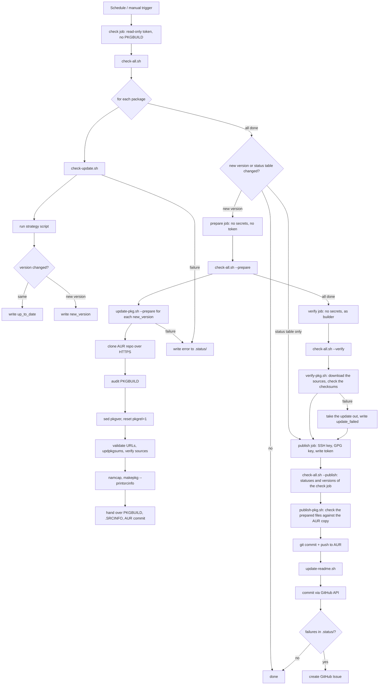

# Aurtomator Workflow Reference

## Table of Contents

1. [Overview](#1-overview)
2. [Package YAML Format](#2-package-yaml-format)
3. [Strategies](#3-strategies)
4. [Update Process](#4-update-process)
5. [CI Workflow: check-updates.yml](#5-ci-workflow-check-updatesyml)
6. [CI Quality Gate: ci.yml](#6-ci-quality-gate-ciyml)
7. [Local Testing](#7-local-testing)
8. [Writing Custom Strategies](#8-writing-custom-strategies)

## 1. Overview

aurtomator bumps the version of AUR packages you already maintain. It does **not** generate PKGBUILDs: it changes `pkgver` in the existing PKGBUILD on the AUR, regenerates checksums and `.SRCINFO`, and pushes the update.

### End-to-end flow



### Key design decisions

- **One YAML per package.** Adding or removing a package is one file.
- **Strategy-based version detection.** Each type of upstream source has its own script. A new source is a new script plus the checks of its fields in `scripts/validate-pkg.sh`.
- **Patch, do not generate.** aurtomator trusts your PKGBUILD and changes only `pkgver`, `pkgrel`, checksums and `.SRCINFO`. Build steps, dependencies and install files stay untouched.
- **Four jobs, one with secrets.** A PKGBUILD is code that every step reading it executes. `check` runs the strategies with the read-only workflow token, executes no PKGBUILD and decides what the run does. The jobs after it take the status of every package from `check`. `prepare` runs the PKGBUILD steps without secrets and without a token, and hands over only prepared files and update failures, because code from one PKGBUILD can write the files of every package there. `verify` downloads the sources of each prepared update and checks its checksums, without secrets and as an unprivileged user, so code from one PKGBUILD cannot forge the checksums of another package. `publish` holds the SSH key, the GPG key and the write token, never executes a PKGBUILD, runs no strategy and never downloads a source, and checks what `verify` passes on before it pushes. See [4.4](#44-prepare-and-publish).
- **Failure isolation.** A broken package does not block the others. Each failure is logged for its package, and a package that starts failing gets a GitHub Issue, see [5.6](#56-issues). Each package has a time budget, so one that hangs does not hold up the run either.

## 2. Package YAML Format

Each package has a file at `packages/<name>.yml`. The file name, the `name` field and the `pkgbase` on the AUR are the same. The `pkgbase` names the AUR git repository, and it is the package name, except for a split package such as `pkgbase=liblinear` with `pkgname=(liblinear python-liblinear)`.

| Field          | Required | Description                                                                 |
|----------------|----------|-----------------------------------------------------------------------------|
| `name`         | yes      | `pkgbase` on the AUR, equal to the file name without `.yml`                 |
| `strategy`     | yes      | Version detection strategy: a script name in `strategies/` without `.sh`    |
| `upstream`     | depends  | Strategy-specific settings. `archpkg`, `repology` and `kde-tarball` need none. |
| `current`      | no       | Currently tracked version. Written after every push.                        |
| `last_updated` | no       | Date of the last push, `YYYY-MM-DD`. Written after every push.              |
| `allow_downgrade` | no    | `true` publishes an upstream version lower than `current`. Default `false`, see [4.3](#43-downgrade-behavior). |
| `allow_version_jump` | no | `true` publishes a version whose first number has at least two digits more than the first number of `current`. Default `false`, see [4.3](#43-downgrade-behavior). |
| `pkgver_dash`  | no       | `_`, `.` or `''`: the character that stands for each `-` of the upstream version, or none, see below |
| `pkgver_format` | no      | The upstream version with a fixed text around it, `%s` in its place, as `4.%s`, see below |
| `alerts`       | no       | Rules for steps of upstream that need a hand edit: each pauses the update or reports a note, see [4.5](#45-update-alerts) |

Example:

```yaml
name: my-package
strategy: github-release
upstream:
  project: owner/repo
current: "2.1.0"
```

`pkgver` cannot hold a dash, so `check-update.sh` refuses a version such as `1.9.0-1` from npm or `1.0.0-beta.24` from crates.io. With `pkgver_dash`, it replaces every `-` in the output of the strategy before that check. The PKGBUILD turns the character back where a source URL needs the dash, as `${pkgver//_/-}` does for `_`, and the `.SRCINFO` check of verify and publish counts such a form as the version, see step 5 of publish in [4.4](#44-prepare-and-publish). `vercmp` reads `_` and `.` the same. `.` fits a PKGBUILD that already writes the dash as a dot, such as pijul with `_pkgver=${pkgver/.beta/-beta}`. A version given to `update-pkg.sh` by hand is taken as it is.

A pre-release mapped to `_` or `.` sorts above its final release: `vercmp 1.0.0.beta.24 1.0.0` and `vercmp 0.60.0_RC1 0.60.0` are both `1`, while a pre-release glued to the number, `1.0.0beta.24`, sorts below `1.0.0`. When the final release comes out, the check skips it as a downgrade, see [4.3](#43-downgrade-behavior), and the AUR package needs an `epoch`, which aurtomator does not write.

`pkgver_dash: ''` drops the dash and so glues the pre-release to the number: `2.5.0-rc1` becomes `2.5.0rc1`, which `vercmp` puts below `2.5.0` and above `2.4.6`, and the final release updates the package without an epoch. The PKGBUILD puts the dash back where a URL needs it, as `${pkgver/rc/-rc}` does, and the `.SRCINFO` check counts a form of the version with a dash between two of its characters as the version. A pre-release that starts with a digit stays above its release: `1.9.0-1` becomes `1.9.01`, and `vercmp 1.9.01 1.9.0` is `1`. A package that moves to `''` from `_` or `.` gets a lower pkgver for `vercmp`, `2.5.0rc2` below `2.5.0_rc1`, so the move needs an epoch once.

With `pkgver_format`, `pkgver` is the upstream version with a fixed text around it: `'4.%s'` turns build `4215` into `4.4215`. `check-update.sh` puts the output of the strategy in place of `%s`, after `pkgver_dash`, so `current` holds the formatted version. The PKGBUILD cuts the text off where a source URL needs the upstream version, as `${pkgver#4.}` does, and the `.SRCINFO` check of verify and publish counts that form as the version, see step 5 of publish in [4.4](#44-prepare-and-publish). `validate-pkg.sh` refuses a format without exactly one `%s` or with a character outside `A-Za-z0-9._+` around it, and a `current` that does not fit the format.

```yaml
name: my-package
strategy: webpage-scrape
upstream:
  url: https://example.com/updates.json
  pattern: '"latest_version": ([0-9]+)'
pkgver_format: '4.%s'
current: "4.4215"
```

## 3. Strategies

aurtomator ships 15 strategies. A strategy is a bash script in `strategies/`. It takes the package name, reads its settings from the package YAML, queries the upstream, and prints one version string on stdout. On failure it prints an error to stderr and exits non-zero. The HTTP-based strategies use `curl` with a 30-second timeout, and the tag-based ones strip a leading `v`.

### 3.1 github-release

**Upstream:** GitHub Releases API: `/repos/{owner}/{repo}/releases/latest`, or the release list with `tag_version_regex`.

**When to use:** GitHub projects that publish releases.

**YAML fields:**

| Field                        | Required | Description                         |
|------------------------------|----------|-------------------------------------|
| `upstream.project`           | yes      | `owner/repo` format                 |
| `upstream.tag_version_regex` | no       | ERE whose first capture group is the version, see below |
| `upstream.tag_version_replace` | no     | The version built from the groups of `tag_version_regex` (default: `\1`), see below |

**Version:** reads `.tag_name` of the latest release and strips a leading `v`. The endpoint skips drafts and pre-releases. When it answers 404, the strategy reads the release list to say why: a list of pre-releases only gets a message that names `github-nightly` with `nightly_tag_regex`, an empty list one that names `github-tag`.

With `tag_version_regex`, the strategy reads the release list instead, 100 releases a page, until a page has a release whose tag the regex matches or the list ends, at most 10 pages. It takes the match published last and leaves out drafts and pre-releases. A repository that releases several products then gives the release of the product the regex names, whatever `/releases/latest` returns. tutao/tutanota publishes its web, desktop and mobile apps as separate releases:

```yaml
name: tutanota-desktop-bin
strategy: github-release
upstream:
  project: tutao/tutanota
  tag_version_regex: '^tutanota-desktop-release-(.*)$'
```

**Authentication:** when `GITHUB_TOKEN` is set in the environment, it is sent as a Bearer token. curl reads the header from stdin, so the token does not appear on a command line. The `check-updates` workflow sets it to the workflow token, which allows 1,000 requests per hour per repository. Without it, for example in a local run, the limit is 60 requests per hour.

**Example YAML:**

```yaml
name: my-package
strategy: github-release
upstream:
  project: owner/repo
```

**Custom tag format:** for tags like `MeshLab-2025.07` or `0.1.8-stable`, set `tag_version_regex`. The text of its first capture group becomes the version. bash `[[ =~ ]]` takes the group, so the regex may hold `|`. A group of alternatives has to come after the version, as in `^v?([0-9.]+)(-stable|)$`, because bash knows no group that does not capture: `^(mesa-)?([0-9.]+)$` gives `mesa-`.

```yaml
name: meshlab-bin
strategy: github-release
upstream:
  project: cnr-isti-vclab/meshlab
  tag_version_regex: 'MeshLab-(.*)'
```

`tag_version_replace` builds the version from more than one group. `\1` to `\9` stand for the groups of `tag_version_regex`, and every other character is copied. The tag `2026-09-10` gives `2026.09.10` here:

```yaml
name: whitesur-icon-theme
strategy: github-release
upstream:
  project: vinceliuice/WhiteSur-icon-theme
  tag_version_regex: '^([0-9]{4})-([0-9]{2})-([0-9]{2})$'
  tag_version_replace: '\1.\2.\3'
```

`validate-pkg.sh` refuses `tag_version_replace` without `tag_version_regex`, with a character other than `A-Za-z0-9._+` outside `\1` to `\9`, or with a group the regex does not have. Both fields also work with `github-tag`, `github-nightly`, `gitlab-tag` and `gitea-tag`.

### 3.2 github-tag

**Upstream:** the tags of the repository, read with `git ls-remote --tags --refs https://github.com/{owner}/{repo}.git`.

**When to use:** GitHub projects with tags and no releases.

**YAML fields:**

| Field                        | Required | Description                              |
|------------------------------|----------|------------------------------------------|
| `upstream.project`           | yes      | `owner/repo` format                      |
| `upstream.tag_version_regex` | no       | ERE whose first capture group is the version, replaces the default filter |
| `upstream.tag_version_replace` | no     | The version built from the groups of `tag_version_regex`, see [3.1](#31-github-release) |

**Version:** reads every tag in one request, outside the API rate limit. Without `tag_version_regex`, it keeps the tags of the form `v1.2.3` or `1.2.3`, so `latest`, `1.0.0-rc1` and `1.0.0rc1` are left out, and a project without such a tag fails the check with a message that names the field. `tag_version_regex` keeps the tags it matches instead. The strategy strips a leading `v`, or applies `tag_version_regex` and `tag_version_replace`, and returns the newest version by `vercmp`, the order of pacman: `1.0.0rc1` is below `1.0.0`. The comparison drops a dash before a letter, as `pkgver_dash: ''` does, so `1.0.0-rc1` is below `1.0.0` too, and takes any other dash for a dot, so `2025-04-03` compares as `2025.04.03`. With `pkgver_dash` `_` or `.`, pacman puts `1.0.0_rc1` above `1.0.0`, so `1.0.0` then shows as a skipped downgrade, see [section 2](#2-package-yaml-format).

**Authentication:** when `GITHUB_TOKEN` is set in the environment, git sends it to `github.com` as `Authorization: Basic` with the user `x-access-token`, which a private repository needs. The header reaches git through `GIT_CONFIG_*` variables, so the token does not appear on a command line. git allows only `https` and asks for no password on the terminal.

**Example YAML:**

```yaml
name: my-package
strategy: github-tag
upstream:
  project: owner/repo
```

A package that follows one release line pins it with the regex. kubernetes gives `1.36.5` here, and `1.37.1` without the field:

```yaml
name: my-kubectl-1.36
strategy: github-tag
upstream:
  project: kubernetes/kubernetes
  tag_version_regex: '^v(1\.36\.[0-9]+)$'
```

### 3.3 github-nightly

**Upstream:** GitHub releases of nightly or prerelease builds, in 4 patterns. The fields select the pattern:

- **Pattern A, fixed tag** (default): `nightly_tag` names one tag that moves, as in neovim, ghostty or yazi.
- **Pattern B, dated tags**: `nightly_tag` is a prefix with a dash, such as `nightly-`. Of the first 20 releases the API lists, the first whose tag contains it wins (ruffle). With `nightly_tag_regex` in place of `nightly_tag`, the strategy reads up to 3 pages of 100 releases and takes the release published last among those whose tag matches the ERE (servo).
- **Pattern C, separate nightly repo**: `nightly_tag: latest` reads `/releases/latest` of a dedicated build repo (yt-dlp).
- **Pattern D, channel filter**: `channel` picks the newest of the last 20 releases whose name contains it (brave).

Patterns B and C depend on how a repository files its releases. `/releases/latest` skips pre-releases, and ruffle-rs/ruffle files its nightlies as pre-releases, so pattern C gives its stable `v0.7.1`. `/releases/latest` also sorts by `created_at`, which GitHub sets to the date of the tagged commit, not of the release. Every release of servo/servo-nightly-builds carries `2024-02-14` there, and its release list starts with 12 `v0.x` rc releases, so `nightly_tag: '-'` picks `v0.7.0-rc1`. `nightly_tag_regex` ranks the matches by `published_at` and depends on neither order. A page with fewer than 100 releases, an empty one included, is the last page it reads.

Pattern A:

```yaml
name: myapp-nightly-bin
strategy: github-nightly
upstream:
  project: owner/repo
  nightly_tag: nightly
  version_source: release_body
  version_pattern: 'APP v\K\S+'
```

Pattern B:

```yaml
name: myapp-nightly-bin
strategy: github-nightly
upstream:
  project: owner/repo
  nightly_tag: "nightly-"
  version_source: tag_date
```

Pattern C:

```yaml
name: myapp-nightly-bin
strategy: github-nightly
upstream:
  project: owner/nightly-builds
  nightly_tag: latest
  version_source: tag
```

Pattern D:

```yaml
name: myapp-nightly-bin
strategy: github-nightly
upstream:
  project: owner/repo
  channel: Nightly
  version_source: tag
```

**YAML fields:**

| Field | Required | Description |
|-------|----------|-------------|
| `upstream.project` | yes | `owner/repo` |
| `upstream.nightly_tag` | no | Tag name or prefix (default: `"nightly"`, `"latest"` for pattern C) |
| `upstream.nightly_tag_regex` | no | ERE for the tag in pattern B, in place of `nightly_tag` and `channel` |
| `upstream.version_source` | no | `"tag"` (default), `"release_body"`, `"tag_date"`, `"published_date"` |
| `upstream.version_pattern` | for `release_body` | Perl regex for the version in the release body. Dashes in the match become `+`. |
| `upstream.tag_version_regex` | no | ERE whose first capture group is the version, for `version_source: tag` |
| `upstream.tag_version_replace` | no | The version built from the groups of `tag_version_regex`, see [3.1](#31-github-release) |
| `upstream.date_format` | no | Format of `date` for `tag_date` and `published_date` (default: `%Y.%m.%d`) |
| `upstream.channel` | for pattern D | Text that the release name must contain |

`tag_date` takes the `YYYY-MM-DD` date in the tag and `published_date` the UTC date of `published_at`. `date -u` renders both with `date_format`, `YYYY.MM.DD` by default. The two dates can differ: the servo release `2026-10-21` was published at `2026-10-22T00:25:00Z`.

A package whose `pkgver` has the form `20251213` needs `date_format: '%Y%m%d'`, because `vercmp` ranks `20251213` above `2026.10.21` and the default form never counts as newer:

```yaml
name: servo-nightly-bin
strategy: github-nightly
upstream:
  project: servo/servo-nightly-builds
  nightly_tag_regex: '^[0-9]{4}-[0-9]{2}-[0-9]{2}$'
  version_source: tag_date
  date_format: '%Y%m%d'
```

`validate-pkg.sh` refuses `date_format` with another `version_source` and a format whose output is not a valid version, such as `%Y-%m-%d`. It refuses `nightly_tag_regex` next to `nightly_tag` or `channel`, and one that bash cannot compile.

**Authentication:** same as `github-release`.

### 3.4 github-asset

**Upstream:** one GitHub release by tag (`/repos/{owner}/{repo}/releases/tags/{tag}`) and the `updated_at` of the assets listed in the package YAML.

**When to use:** releases whose tag never moves while the assets behind it are replaced, such as a model zoo or a rolling download tag. A PKGBUILD for such a release points at fixed URLs, so an update changes `pkgver` and the checksums and nothing else. Nightly binaries fit as well, such as the `nightly` tag of `wezterm/wezterm`. The PKGBUILD has no `pkgver()`, because the audit blocks one with this strategy, and `pkgver` holds the date, see [pkgver() with the wrong strategy](SUPPORTED-PACKAGES.md#pkgver-with-the-wrong-strategy-blocked).

**YAML fields:**

| Field              | Required | Description                                  |
|--------------------|----------|----------------------------------------------|
| `upstream.project` | yes      | `owner/repo` format                          |
| `upstream.tag`     | yes      | Release tag that carries the assets          |
| `upstream.assets`  | yes      | List of exact asset file names, at least one |

**Version:** every listed asset must be present in the release, otherwise the strategy fails and names the missing one. The newest `updated_at` among them becomes the version, rendered as `YYYYMMDD` (for example `20251202`). A re-upload of any listed asset moves the date forward. The release object lists only assets in state `uploaded`, so one request covers every downloadable asset.

**Authentication:** same as `github-release`.

**Example YAML:**

```yaml
name: sherpa-onnx-piper-voices-ru
strategy: github-asset
upstream:
  project: k2-fsa/sherpa-onnx
  tag: tts-models
  assets:
    - vits-piper-ru_RU-denis-medium.tar.bz2
    - vits-piper-ru_RU-dmitri-medium.tar.bz2
```

### 3.5 gitlab-tag

**Upstream:** GitLab Tags API (`/api/v4/projects/{id}/repository/tags`).

**When to use:** any GitLab instance: gitlab.com, invent.kde.org, self-hosted.

**YAML fields:**

| Field                  | Required | Description                                           |
|------------------------|----------|-------------------------------------------------------|
| `upstream.host`        | yes      | GitLab hostname (e.g. `invent.kde.org`, `gitlab.com`) |
| `upstream.project`     | yes      | Project path (e.g. `network/my-kde-app`)              |
| `upstream.tag_version_regex` | no | ERE whose first capture group is the version, replaces the default filter, see [3.1](#31-github-release) |
| `upstream.tag_version_replace` | no | The version built from the groups of `tag_version_regex`, see [3.1](#31-github-release) |

**Version:** URL-encodes the project path (`/` becomes `%2F`) and fetches the first 100 tags; [git-tag](#315-git-tag) with the `.git` URL of the project reads every tag. An answer that is not JSON, such as the page of a bot check, fails the check with the URL of that page, see [Upstreams behind a bot check](SUPPORTED-PACKAGES.md#upstreams-behind-a-bot-check). Without `tag_version_regex`, it keeps the tags of the form `v1.2.3` or `1.2.3`, and a project without such a tag fails the check with a message that names the field. It strips a leading `v`, or applies `tag_version_regex` and `tag_version_replace`, and returns the newest version by `vercmp`, as [github-tag](#32-github-tag) does. There is no authentication, so private projects cannot be queried.

**Example YAML:**

```yaml
name: my-kde-app
strategy: gitlab-tag
upstream:
  host: invent.kde.org
  project: network/my-kde-app
```

Mesa names its releases `mesa-26.2.5`:

```yaml
name: my-mesa
strategy: gitlab-tag
upstream:
  host: gitlab.freedesktop.org
  project: mesa/mesa
  tag_version_regex: '^mesa-([0-9.]+)$'
```

### 3.6 gitea-tag

**Upstream:** Gitea/Forgejo Tags API (`/api/v1/repos/{owner}/{repo}/tags`).

**When to use:** Codeberg and self-hosted Gitea or Forgejo instances.

**YAML fields:**

| Field                  | Required | Description                              |
|------------------------|----------|------------------------------------------|
| `upstream.host`        | yes      | Instance hostname (e.g. `codeberg.org`)  |
| `upstream.project`     | yes      | `owner/repo` format                      |
| `upstream.tag_version_regex` | no | ERE whose first capture group is the version, replaces the default filter, see [3.1](#31-github-release) |
| `upstream.tag_version_replace` | no | The version built from the groups of `tag_version_regex`, see [3.1](#31-github-release) |

**Version:** fetches up to 50 tags without pagination; [git-tag](#315-git-tag) with the `.git` URL of the project reads every tag. An answer that is not JSON, such as the page of a bot check, fails the check with the URL of that page, see [Upstreams behind a bot check](SUPPORTED-PACKAGES.md#upstreams-behind-a-bot-check). Without `tag_version_regex`, it keeps the tags of the form `v1.2.3` or `1.2.3`, and a project without such a tag fails the check with a message that names the field. It strips a leading `v`, or applies `tag_version_regex` and `tag_version_replace`, and returns the newest version by `vercmp`, as [github-tag](#32-github-tag) does.

**Example YAML:**

```yaml
name: my-package
strategy: gitea-tag
upstream:
  host: codeberg.org
  project: owner/repo
```

### 3.7 git-latest

**Upstream:** any git repository with an HTTPS URL, through a bare clone.

**When to use:** `-git` AUR packages that track the latest commit.

**YAML fields:**

| Field              | Required | Description                                  |
|--------------------|----------|----------------------------------------------|
| `upstream.type`    | yes      | One of: `github`, `gitlab`, `git`            |
| `upstream.host`    | depends  | Required for the `gitlab` type               |
| `upstream.project` | depends  | Required for the `github` and `gitlab` types |
| `upstream.url`     | depends  | Required for the `git` type: full clone URL, `https://` only |
| `upstream.branch`  | no       | The branch of a source pinned to `#branch=`. Default: the default branch of the repository |
| `upstream.describe` | no      | `tags` or `annotated`: print the form of `git describe` instead of `r<count>.<hash>` |
| `upstream.tag_prefix` | no    | Text cut from the start of the tag with `upstream.describe`, such as `v` |

**Version:** makes a bare clone into a temporary directory, counts the commits on `HEAD` (`git rev-list --count HEAD`), takes the hash of `HEAD` and prints the usual `-git` format `r<count>.<hash>`, for example `r431.66db9ce`. With `upstream.branch`, the clone takes `--branch`, and `HEAD` is that branch, as makepkg checks it out for `#branch=`: sharkdp/fd gives `r2061.9e90463` on `master` and `r1925.cf8a48a` with `branch: abort-on-panic`. A branch the repository does not have fails the clone. `validate-pkg.sh` refuses a name that `git check-ref-format --branch` refuses, such as one that starts with `-`. The hash has as many characters as the hash in `current`, and 7 when `current` is empty. `git rev-parse --short` in a `pkgver()` gives more characters as the repository grows: fabric-git is `r2173.ef2e985d` on the AUR, and `vercmp` reads `r2173.ef2e985` of the same commit as older.

With `upstream.describe`, the strategy prints what the `git describe` recipes of the [Arch package guidelines for VCS packages](https://manual.archlinux.page/package-guidelines/vcs/) print: `git describe --long --abbrev=<n>`, with `--tags` for `describe: tags` and without it for `describe: annotated`, which takes annotated tags only. `upstream.tag_prefix` is cut from the start of the tag first, as `sed 's/^v//'` does, and then `sed 's/\([^-]*-g\)/r\1/;s/-/./g'` turns `v1.2.0-rc1-47-g0bbf5ad` into `1.2.0.rc1.r47.g0bbf5ad`. On a tagged commit, `--long` still gives `r0` and the hash. The hash takes as many characters as the hash after `.g` in `current`, and 7 when `current` is empty. A repository without a tag reachable from `HEAD` fails with `git describe finds no tag reachable from HEAD of <url>`. `validate-pkg.sh` refuses a `describe` other than `tags` or `annotated`, a `tag_prefix` without `describe`, and a `tag_prefix` with a character outside `A-Za-z0-9._+/-`.

`current` must be empty or of the form the strategy prints: `r<count>.<hash>`, or `<tag>.r<count>.g<hash>` with `upstream.describe`. `validate-pkg.sh` refuses any other. `vercmp` reads `1.4.0.r47.g0bbf5ad` as newer than every `r<count>.<hash>`, so a `current` of the other form would make each check a downgrade, and the package would never update.

The clone runs with `GIT_ALLOW_PROTOCOL=http:https`. A URL in a package YAML that comes with a pull request therefore cannot read a local repository or connect to an ssh host with the SSH key of the machine that runs the check.

**Example YAML (GitHub):**

```yaml
name: my-package-git
strategy: git-latest
upstream:
  type: github
  project: owner/repo
```

**Example YAML (GitLab):**

```yaml
name: my-package-git
strategy: git-latest
upstream:
  type: gitlab
  host: invent.kde.org
  project: network/my-kde-app
```

**Example YAML (the form of `git describe`):** lightdm-git counts with `git describe --long --tags | sed 's/\([^-]*-g\)/r\1/;s/-/./g'`, and git gives its hash 8 characters. The AUR version as `current` keeps that length:

```yaml
name: lightdm-git
strategy: git-latest
upstream:
  type: github
  project: CanonicalLtd/lightdm
  describe: tags
current: '1.30.0.r9.g03f21898'
```

**Example YAML (any HTTPS git URL):**

```yaml
name: my-package-git
strategy: git-latest
upstream:
  type: git
  url: "https://git.sr.ht/~user/repo"
```

### 3.8 pypi

**Upstream:** PyPI JSON API (`https://pypi.org/pypi/{package}/json`).

**When to use:** Python packages published on PyPI.

**YAML fields:**

| Field               | Required | Description                                  |
|---------------------|----------|----------------------------------------------|
| `upstream.registry` | yes      | PyPI package name (e.g. `requests`, `flask`) |

**Version:** reads `.info.version`, the latest stable release on PyPI.

**Example YAML:**

```yaml
name: python-requests
strategy: pypi
upstream:
  registry: requests
```

### 3.9 npm

**Upstream:** npm registry (`https://registry.npmjs.org/{package}/latest`).

**When to use:** Node.js packages published on npm.

**YAML fields:**

| Field               | Required | Description                                  |
|---------------------|----------|----------------------------------------------|
| `upstream.registry` | yes      | npm package name (e.g. `express`, `webpack`) |

**Version:** reads `.version` of the `latest` tag.

**Example YAML:**

```yaml
name: nodejs-express
strategy: npm
upstream:
  registry: express
```

### 3.10 crates

**Upstream:** crates.io API (`https://crates.io/api/v1/crates/{crate}`).

**When to use:** Rust crates published on crates.io.

**YAML fields:**

| Field               | Required | Description                        |
|---------------------|----------|------------------------------------|
| `upstream.registry` | yes      | Crate name (e.g. `serde`, `tokio`) |
| `upstream.prerelease` | no     | `true` reads `max_version`, pre-releases included. Needs `pkgver_dash`. Default `false`. |

**Version:** reads `.crate.max_stable_version`, which excludes pre-releases, or `.crate.max_version` with `prerelease: true`. The request sends `User-Agent: aurtomator/1.0`, as every strategy request does and as the crates.io API policy requires.

**Example YAML:**

```yaml
name: rust-serde
strategy: crates
upstream:
  registry: serde
```

A semver pre-release such as `1.0.0-beta.24` holds a dash, so `validate-pkg.sh` refuses `prerelease: true` without `pkgver_dash`, see [section 2](#2-package-yaml-format). pijul gives `1.0.0.beta.24` with:

```yaml
name: pijul
strategy: crates
upstream:
  registry: pijul
  prerelease: true
pkgver_dash: .
```

`1.0.0` sorts below `1.0.0.beta.24`, so when pijul 1.0.0 comes out, the check skips it as a downgrade, see the note on pre-releases in [section 2](#2-package-yaml-format). With `pkgver_dash: ''`, pijul gives `1.0.0beta.24`, which `vercmp` puts below `1.0.0`.

### 3.11 repology

**Upstream:** Repology API (`https://repology.org/api/v1/project/{name}`).

**When to use:** as a fallback when no other strategy fits. Repology tracks versions across many distribution repositories.

**YAML fields:**

| Field               | Required | Description                                                  |
|---------------------|----------|--------------------------------------------------------------|
| `upstream.repology` | no       | Repology project name. Defaults to the package `name`.       |

**Version:** returns the version of the first entry with `status == "newest"` outside the AUR. The AUR entries are left out, because for a package of ours they hold our own version. When only the AUR is newest, the strategy returns the newest `outdated` version outside the AUR by `vercmp`, and a `current` above it reads as a downgrade, see [4.3](#43-downgrade-behavior). The version is the normalized `version` field of Repology: the OpenBSD entry of qodem gives `1.0.1`, and its `origversion` is `1.0.1p1`. The request sends `User-Agent: aurtomator/1.0`, as every strategy request does and as Repology asks.

The version lags behind upstream until a distribution other than the AUR packages the new release. A project that Repology does not know, such as `wingide` in place of `wing-ide`, fails the check with `Project <name> not found on Repology`. A project with no `newest` or `outdated` entry outside the AUR fails with `No version found on Repology for <name> outside the AUR`.

Repology names a library of Python, Ruby, Perl or Haskell `<language>:<name>`, as `python:requests`, `ruby:rmagick`, `perl:mojolicious` and `haskell:haxml`. The AUR package name, such as `ruby-rmagick`, is then no Repology project, and the default fails with `Project ruby-rmagick not found on Repology`. The name without the prefix can be another project: `rmagick` holds one stale entry, `1.15.4`, which reads as a downgrade. The search at `https://repology.org/projects/?search=rmagick` lists `ruby:rmagick`:

```yaml
name: ruby-rmagick
strategy: repology
upstream:
  repology: ruby:rmagick
```

**Example YAML:**

```yaml
name: my-package
strategy: repology
upstream:
  repology: my-package
```

Without `upstream.repology`, the package name is used:

```yaml
name: my-package
strategy: repology
```

### 3.12 archpkg

**Upstream:** Arch Linux package search API (`https://archlinux.org/packages/search/json/?name={name}`).

**When to use:** AUR packages that follow the `pkgver` of an official Arch package, for example an addon released together with it.

**YAML fields:**

| Field              | Required | Description                                                    |
|--------------------|----------|----------------------------------------------------------------|
| `upstream.archpkg` | no       | Package name in the official repos. Defaults to the package `name`. |

**Version:** reads `.results[0].pkgver`, the version without `epoch` and `pkgrel`: ffmpeg `2:9.0.2-2` gives `9.0.2`. A rebuild in the official repos raises only `pkgrel`, so it gives no new version, and aurtomator has no update that raises `pkgrel` alone, see [SUPPORTED-PACKAGES.md](SUPPORTED-PACKAGES.md#packages-needing-a-pkgrel-bump).

**Example YAML:**

```yaml
name: my-qt6-addon
strategy: archpkg
upstream:
  archpkg: qt6-base
```

### 3.13 webpage-scrape

**Upstream:** any HTTPS page, with a regex that matches the version.

**When to use:** upstreams without a structured API: download pages, directory listings, changelogs.

**YAML fields:**

| Field              | Required | Description                                          |
|--------------------|----------|------------------------------------------------------|
| `upstream.url`     | yes      | HTTPS URL of the page                                |
| `upstream.pattern` | yes      | ERE whose first capture group is the version         |
| `upstream.user_agent` | no    | User-Agent in place of `aurtomator/1.0`, printable ASCII |

**Version:**

1. Fetches the page: HTTPS only, at most 5 redirects and 5 MB, with the User-Agent `aurtomator/1.0` or `upstream.user_agent`. SourceForge answers a bare `Mozilla/5.0` with HTTP 403. `validate-pkg.sh` refuses a `user_agent` with a character outside printable ASCII, because curl sends the text after a line break as a header of its own.
2. Finds every match with `grep -oE`.
3. Takes the first capture group of each match with bash `[[ =~ ]]`, so the pattern may hold any character, `/` included.
4. Returns the newest version by `vercmp`, as [github-tag](#32-github-tag) does.

`validate-pkg.sh` compiles the pattern with bash, which refuses some patterns that `grep -E` takes, `(?:...)` among them.

**Example YAML:**

```yaml
name: my-scrape-pkg
strategy: webpage-scrape
upstream:
  url: "https://www.example.com/~maintainer/my-scrape-pkg/"
  pattern: "my-scrape-pkg-([0-9.]+)\\.tar\\.gz"
```

A version file that a project publishes as a release asset is read through its download URL, which redirects to the file. `jpenilla/ghostty-nightly-bin` publishes the version of each Ghostty nightly build as `ghostty-nightly-version.txt`:

```yaml
name: ghostty-nightly-bin
strategy: webpage-scrape
upstream:
  url: https://github.com/jpenilla/ghostty-nightly-bin/releases/download/nightly/ghostty-nightly-version.txt
  pattern: '^([0-9]{8}\.r[0-9]+\.g[0-9a-f]+)$'
```

**Common patterns:**

```text
# Standard tarball naming
"mypackage-([0-9]+\\.[0-9]+\\.[0-9]+)\\.tar\\.gz"

# With optional patch version
"mypackage-([0-9]+\\.[0-9]+(\\.[0-9]+)?)\\.tar\\.xz"

# Version in URL path
"/download/v([0-9.]+)/"
```

### 3.14 kde-tarball

**Upstream:** the KDE download server listing (`https://download.kde.org/{path}/`), and the newest version directory in it.

**When to use:** KDE projects that publish release tarballs on download.kde.org, in one directory, such as `stable/kio-s3/kio-s3-1.0.2.tar.xz`, or in a directory per version or per series: Plasma under `stable/plasma/6.8.1/`, Frameworks under `stable/frameworks/6.31/`, KDE Gear under `stable/release-service/26.08.2/src/`, krita under `stable/krita/6.0.4.1/`.

**YAML fields:**

| Field              | Required | Description                                                  |
|--------------------|----------|--------------------------------------------------------------|
| `upstream.project` | no       | Tarball name. Defaults to the package `name`.                |
| `upstream.path`    | no       | Directory on download.kde.org. Defaults to `stable/{project}`. |

**Version:** matches `{project}-{version}.tar.xz` links on the listing, where the version is digits and dots (`[0-9]+\.[0-9]+(\.[0-9]+)*`). When the listing also holds directories named by digits and dots, it reads the newest of them by `sort -V`, and the `src/` in it when there is one, as for KDE Gear. The highest version of both listings wins by `sort -Vu`, so older tarballs beside the directories do not hide a newer release. A newest directory without a tarball of the project stops the strategy with that directory in the message, so a project dropped from Plasma is not followed into an older directory. A dot or a plus in `project` matches itself. `validate-pkg.sh` refuses a `project` with a character outside `A-Za-z0-9@._+-`, and a `path` with an empty segment, a segment that starts with a dot, or a character outside `A-Za-z0-9._+-`.

**Example YAML:**

```yaml
name: my-kde-app
strategy: kde-tarball
```

The Oxygen theme comes with Plasma, so its tarball sits in the directory of each Plasma release:

```yaml
name: xcursor-oxygen
strategy: kde-tarball
upstream:
  project: oxygen
  path: stable/plasma
```

The pre-releases of alkimia, `8.2.70` at the time of writing, live in `unstable/alkimia/`:

```yaml
name: alkimia-unstable
strategy: kde-tarball
upstream:
  project: alkimia
  path: unstable/alkimia
```

### 3.15 git-tag

**Upstream:** the tags of any git repository, read with `git ls-remote --tags --refs {url}`.

**When to use:** hosts without a tags API, such as sourcehut, kernel.org and Savannah, and a GitLab or Gitea project with more tags than `gitlab-tag` or `gitea-tag` read.

**YAML fields:**

| Field                        | Required | Description                              |
|------------------------------|----------|------------------------------------------|
| `upstream.url`               | yes      | HTTPS URL of the repository              |
| `upstream.tag_version_regex` | no       | ERE whose first capture group is the version, replaces the default filter |
| `upstream.tag_version_replace` | no     | The version built from the groups of `tag_version_regex`, see [3.1](#31-github-release) |

**Version:** reads every tag in one request, as `github-tag` does, and picks the version the same way: without `tag_version_regex`, the tags of the form `v1.2.3` or `1.2.3`, without a leading `v`, the newest by `vercmp`. git allows only `https`, asks for no password on the terminal and sends no `GITHUB_TOKEN`, so only a public repository works. `validate-pkg.sh` refuses a `url` that does not start with `https://`. A repository behind the bot check of its site fails with the message of git, which names the page of the redirect.

**Example YAML:**

```yaml
name: my-package
strategy: git-tag
upstream:
  url: https://git.sr.ht/~owner/repo
```

The `.git` URL of a GitLab or Gitea project works the same way:

```yaml
name: my-package
strategy: git-tag
upstream:
  url: https://gitlab.gnome.org/GNOME/gtk.git
```

## 4. Update Process

`check-all.sh --update` calls `update-pkg.sh` for every package with a new version. `--prepare`, `--verify` and `--publish` split the same update into three runs, see [4.4](#44-prepare-and-publish).

Outside `--update`, `check-all.sh` gives each package a time budget: 120 seconds for `check-update.sh`, and 300 seconds each for `update-pkg.sh`, `verify-pkg.sh` and `publish-pkg.sh`. `timeout` ends the script together with everything it started, makepkg, git and curl included, and the package gets `check_failed: timed out after 120 s` or `update_failed: timed out after 300 s`. `AURTOMATOR_CHECK_TIMEOUT` and `AURTOMATOR_UPDATE_TIMEOUT` change the budgets. `--update` has none, because it runs on a terminal, where git and ssh may ask for a passphrase, and a command under `timeout` cannot read the terminal.

Without a mode and with `--update`, a package whose check failed within its budget is checked once more after all the others, following a pause of 60 seconds, and the second result counts. A check that ran out of its budget is not repeated, so a run without network does not take twice as long. `AURTOMATOR_RECHECK_DELAY` changes the pause, and the tests set it to 0.

### 4.1 Arguments

```text
update-pkg.sh <package-name> <new-version> [--dry-run] [--prepare <dir>]
verify-pkg.sh <package-name> <prepared-dir>
publish-pkg.sh <package-name> <version> <prepared-dir> [--dry-run]
check-all.sh [--update | --prepare <dir> | --verify <dir> | --publish <dir>] [--dry-run]
```

### 4.2 Step-by-step

1. Load `.aurtomator.conf` when it exists. In CI, `GIT_AUTHOR_NAME`, `GIT_AUTHOR_EMAIL` and `GPG_KEY_ID` come from the workflow environment.
2. Wait 2 seconds, then clone `ssh://aur@aur.archlinux.org/<package-name>.git` into a temporary directory, with up to 3 attempts 5 seconds apart. A clone without a PKGBUILD stops the update.
3. When the clone lands on a detached `HEAD`, reset `master` to `origin/master`, so the push is a fast-forward.
4. Warn when the PKGBUILD has no `# Maintainer:` line.
5. Audit the PKGBUILD. `pkgver()` with the wrong strategy and mixed checksums block the update. Patches only warn. See [SUPPORTED-PACKAGES.md](SUPPORTED-PACKAGES.md).
6. Set `pkgver` with `sed` and reset `pkgrel=1`. When the PKGBUILD does not change, the AUR already has this version: the script writes it to `current` and exits with code 2.
7. Validate every `http` and `https` source URL, whatever its checksum. Unless a checksum array holds a `SKIP` other than that of a signature and no remote source has a real hash, run `updpkgsums`, and verify the result with `makepkg --verifysource --skippgpcheck`. A signature is a source whose file name ends in `.sig`, `.sign` or `.asc`, and makepkg gives it `SKIP` itself, as it does for a VCS source without a `#commit=`, `#tag=` or `#revision=` pin. Step 5 allows a real remote hash only next to such a `SKIP`, and `makepkg` clones the repository of a VCS source to run `updpkgsums`. Any failure stops the update.
8. Run `namcap` when it is installed. Errors stop the update. Warnings are printed.
9. Regenerate `.SRCINFO` with `makepkg --printsrcinfo`.
10. Check `PKGBUILD` and `.SRCINFO` against the files of the clone's `HEAD`, as publish does in steps 4 and 5 of [4.4](#44-prepare-and-publish). A refused file stops the update.
11. With `--dry-run`, print the PKGBUILD diff and stop.
12. Commit `PKGBUILD` and `.SRCINFO` as `<new-version> release from <strategy>`, authored by `GIT_AUTHOR_NAME` and `GIT_AUTHOR_EMAIL` (default `aurtomator`). With `GPG_KEY_ID` set, the commit is amended with a signature. When signing fails, the commit is pushed unsigned.
13. Push, with up to 3 attempts 5 seconds apart.
14. Write `current` and `last_updated` to the package YAML.

`AURTOMATOR_CLONE_DELAY` and `AURTOMATOR_RETRY_DELAY` change the 2 and the 5 seconds. The tests set both to 0. The anonymous HTTPS clones of prepare and verify, see [4.4](#44-prepare-and-publish), start without the 2 seconds.

### 4.3 Downgrade behavior

An upstream version lower than `current` reaches the AUR only when the package YAML sets `allow_downgrade: true`. Without it, `check-all.sh` skips the version, writes `downgrade_skipped: <version>` and pushes nothing. A skipped downgrade opens no issue and does not count as a failure. `--prepare` and `--publish` apply the same rule, so a downgrade of a package without the flag is never prepared or published.

The default guards against a lower version that upstream does not mean as a step back. `github-release` reads `/releases/latest`, and GitHub picks that release by the date of the commit it was made from, not by the date it was published. A maintenance release of an older line, made from a commit newer than the one of the current release, becomes the latest release. Without the flag, aurtomator would push it as a downgrade and push the newer version again at the next release.

`allow_downgrade: true` fits a package whose upstream does mean it, for example one that rolls back a broken release and the AUR package should follow.

#### When does this happen?

- Upstream publishes a maintenance release of an older line, and `/releases/latest` returns it.
- Upstream deletes and recreates a release tag. In the gap, `/releases/latest` returns the previous release, so a cycle like `v1.2.1 → v1.2.0 → v1.2.1` can take only minutes.
- Upstream rolls back a broken release and removes its tag.
- Upstream marks an older release line as latest again, for example when a 2.x release is pulled and 1.x becomes the newest release.

#### How to detect downgrades in logs

Every comparison that finds the current version newer than the latest one (`vercmp "$current" "$latest"` returns `1`) logs the literal token `DOWNGRADE`. In a CI run, `check-all.sh` logs the first line for a package without `allow_downgrade: true` and the second for one with it:

```text
! myapp-bin: DOWNGRADE detected 1.2.1 → 1.2.0, skipped: allow_downgrade is not set
! myapp-bin: DOWNGRADE detected 1.2.1 → 1.2.0 (mirroring upstream)
```

`check-update.sh` run on its own logs:

```text
! myapp-bin: DOWNGRADE 1.2.1 → 1.2.0
```

`grep DOWNGRADE` on a downloaded run log finds both.

#### Status values and README icons

`check-all.sh` writes three status tokens for downgrades to `.status/<pkg>`:

| Token                          | Meaning                                                        |
|--------------------------------|----------------------------------------------------------------|
| `downgrade_skipped: <version>` | A downgrade was found for a package without `allow_downgrade: true`. Nothing is pushed |
| `available_downgrade: <ver>`   | A downgrade the package allows was found and is not pushed yet |
| `downgrade: <version>`         | The downgrade was pushed to the AUR                            |

`update-readme.sh` renders them as:

- `downgrade_skipped: 1.2.0` → `⬇️ 1.2.0 skipped (downgrade)`
- `available_downgrade: 1.2.0` → `⬇️ 1.2.0 available (downgrade)`
- `downgrade: 1.2.0` → `⬇️ downgraded to 1.2.0`

All three count toward `pkg_ok`, so the packages badge stays `brightgreen`. Only `check_failed` and `update_failed` turn it red.

#### Version jumps

An update whose first number has at least two digits more than the first number of `current`, such as `13 → 2026102100` or `4.4215 → 4215`, reaches the AUR only when the package YAML sets `allow_version_jump: true`. Such a step is more often another version scheme of the same upstream than a release: GrapheneOS tags the standalone releases of `hardened_malloc` `1` to `14` and its GrapheneOS builds, such as `2026102100`, in the same repository, and the default tag filter keeps both. Without the flag, `check-all.sh` writes `jump_skipped: <version>`, logs the line below and pushes nothing. `--prepare` and `--publish` apply the same rule. A skipped jump opens no issue and counts toward `pkg_ok`, and `update-readme.sh` renders `jump_skipped: 2026102100` as `⬆️ 2026102100 skipped (version jump)`.

```text
! hardened_malloc: version jump 13 → 2026102100, skipped: allow_version_jump is not set
```

A step such as `9 → 10` or `99 → 100` adds one digit and passes. A package that moves to another scheme on purpose, from `1.9` to `2026.1` for example, sets the flag and can remove it once `current` holds the new scheme. Where a repository carries two schemes, `tag_version_regex` picks one.

### 4.4 Prepare and publish

A PKGBUILD is a bash script, and every step that reads it executes it: the audit, `updpkgsums`, `makepkg --verifysource` and `makepkg --printsrcinfo`. Whoever can push to the AUR repo of a tracked package, a co-maintainer for example, runs code in those steps. Prepare and publish split the update so that this code never runs where the SSH key, the GPG key or a write token is. Code that runs in prepare can write the prepared files and the statuses of every package, so verify checks the checksums against the sources in between, and publish takes the statuses from the check run, which executes no PKGBUILD.

**Prepare**, `update-pkg.sh --prepare <dir>`, needs no secrets:

1. Clone `https://aur.archlinux.org/<package-name>.git` anonymously.
2. Run steps 3 to 9 of [4.2](#42-step-by-step).
3. Copy `PKGBUILD`, `.SRCINFO` and the commit id of the clone's `HEAD` to `<dir>/<package-name>/` as `PKGBUILD`, `.SRCINFO` and `base`. Nothing is committed and the package YAML does not change. Exit code 2 still means the AUR already has the version.

**Verify**, `verify-pkg.sh <package-name> <dir>/<package-name>`, needs no secrets, never sources the PKGBUILD and never runs `makepkg`:

1. The prepared directory must pass step 1 of publish below.
2. Clone `https://aur.archlinux.org/<package-name>.git` anonymously with `--no-checkout`. When `HEAD` is not `base`, the AUR repo moved after the update was prepared: exit code 3. The entries at the top of `HEAD` are written to a separate directory with `git ls-tree` and `git cat-file`, so git applies none of the links, attributes or filters of the repo: a regular file with its content, a symlink as a link to nowhere, anything else as an empty directory. The steps below read the AUR copy there.
3. `PKGBUILD` and `.SRCINFO` in the AUR copy must be regular files. The prepared files must hold no NUL byte and pass steps 4 and 5 of publish below, with the prepared `pkgver` as `<version>`. From here on, every source URL in the prepared `.SRCINFO` follows from the AUR copy.
4. Each checksum array of the prepared `PKGBUILD` must hold the same values as the same key in the prepared `.SRCINFO`.
5. Every checksum other than `SKIP` must match its source, computed as makepkg does with `<algorithm>sum`. The file is the one makepkg uses. A file in the AUR repo with the name of the source comes first and must be a regular file. Otherwise a remote source is downloaded with curl, retried as makepkg does and limited to `http`, `https` and `ftp`, redirects included. A git source at `#tag=` or `#commit=` is cloned as a mirror over `https` or `http`, and its checksum is that of `git archive --format tar` of the tag or commit, with `export-subst` and `export-ignore` turned off, as makepkg computes it. A checksum for any other source, another VCS for example, cannot be checked and stops the verify.
6. Any mismatch stops the verify with exit code 1. Otherwise the exit code is 0.

**Publish**, `publish-pkg.sh <package-name> <version> <dir>/<package-name>`, never sources the PKGBUILD and never runs `makepkg`. It treats the prepared files as untrusted:

1. The prepared directory must not be a symlink, `PKGBUILD`, `.SRCINFO` and `base` must be regular files, and `base` a commit id.
2. The prepared `pkgver` must be `<version>`. `check-all.sh --publish` passes the version the check run found, and the prepare run was given the same one, so another `pkgver` stops the publish with exit code 1.
3. Clone over SSH with `--no-checkout`, and write the AUR copy as step 2 of verify does. When `HEAD` is not `base`, the AUR repo moved after the update was prepared: exit code 3. `PKGBUILD` and `.SRCINFO` in the AUR copy must be regular files, not symlinks.
4. The prepared `PKGBUILD` may differ from the AUR copy only in `pkgver=`, which must be `<version>`, in `pkgrel=`, which must be `1`, and in the values of the checksum arrays. The arrays keep their names and lengths, hold only quoted hex checksums or `SKIP`, and have a `SKIP` exactly where the AUR copy has one. Comments and line continuations may stand between the checksums, read as bash reads them: a `#` at the start of a line, right after the opening parenthesis, or after a space or a tab comments out the rest of the line, and a backslash that ends a line without a comment, as a word of its own, continues the array on the next line. A backslash on the line that closes the array stops the publish, because bash joins the next line to the assignment.
5. The prepared `.SRCINFO` must have as many lines as the AUR copy, not counting empty lines at the end: `makepkg --printsrcinfo` writes none, and some AUR copies end in one, as those `mksrcinfo` v8 wrote do. Each `source` line of the prepared `.SRCINFO`, with or without an arch suffix, must be the line of the AUR copy with the old version replaced by `<version>`. A source that is `SKIP` in every checksum array of its arch may also change the digits in the name it is saved under, the part before `::`, as `neovim-20261014.tar.gz` becomes `neovim-20261016.tar.gz` in a PKGBUILD that names a nightly download by `$(date -u +%Y%m%d)`. Its URL after `::` must still be the AUR URL with the version replaced. Verify never downloads a `SKIP` source, and makepkg takes the sources from the `PKGBUILD`. Any other line must either equal the line of the AUR copy or be that line with the version replaced in the same way, because a license, a dependency or a description can hold the old version without taking it from `pkgver`, as `GPL-2.0` does in a package at version `2.0`. The replacement also covers three forms a PKGBUILD often derives from `pkgver`: dots and plus signs turned into underscores (`1_86_0`, and `28_21` of `28+21` in the asset names of Temurin early-access builds), the part before the first `+` (`0.13.0` of `0.13.0+dev+1853+g6edb38ca98`), and the version without its last component (`6.19` of `6.19.0`, as in `frameworks/${pkgver%.*}/` of KDE Frameworks). The last form counts only while it keeps a dot. With `pkgver_dash`, a form of the old or the new version with a dash in place of that character counts as the version, as `${pkgver//_/-}` writes `0.0.1-rc.20` for `0.0.1_rc.20`, and with `pkgver_dash: ''` a form with a dash between two of its characters, as `${pkgver/rc/-rc}` writes `2.5.0-rc1` for `2.5.0rc1`. With `pkgver_format`, the upstream version inside the old and the new version counts as a form too, as `${pkgver#4.}` writes `4215` for `4.4215`. Nothing else in the line may differ. Each part of a line is replaced at most once, so `5.1` inside an already replaced `5.10.0` stays. A line built from any other form of the version, a lone major version for example, stops the publish, and so does a line that has the version replaced in one place and kept in another. The package then needs a manual update. `pkgrel` and the checksums follow the rules of step 4. When `pkgver` changes and a download over `http`, `https` or `ftp` has a real checksum, or a VCS source is pinned by `#commit=`, `#tag=` or `#revision=`, at least one source URL, the part after `::`, or one checksum has to change as well. Otherwise the new version would hold the files of the old one, as it would with `pkgver="${_pkgver//-/.}"` and sources built from `_pkgver`, with a download URL without the version whose file has not changed, with `#commit=$_commit` and a `_commit` the bump leaves alone, or with the archive of a fixed commit saved under a name that holds the version, as `pkgname-$pkgver.zip::$url/archive/$_commit.zip`. A VCS source without a pin, on its default branch or on `#branch=`, and a download with a `SKIP` checksum do not count, because makepkg fetches what they hold at build time.
6. Any other difference, and a NUL byte in either file, stops the publish with exit code 1. Otherwise the index of the clone takes the tree of `HEAD`, and the two prepared files enter it byte for byte through `git hash-object --no-filters` and `git update-index`, so the commit keeps every other file of the AUR repo. `git add` would pass them through the attributes of the AUR repo, and `working-tree-encoding=UTF-7` there turns `+AAo-` in a comment into a new line that the checks above never saw. Steps 12 to 14 of [4.2](#42-step-by-step) follow. When the prepared files equal the AUR copy, only `current` is written to the YAML and the exit code is 2.

Step 5 accepts both forms of a line other than `pkgver`, `pkgrel`, `source` and the checksums, because only running the PKGBUILD shows which form it yields. Code that runs in prepare can therefore pick the form of each such line in the `.SRCINFO` of any package updated in the same run, and keep `depends = foo>=1.2` where the PKGBUILD derives `foo>=${pkgver}` for version `1.3`. makepkg reads only the PKGBUILD. The AUR stores the description, the URL, the dependencies, the relations and the licenses from `.SRCINFO` and serves them on the package page and through its RPC interface, and yay parses the `.SRCINFO` of every package it clones. That code comes from whoever can push to the AUR repo of a tracked package, as the first paragraph of this section says.

`check-all.sh --prepare <dir>` runs no strategy and needs no `GITHUB_TOKEN`. It takes the versions from the statuses that a check run, `check-all.sh` without a mode, wrote to `.status/` before it, and reads them before the first PKGBUILD runs. It prepares every package with `new_version` or `available_downgrade` into `<dir>/prepared/` and copies the statuses to `<dir>/status/`. A downgrade of a package without `allow_downgrade: true` gets `downgrade_skipped` instead, and a version jump of a package without `allow_version_jump: true` gets `jump_skipped`, see [4.3](#43-downgrade-behavior). An update that an alert with `hold: true` fires on gets `held`, see [4.5](#45-update-alerts). A failed preparation becomes `update_failed`, and a package without a status from the check run becomes `check_failed`. The other statuses stay as the check run wrote them.

`check-all.sh --verify <dir>` runs `verify-pkg.sh` for every package in `packages/` that has a directory in `<dir>/prepared/`, and runs no strategy. An update that fails is removed from `<dir>/prepared/`, its status in `<dir>/status/` becomes `update_failed`, and `<dir>/status/_error_count` grows by one. Exit code 3 counts as a failure as well: the prepare run writes `base` for every package, so a moved AUR repo looks the same as a wrong `base`. The next run prepares the package again.

`check-all.sh --publish <dir>` takes the statuses of the check run from `.status/`, as `--prepare` does, and writes `.status/` anew. `up_to_date`, `check_failed`, `downgrade_skipped`, `jump_skipped` and `held` stay as they are, and the alerts of a held update are evaluated again to record their notes in `.status/_alerts`. A downgrade of a package without `allow_downgrade: true` gets `downgrade_skipped`, a version jump of a package without `allow_version_jump: true` gets `jump_skipped`, an update that an alert with `hold: true` fires on gets `held`, and none of them is published. A missing status, and one the check run does not write, become `check_failed`. For a package with `new_version` or `available_downgrade` and a directory in `<dir>/prepared/`, it publishes the version in that status and runs no strategy, so nothing contacts an upstream host while the AUR and GPG keys are in place. Exit code 3, an AUR repo that moved, leaves the status at `new_version` or `available_downgrade` without an error, and the next run prepares the package again. A package with `new_version` or `available_downgrade` and no prepared directory gets the `update_failed` status that the prepare or the verify run wrote for it to `<dir>/status/`, or `update_failed: prepare and verify handed over no update`. Nothing else is taken from `<dir>/status/`, and only a regular file without a NUL byte: the prepare run executes PKGBUILDs, and code from one of them can write the files of every package. `_error_count` is the number of `check_failed` and `update_failed` statuses.

### 4.5 Update alerts

Some packages need a hand edit of the PKGBUILD at a known point of the upstream version line, and a bump of `pkgver` alone misses it: a new major of a JDK needs a newer boot JDK in `makedepends`, a release changes the license, or the old major needs a package of its own. `alerts` names such points. Each rule fires on the step from `current` to the new version, and either pauses the update or lets it through with a note for the maintainer.

```yaml
alerts:
  - when: major
    note: Create the package for the old major
  - from: '0.4.0'
    hold: true
    note: License changes to Apache-2.0
  - match: '^29\+'
    hold: true
    note: Raise makedepends java-environment to 28
```

| Field   | Required | Description |
|---------|----------|-------------|
| `when`  | one of `when`, `from`, `match` | `major`: the first number of the new version is greater than the first number of `current`, as in `28+25 → 29+1` |
| `from`  | one of `when`, `from`, `match` | A version: the new version is at or above it, and `current` is below it |
| `match` | one of `when`, `from`, `match` | An ERE: the new version matches it, and `current` does not |
| `note`  | yes      | One line for the maintainer |
| `hold`  | no       | `true` pauses the update. Default `false` |

A rule fires when the new version meets its condition and `current` does not, so it fires once at each crossing. A `from` rule can stay in the file after the release it names, and a `when: major` rule fires again at the next major. The versions are in `pkgver` form, as `current` holds them, after `pkgver_dash` and `pkgver_format`. `vercmp` compares a version with `from` and the first numbers for `when: major`, so `9 → 10` is a new major. A package without `current` fires no rule.

With `hold: true`, `check-all.sh` writes `held: <version>`, logs the first line below and pushes nothing. The maintainer makes the edit, publishes the version by hand and sets `current` in the package YAML to it. The rule then no longer fires, and the next run finds the package up to date. Without `hold`, the update goes on, and `check-all.sh` logs the second line. Every rule that fires logs its own line, so a held update shows the notes of the other rules too.

```text
! myjdk-ea: update 28+25 → 29+1 held: Raise makedepends java-environment to 28
! myjdk-ea-bin: update 28+25 → 29+1 notice: Create the package for the old major
```

A skipped downgrade or version jump comes first, see [4.3](#43-downgrade-behavior). `--prepare` and `--publish` apply the rules again to the version of the check run. A held update counts toward `pkg_ok`, and `update-readme.sh` renders `held: 29+1` as `⏸️ 29+1 held`.

Every rule that fires writes its note to `.status/_alerts`, and the run opens an issue from it, see [5.6](#56-issues). A held update gets the issue `⏸️ <package>: update held` with the notes of every rule that fired, because after the hand publish a rule without `hold` no longer fires. The run closes it once the update is no longer held. A published update gets the issue `🔔 <package>: <version> notice` with its notes, and the maintainer closes it once the edit is done.

`validate-pkg.sh` refuses an entry with any other key, without exactly one of `when`, `from` and `match`, with `when` other than `major`, with a `from` that is not a version, a `match` that bash does not accept as an ERE, a `note` that is not one line, or a `hold` that is not a boolean. It refuses `when: major` together with `pkgver_format`, because the fixed text of a format such as `4.%s` holds the first number of every version. `check-all.sh` reads the rules on every run, so a rule it cannot evaluate fails the check of the package and never lets a held update through.

## 5. CI Workflow: check-updates.yml

### 5.1 Trigger

The workflow runs every hour at minute 17 (`cron: "17 * * * *"`) and by hand through `workflow_dispatch`. GitHub delays scheduled runs at the start of every hour and drops some of them when the load is high, so the schedule avoids minute 0. The `check-updates` concurrency group serializes runs: a new run waits for the running one.

### 5.2 Permissions and container

The workflow has four jobs after a short `image` job. `image` reads the image from `.github/ci-image/Dockerfile`: `archlinux:base-devel`, pinned by digest, so a new image on Docker Hub reaches the jobs with the secrets only through a reviewed commit. Dependabot updates the digest once a month with a pull request, and `ci.yml` runs the tests in the new image before the merge, see [6.3](#63-ci-image-updates). The four jobs run in that image on `ubuntu-latest` with a 30-minute timeout, and `vercmp` from pacman, which `check-all.sh` requires, is the reason `check`, `verify` and `publish` need Arch too. Every install step upgrades `archlinux-keyring` before the system, because a pinned image ages and an old keyring rejects packages signed with a newer packager key. `makepkg` refuses to run as root, so the steps that touch packages in `prepare` and `publish` run as a `builder` user, and `check` runs the strategies as `builder` as well. `builder` has no `sudo` rights: the steps run as root and switch to `builder` with `sudo -u builder`. `verify` executes no PKGBUILD and runs `check-all.sh` as `builder` too.

| Job | Permissions | Secrets |
|-----|-------------|---------|
| `image` | `contents: read` | none |
| `check` | `contents: read` | none |
| `prepare` | `contents: read` | none |
| `verify` | `contents: read` | none |
| `publish` | `contents: write` for the status commit, `issues: write` for the issues of [5.6](#56-issues) | `AUR_SSH_KEY`, `GPG_SIGNING_KEY`, `AUR_GIT_NAME`, `AUR_GIT_EMAIL` |

`check` decides the run. `prepare` and `verify` run only when a package has a new version. `publish` runs for a new version and also for a change in the status table of `README.md`. It runs after a failure of `prepare` or `verify` as well: then it publishes nothing, and every package with a new version gets `update_failed` and an issue. In most hours nothing changes, and all three are skipped.

### 5.3 Steps

Every job checks out the repository with **Checkout:** `actions/checkout`, pinned by commit SHA like every action in this repository, with `persist-credentials: false`, so the workflow token is not written to `.git/config`. In `image` it is the first step. The four jobs after it install their packages first, `git` among them, and check out after that. The workflow never pushes to GitHub with git: the status commit goes through the API.

The four steps that run `check-all.sh` as `builder` stop workflow commands while it runs. Its output carries text that a PKGBUILD, the AUR or an upstream chose: the error text a git server sends, a line of a prepared `.SRCINFO` that `verify` refuses. The runner takes a line as a workflow command when it starts with `::` after leading whitespace, or when it holds `##[` anywhere. A line `::add-mask::true` makes the runner skip the outputs `prepare` and `work` of `check`, so no job after `check` runs. Root prints `::stop-commands::` with a token of 32 hex digits from `/dev/urandom` before the run and `::<token>::` after it, and the runner takes no command in between. The token stays in a variable of root's shell, so `builder` cannot print it. The output goes through a pipe to `cat`, which ends only when no process of `builder` holds the pipe, so nothing `builder` prints comes after the token. The steps run in bash with `pipefail` and exit with the status of `check-all.sh`.

The four steps use the composite action `.github/actions/run-as-builder`. It adds the workspace to `safe.directory` of root's git, gives the workspace to `builder` and runs `check-all.sh` with the words of its input `args`. Its input `keep-env` names the variables of the step that `sudo --preserve-env` passes to `builder`. The runner reads a local action from the workspace when its step starts, and `builder` owns the workspace once `check-all.sh` ran, so no local action follows `run-as-builder` in a job. Hand over runs after `check-all.sh` in `prepare` and in `verify`, so it stays a step of the workflow: `prepare` defines it with the YAML anchor `&hand-over`, and `verify` repeats it with the alias `*hand-over`.

`image`:

1. **Checkout:** `.github/ci-image` only.
2. **Read image:** takes the `FROM` line of `.github/ci-image/Dockerfile` and fails unless it is `archlinux:base-devel@sha256:` with a 64-character digest.

`check`:

1. **Install dependencies:** `sudo git go-yq`, and the `builder` user.
2. **Check updates:** gives the workspace to `builder` and runs `check-all.sh` as `builder`, with `GITHUB_TOKEN` set to the read-only workflow token. `sudo --preserve-env` passes the token, so it does not appear on a command line. Workflow commands are stopped while it runs.
3. **Decide:** sets the output `prepare` when a status is `new_version` or `available_downgrade`. It runs `update-readme.sh` as `builder` and sets the output `work` for `prepare` and for a change in the status table.
4. **Upload statuses:** with `work`, uploads `.status/` as the `checked` artifact with a retention of 1 day.

`prepare`:

1. **Install dependencies:** `sudo git openssh namcap jq go-yq pacman-contrib`, and the `builder` user.
2. **Download statuses:** the `checked` artifact to `.status/`.
3. **Prepare updates:** gives the workspace to `builder` and runs `check-all.sh --prepare handoff` as `builder`, without a token. Code from a PKGBUILD can read the environment of every running process of `builder` through `/proc/<pid>/environ`, so the token stays in `check`. Workflow commands are stopped while it runs.
4. **Hand over:** code from a PKGBUILD has run in the workspace by now, so the step runs nothing from it. A process started by a PKGBUILD can outlive its step, so the step kills every process whose effective or real user is `builder` and waits up to 30 seconds for them to end. A zombie does not count: it runs nothing, and pid 1 of a job container never reaps one. A process that is still running after that fails the step, and so does a process list that `ps` cannot produce. Only after that does root copy the regular files at `prepared/<package>/PKGBUILD`, `prepared/<package>/.SRCINFO`, `prepared/<package>/base` and `status/<package>` from `handoff/` to `upload/`. `find` does not follow symlinks and separates paths with NUL, because a name may hold a newline, so a link to a file outside the workspace does not reach the artifact. A package name never starts with a dot, so `.` and `..` match no path.
5. **Upload handoff:** uploads `upload/` as the `handoff` artifact with `include-hidden-files: true`, because `.SRCINFO` starts with a dot, and a retention of 1 day.

`verify`:

1. **Install dependencies:** `sudo git jq go-yq`, and the `builder` user.
2. **Download handoff:** the `handoff` artifact to `handoff/`.
3. **Verify checksums:** gives the workspace to `builder` and runs `check-all.sh --verify handoff` as `builder`, see [4.4](#44-prepare-and-publish). git and curl read the AUR repo and the sources here. A job container has the Docker socket of the runner, which root can use and `builder` cannot. Workflow commands are stopped while it runs.
4. **Hand over:** the same step as in `prepare`, through the alias `*hand-over`.
5. **Upload verified handoff:** uploads `upload/` as the `verified` artifact with `include-hidden-files: true` and a retention of 1 day.

`publish`:

1. **Install dependencies:** `sudo git github-cli openssh gnupg jq go-yq`, and the `builder` user.
2. **Download statuses:** the `checked` artifact to `.status/`.
3. **Download verified handoff:** the `verified` artifact to `handoff/`, when `verify` ran.
4. **Setup workspace:** git identity for `builder` from the `AUR_GIT_NAME` and `AUR_GIT_EMAIL` secrets, default `aurtomator`.
5. **Setup AUR SSH:** writes `AUR_SSH_KEY` to `/home/builder/.ssh/aur`, writes the Ed25519 host key that <https://aur.archlinux.org> publishes to `known_hosts`, and writes an SSH config with `StrictHostKeyChecking yes` and connection multiplexing. A host that answers with another key fails with `Host key verification failed`. When the AUR changes its host key, update the key in `check-updates.yml`.
6. **Setup GPG:** with `GPG_SIGNING_KEY` set, imports the key for `builder`, passes `GPG_KEY_ID` to the later steps and enables commit signing. Without it, the step is skipped.
7. **Publish updates:** runs `check-all.sh --publish handoff` as `builder`, with `GPG_KEY_ID`, `GIT_AUTHOR_NAME` and `GIT_AUTHOR_EMAIL`, and without `GITHUB_TOKEN`, as it runs no strategy. It keeps the statuses of `check` and checks the prepared files before it pushes, see [4.4](#44-prepare-and-publish). Workflow commands are stopped while it runs.
8. **Update README status table:** runs `update-readme.sh` as `builder`.
9. **Commit changes via API:** see [5.5](#55-verified-commit).
10. **Close resolved issues:** see [5.6](#56-issues).
11. **Create issues:** see [5.6](#56-issues).

Steps 9 to 11 run as root with `GH_TOKEN` set to the workflow token, `github.token`.

### 5.4 README update

`update-readme.sh` rewrites two blocks of `README.md`:

1. **Badges** between `<!-- BADGES:START -->` and `<!-- BADGES:END -->`: CI, Codecov and static badges for the repository in `origin`. A public repository gets its own tokenless Codecov badge. A private one, or a failed API call, links the upstream aurtomator badge.
2. **Package table** between `<!-- PACKAGES:START -->` and `<!-- PACKAGES:END -->`, built from `.status/`. Each name links to `https://aur.archlinux.org/pkgbase/<name>`. The AUR shows the base of a split package there and sends any other package to `/packages/<name>`.

#### .status/ directory format

`check-all.sh` writes one file per package:

| Filename               | Content                          | Meaning                                  |
|------------------------|----------------------------------|------------------------------------------|
| `.status/<name>`       | `up_to_date`                     | The package is at the latest version     |
| `.status/<name>`       | `updated: 2.0.0`                 | Pushed to the AUR                        |
| `.status/<name>`       | `new_version: 2.0.0`             | Update found, not pushed yet             |
| `.status/<name>`       | `downgrade: 1.2.0`               | Downgrade pushed to the AUR              |
| `.status/<name>`       | `available_downgrade: 1.2.0`     | Downgrade found, not pushed yet          |
| `.status/<name>`       | `downgrade_skipped: 1.2.0`       | Downgrade found, not allowed by the YAML |
| `.status/<name>`       | `jump_skipped: 2026102100`       | Version jump found, not allowed by the YAML |
| `.status/<name>`       | `held: 29+1`                     | Update paused by an alert with `hold: true` |
| `.status/<name>`       | `check_failed: <error>`          | The strategy failed                      |
| `.status/<name>`       | `update_failed: <error>`         | The update failed                        |
| `.status/_error_count` | `0`                              | Total error count of the run             |
| `.status/_alerts`      | `<name>`, `hold` or `notice`, the note, split by tabs | One line for each alert that fired, see [4.5](#45-update-alerts) |

#### Packages badge

```text
https://img.shields.io/badge/packages-<ok>%2F<total>-<color>
```

`<ok>` counts every package without a `check_failed` or `update_failed` status, a new one without `current` included. The color is `brightgreen` with no failures and `red` otherwise.

#### Status table

The table is HTML, since a Markdown table cell takes no attributes. GitHub keeps `nowrap` on a cell, so Strategy, Updated and Status stay on one line and a long package name wraps.

```html
<table>
<tr><th>Package</th><th>Version</th><th>Strategy</th><th>Updated</th><th>Status</th></tr>
<tr><td><a href="https://aur.archlinux.org/pkgbase/my-package">my-package</a></td><td>1.0.1</td><td nowrap>kde-tarball</td><td nowrap>2026-10-01</td><td nowrap>✅ up to date</td></tr>
<tr><td><a href="https://aur.archlinux.org/pkgbase/other-pkg">other-pkg</a></td><td>2.0.0</td><td nowrap>github-release</td><td nowrap>2026-10-14</td><td nowrap>🔄 updated to 2.0.0</td></tr>
</table>
```

### 5.5 Verified commit

A `git push` from the workflow would show as unverified, so the step commits through the GitHub Git Data API:

1. List the changed tracked files with `git diff --name-only -z`, and stop when there is none. The job writes only `README.md` and `packages/<package-name>.yml`, so a change to any other tracked file fails the step and nothing is committed.
2. Read the branch head and its tree. A head other than the commit the job checked out means a commit was pushed during the run. The step then lists the tree of the new head, and when a changed file differs there from the checked-out commit, or is gone, it prints a notice and commits nothing, because the tree of step 3 replaces each file as a whole and would drop that change. The next run starts from the new head and writes the statuses again. A package that this run pushed to the AUR keeps its old `last_updated`: the next run finds the version in the AUR and writes only `current`. When the pushed commits changed none of these files, the step commits on the new head.
3. Create a blob for every changed file, a tree on the base tree, and a commit.
4. Move the branch ref with `force=false`.

The message is `chore: update package versions [skip ci]`. `[skip ci]` keeps the commit from starting `ci.yml`. GitHub marks the commit as verified because the Actions bot creates it through the API.

### 5.6 Issues

The step `Create issues` runs with `if: always()`. When a package failed, is held or has an alert in `.status/_alerts`, it first reads `has_issues` of the repository. `gh issue list` fails in a repository with Issues turned off, so when GitHub answers `false`, the step prints a notice and opens no issue. Any other answer goes on, and a failure to read the answer or to list the issues fails the step.

For every `.status/` entry with `check_failed:` or `update_failed:`, the step:

1. Creates the `auto-update` label when it is missing.
2. Skips the package when an open `auto-update` issue already has the title `❌ <package>: check failed` or `❌ <package>: update failed`, so a package never gets a second issue while one is open. The step compares the titles of up to 1000 open issues and uses no search, because a search splits `foo-bar` into words and finds the issue of `foo-bar` for `foo`.
3. Opens an issue titled `❌ <package>: check failed` or `❌ <package>: update failed`, after the status, with the package, the status, a link to the run and the error. The error holds text from upstream, a rejected tag name for example, so it stands in a code block, where links, images and mentions do not render, and is cut to its last 4000 characters. `builder` writes the body with `failure_issue_body` from `scripts/lib/issue.sh`, so the step runs no code from the workspace as root.

An alert opens an issue as well, see [4.5](#45-update-alerts). Its notes come from `.status/_alerts`, where `check-all.sh` writes one line for each alert that fired: the package, `hold` or `notice`, and the note, split by tabs. `builder` writes the body with `alert_issue_body` from `scripts/lib/issue.sh`, and the step creates each label the first time it needs it.

- A `held:` status opens an issue titled `⏸️ <package>: update held` with the label `update-held`, unless an open `update-held` issue has that title. The body holds the held version and the notes of every alert that fired, and asks the maintainer to publish the version by hand and set `current`.
- An `updated:` or `downgrade:` status of a package with a line in `.status/_alerts` opens an issue titled `🔔 <package>: <version> notice` with the label `update-notice`, unless an open `update-notice` issue has that title. The body holds the published version and the notes. The maintainer closes it once the edit is done.

The step belongs to `publish`, which runs for a new version or a change in the status table. A package that keeps failing gets its issue in the run where it starts failing. An issue closed while the package still fails comes back in the next run that reaches `publish`.

The step before it, `Close resolved issues`, closes the issue of a package that recovered, with a comment that names the new status and the run. An open `❌ <package>: check failed` closes when the status is anything but `check_failed`. An open `❌ <package>: update failed` closes when the status is `up_to_date`, `updated` or `downgrade`, so the version is in the AUR. An open `⏸️ <package>: update held` closes when the status is anything but `held`. The close step comes first because an open issue of a package holds back a new one: a package whose check passes and whose update fails gets its check issue closed and an update issue opened in the same run. It does not run after a failed step, so a status that `publish` did not write closes nothing, and with Issues turned off it does nothing.

### 5.7 Failed runs

The issue step of `publish` reports failed packages, and a run that fails in `image` or `check` never reaches it. `notify-failure.yml` runs on `workflow_run` when a run of `Check AUR Package Updates` completes, and its job runs only when the conclusion of that run is `failure` or `timed_out`. It opens one issue titled `❌ Check AUR Package Updates failed`, with a link to the run, its branch and the names of the failed jobs, and opens no second one while that issue is open. A repository with Issues turned off gets a notice instead, as in [5.6](#56-issues). The workflow has `actions: read` to list the jobs and `issues: write`, and checks out nothing.

GitHub starts a `workflow_run` workflow only from its file on the default branch.

## 6. CI Quality Gate: ci.yml

`ci.yml` runs on every push and pull request to `main`.

### 6.1 Lint job

`ubuntu-latest`, 5-minute timeout. It installs `shellcheck` from apt, and `shfmt` v3.14.1 and `actionlint` v1.7.12 with `go install`, then runs:

```bash
shellcheck -x -S warning scripts/*.sh scripts/lib/*.sh strategies/*.sh
shfmt -d -i 2 -ci scripts/*.sh scripts/lib/*.sh strategies/*.sh tests/*.bats tests/helpers/*.sh
actionlint
```

`-x` follows the `source` directives, and `.shellcheckrc` makes shellcheck look for their files next to the script. `-S warning` sets the minimum severity. `-d` fails on any formatting diff, `-i 2` sets two-space indentation, and `-ci` indents `case` branches. `actionlint` checks every file in `.github/workflows/`: the syntax, the expressions, the `needs` of each job, and the `run:` blocks with `shellcheck`.

`actionlint` does not check the `run:` blocks of a composite action. The step `shellcheck the actions` takes them from every `.github/actions/*/action.yml` with the `yq` of the runner image and runs `shellcheck -s bash` on them at its default severity, so an unquoted variable fails the step as it fails `actionlint` in a workflow.

### 6.2 Test job

15-minute timeout. It runs in the image that the `image` job of `ci.yml` reads, the same job as in [5.2](#52-permissions-and-container). It upgrades `archlinux-keyring`, installs `bash bats git go-yq jq curl openssh namcap ruby ruby-erb` and the gems `bashcov` 4.0.0 and `simplecov-cobertura` 4.0.0, then runs:

```bash
./scripts/validate-pkg.sh --all
bashcov -- tests/helpers/bashcov-bats.sh tests/ --recursive
```

The suite runs once, under bashcov, and a failing test fails the job. bashcov exports `SHELLOPTS` to trace every script the tests start, so those scripts, mocks included, run with the options of the test: `errexit`, `nounset` and `pipefail`. The upload of `coverage/coverage.xml` to Codecov never fails the job.

bashcov 4.0.0 on its own loses trace lines, and with them coverage the suite has. Ruby opens the pipe that bashcov reads in non-blocking mode, so bash drops a line whenever the pipe is full. And bashcov resolves the path of a traced script when it reads the line, after the test may have removed the link it ran the script from. `tests/helpers/bashcov-bats.sh` makes the pipe blocking and keeps the test directories until bashcov exits. bats itself writes most of the trace, so the script passes bashcov only the lines of `.sh` files. `tests/coverage.bats` runs bashcov on a small project and checks the exact count of a line.

The two tests of the `namcap` check in `update-pkg.sh` run the real `namcap`, and the tests in `tests/coverage.bats` run the real `bashcov`. Without them they skip, except when `CI` is set: there a missing `namcap` or `bashcov` fails them.

### 6.3 CI image updates

Once a month, when Docker Hub has a new `archlinux:base-devel`, Dependabot opens a pull request that changes the digest in `.github/ci-image/Dockerfile`. The `image` job reads the digest from the pull request, so `test` runs in the new image before the merge.

The `merge-image` job merges such a pull request without a review. It is off until the repository variable `CI_IMAGE_AUTO_MERGE` is `true`, see [SETUP.md](SETUP.md#recommended). It runs after `lint` and `test` passed, only for a pull request that `dependabot[bot]` opened, on an event Dependabot caused, and gets `contents: write` and `pull-requests: write`. A pull request that changes any other file, a Dependabot update of an action for example, stays open with a notice. Otherwise the job squash-merges it with `--match-head-commit`, so a commit pushed after the tests stops the merge.

With the variable set, a new image reaches the jobs with the secrets after the tests and without a review. A branch rule that requires an approval, or an up-to-date branch after `main` has moved, makes the merge fail, and the pull request waits for a manual merge.

## 7. Local Testing

### 7.1 Prerequisites

```bash
sudo pacman -S --needed git curl go-yq pacman-contrib namcap
# For tests and linting:
sudo pacman -S --needed bats shellcheck shfmt
```

### 7.2 Check a single package

```bash
./scripts/check-update.sh my-package
```

The log goes to stderr. When an update is available, the new version is printed on stdout:

```text
→ Checking my-package (strategy: github-release, current: 1.0.0)
! my-package: update available 1.0.0 → 2.0.0
2.0.0
```

When the package is up to date, stdout stays empty:

```text
→ Checking my-package (strategy: github-release, current: 2.0.0)
✓ my-package is up to date (2.0.0)
```

### 7.3 Dry-run an update

```bash
./scripts/update-pkg.sh my-package 2.0.0 --dry-run
```

It runs the steps of [4.2](#42-step-by-step) up to the check of `PKGBUILD` and `.SRCINFO`, prints the PKGBUILD diff and does not push.

### 7.4 Push an update

```bash
./scripts/update-pkg.sh my-package 2.0.0
```

It runs the full cycle, including `git push` to the AUR with your SSH key.

### 7.5 Check all packages

```bash
# Check only
./scripts/check-all.sh

# Check and push updates
./scripts/check-all.sh --update

# Check and dry-run updates
./scripts/check-all.sh --update --dry-run
```

The last line is a summary:

```text
→ Checked: 4, Updated: 2, Errors: 0
```

### 7.6 Running BATS tests

```bash
# Run all tests
bats tests/ --recursive --timing

# Run one file
bats tests/scripts.bats
bats tests/strategies.bats
bats tests/setup.bats

# Coverage report in coverage/, as CI makes it
bashcov -- tests/helpers/bashcov-bats.sh tests/ --recursive
```

`tests/helpers/setup.sh` gives every test a temporary project directory with symlinked scripts and strategies. It copies `tests/helpers/mock-curl.sh` there as `curl`, puts it first in `PATH`, and removes the directory afterwards, unless `AURTOMATOR_KEEP_TEST_DIRS` is set, as `bashcov-bats.sh` sets it (see [6.2](#62-test-job)). Tests that need `git`, `ssh` or `gh` put their own mocks in the same place. The suite makes no network requests and never touches real AUR repos.

### 7.7 Linting locally

```bash
# shellcheck
shellcheck -x -S warning scripts/*.sh scripts/lib/*.sh strategies/*.sh

# shfmt (check mode)
shfmt -d -i 2 -ci scripts/*.sh scripts/lib/*.sh strategies/*.sh tests/*.bats tests/helpers/*.sh

# shfmt (auto-fix)
shfmt -w -i 2 -ci scripts/*.sh scripts/lib/*.sh strategies/*.sh tests/*.bats tests/helpers/*.sh

# actionlint (the workflows, with shellcheck on their run: blocks)
actionlint
```

## 8. Writing Custom Strategies

A strategy is a bash script in `strategies/` that finds the latest upstream version of a package.

### 8.1 Interface contract

- **Input:** one positional argument, the package name.
- **Success:** the version on stdout as one line, exit code 0.
- **Failure:** an error on stderr, a non-zero exit code.
- **Version format:** `check-update.sh` rejects a version with any character outside `A-Za-z0-9._+`, and a version without a digit, such as `latest`. `pkgver_dash` replaces the dashes before that check, see [section 2](#2-package-yaml-format).

The script can rely on `yq` and `curl`. `scripts/lib/common.sh` provides YAML helpers, `http_get` for requests and logging, and sets `AURTOMATOR_DIR` to the project root.

### 8.2 Template

```bash
#!/usr/bin/env bash
#
# my-strategy - Detect latest version from <source>
#
# Input: package name (reads upstream config from package YAML)
# Output: latest version string

set -euo pipefail

readonly NAME="${1:?Usage: my-strategy.sh <package-name>}"
SCRIPT_DIR="$(cd "$(dirname "${BASH_SOURCE[0]}")" && pwd)"
readonly SCRIPT_DIR

# shellcheck source=../scripts/lib/common.sh
source "${SCRIPT_DIR}/../scripts/lib/common.sh"

pkg_file=$(pkg_file "$NAME")
my_field=$(pkg_get "$pkg_file" .upstream.my_field)

version=$(http_get "https://example.com/api/${my_field}" |
  yq -r '.version') || {
  echo "Failed to fetch version for ${my_field}" >&2
  exit 1
}

if [[ -z "$version" || "$version" == "null" ]]; then
  echo "No version found for ${my_field}" >&2
  exit 1
fi

echo "$version"
```

### 8.3 Checklist

1. **Location:** `strategies/<name>.sh`, executable (`chmod +x`). `<name>` is the value of the YAML `strategy` field.
2. **Header:** `set -euo pipefail`, then source `scripts/lib/common.sh` for `pkg_file`, `pkg_get` and logging. `tests/strategies.bats` runs every strategy with `common.sh` as the only file of `scripts/`.
3. **HTTP:** `http_get <url> [curl option]...` from `common.sh`. It runs `curl -sfL --max-time 30` and tries a timeout, a refused connection and an HTTP 408, 429, 500, 502, 503, 504, 522 or 524 answer twice more, 5 seconds apart. `-f` fails on HTTP errors and `-L` follows redirects. Every request sends the User-Agent in `USER_AGENT`, `aurtomator/1.0` by default. A failed request prints the URL of the last answer and the error of curl to stderr, and names a Cloudflare challenge, which only a browser passes. `http_get_json` fails also on an answer that is not a JSON object or array, such as the HTML page of a bot check after a redirect, and names the URL of that answer. A test in `tests/strategies.bats` fails when a strategy calls `curl` itself.
4. **Result:** check for an empty string and for `null` from `yq`.
5. **Prefix:** strip a leading `v` with `${version#v}` when upstream tags look like `v1.0.0`.
6. **Validation:** add the checks of its required fields to `scripts/validate-pkg.sh`. The name needs no entry: every script in `strategies/` is a valid strategy.
7. **Tests:** add the API fixture to `tests/helpers/mock-curl.sh` and tests to `tests/strategies.bats`.
8. **Linters:**

   ```bash
   shellcheck -x -S warning strategies/my-strategy.sh
   shfmt -d -i 2 -ci strategies/my-strategy.sh
   ```

9. **Docs:** the strategies table in `README.md`, a section in this file, and an example in `packages/example.yml.sample`.

### 8.4 Functions in lib/common.sh

| Function                        | Description                                         |
|---------------------------------|-----------------------------------------------------|
| `pkg_file <name>`               | Resolves `packages/<name>.yml`, returns 1 if missing |
| `pkg_get <file> <yq-query>`     | Reads a field from a YAML file with yq              |
| `pkg_set <file> <query> <val>`  | Writes a field to a YAML file with yq               |
| `require_cmd <cmd>`             | Exits 1 if the command is not in `PATH`             |
| `load_config`                   | Sources `.aurtomator.conf` if present               |
| `http_get <url> [curl option]...` | Fetches a URL with `curl`, see 8.3                |
| `http_get_json <url> [curl option]...` | `http_get` for an API that answers JSON, see 8.3 |
| `github_api <url>`              | `http_get` with an `Authorization` header from `GITHUB_TOKEN` when it is set |
| `github_release_matching <api> <ere> <pages> [stable]` | Prints the release published last whose tag matches the ERE, as JSON, from up to `<pages>` pages of 100 releases; `stable` leaves out pre-releases |
| `validate_pkgver <version>`     | Returns 1 for an empty version, one with a character outside `A-Za-z0-9._+` or one without a digit |
| `version_jump <current> <new>`  | Returns 0 when the first number of the new version has at least two digits more than the first number of the current one |
| `remote_tags <url>`             | Prints every tag name of a git repository from `git ls-remote`, over `https` only and without a terminal prompt |
| `release_tags <tags>`           | Prints the tags of the form `v1.2.3` or `1.2.3`, one per line |
| `tag_version_fill <template>`   | Prints the template with `\1` to `\9` replaced by the groups in `BASH_REMATCH`, returns 1 for a group the last match does not have |
| `tag_versions <ere> [template]` | Prints the version in each tag of stdin: the template filled from the groups of the ERE (default: `\1`), or the tag without a leading `v` when the ERE is empty |
| `latest_tag_version <tags> <ere> [template]` | Prints the highest version among the tags, filtered as the tag strategies filter them |
| `capture_matches <ere>`         | Prints the first capture group of every match of the ERE in stdin |
| `ere_valid <ere>`               | Succeeds when bash can compile the ERE              |
| `log_ok <msg>`                  | Prints a green check mark and the message to stderr |
| `log_warn <msg>`                | Prints a yellow `!` and the message to stderr       |
| `log_err <msg>`                 | Prints a red cross and the message to stderr        |
| `log_info <msg>`                | Prints a bold arrow and the message to stderr       |

The logging functions omit ANSI colors when stdout is not a terminal.

### 8.5 YAML conventions for custom strategies

Put the strategy's settings under `upstream`, with descriptive names, and list them in the header of the strategy script. Other strategies ignore fields they do not read.

```yaml
name: my-package
strategy: my-strategy
upstream:
  my_field: some-value
  another_field: another-value
```
