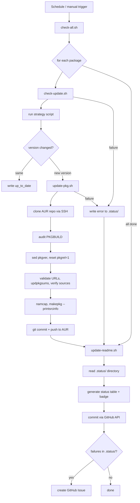

# Aurtomator Workflow Reference

## Table of Contents

1. [Overview](#1-overview)
2. [Package YAML Format](#2-package-yaml-format)
3. [Strategies](#3-strategies)
4. [Update Process](#4-update-process)
5. [CI Workflow: check-updates.yml](#5-ci-workflow-check-updatesyml)
6. [CI Quality Gate: ci.yml](#6-ci-quality-gate-ciyml)
7. [Local Testing](#7-local-testing)
8. [Writing Custom Strategies](#8-writing-custom-strategies)

## 1. Overview

aurtomator bumps the version of AUR packages you already maintain. It does **not** generate PKGBUILDs: it changes `pkgver` in the existing PKGBUILD on the AUR, regenerates checksums and `.SRCINFO`, and pushes the update.

### End-to-end flow



### Key design decisions

- **One YAML per package.** Adding or removing a package is one file.
- **Strategy-based version detection.** Each type of upstream source has its own script. A new source is a new script plus its entry in `scripts/validate-pkg.sh`.
- **Patch, do not generate.** aurtomator trusts your PKGBUILD and changes only `pkgver`, `pkgrel`, checksums and `.SRCINFO`. Build steps, dependencies and install files stay untouched.
- **One workflow run.** All packages are checked in one CI job, with one Arch container and one SSH and GPG setup.
- **Failure isolation.** A broken package does not block the others. Each failure is logged for its package and opens a GitHub Issue.

## 2. Package YAML Format

Each package has a file at `packages/<name>.yml`. The file name, the `name` field and the AUR package name are the same.

| Field          | Required | Description                                                                 |
|----------------|----------|-----------------------------------------------------------------------------|
| `name`         | yes      | AUR package name, equal to the file name without `.yml`                     |
| `strategy`     | yes      | Version detection strategy: a script name in `strategies/` without `.sh`    |
| `upstream`     | depends  | Strategy-specific settings. `archpkg`, `repology` and `kde-tarball` need none. |
| `current`      | no       | Currently tracked version. Written after every push.                        |
| `last_updated` | no       | Date of the last push, `YYYY-MM-DD`. Written after every push.              |

Example:

```yaml
name: my-package
strategy: github-release
upstream:
  project: owner/repo
current: "2.1.0"
```

## 3. Strategies

aurtomator ships 14 strategies. A strategy is a bash script in `strategies/`. It takes the package name, reads its settings from the package YAML, queries the upstream, and prints one version string on stdout. On failure it prints an error to stderr and exits non-zero. The HTTP-based strategies use `curl` with a 30-second timeout, and the tag-based ones strip a leading `v`.

### 3.1 github-release

**What it checks:** GitHub Releases API (`/repos/{owner}/{repo}/releases/latest`).

**When to use:** GitHub projects that publish releases.

**YAML fields:**

| Field                        | Required | Description                         |
|------------------------------|----------|-------------------------------------|
| `upstream.project`           | yes      | `owner/repo` format                 |
| `upstream.tag_version_regex` | no       | ERE with one capture group, see below |

**How the version is extracted:** reads `.tag_name` of the latest release and strips a leading `v`. The endpoint skips drafts and pre-releases.

**Authentication:** when `GITHUB_TOKEN` is set in the environment, it is sent as a Bearer token. The `check-updates` workflow sets it to the workflow token, which allows 1,000 requests per hour per repository. Without it, for example in a local run, the limit is 60 requests per hour.

**Example YAML:**

```yaml
name: my-package
strategy: github-release
upstream:
  project: owner/repo
```

**Custom tag format:** for tags like `MeshLab-2025.07` or `0.1.8-stable`, set `tag_version_regex`. The text of its capture group becomes the version. It also works with `github-tag` and `github-nightly`.

```yaml
name: meshlab-bin
strategy: github-release
upstream:
  project: cnr-isti-vclab/meshlab
  tag_version_regex: 'MeshLab-(.*)'
```

### 3.2 github-tag

**What it checks:** GitHub Tags API (`/repos/{owner}/{repo}/tags`).

**When to use:** GitHub projects with tags and no releases.

**YAML fields:**

| Field                        | Required | Description                              |
|------------------------------|----------|------------------------------------------|
| `upstream.project`           | yes      | `owner/repo` format                      |
| `upstream.tag_pattern`       | no       | Glob to filter tags (e.g. `v*`)          |
| `upstream.tag_version_regex` | no       | ERE with one capture group               |

**How the version is extracted:** fetches the first 100 tags and filters them by `tag_pattern`, where `*` matches anything and the match is anchored at the start. It strips a leading `v`, or applies `tag_version_regex`, and returns the highest tag by `sort -V`. `sort -V` places `1.0.0-rc1` above `1.0.0`, so filter pre-release tags with `tag_pattern`.

**Authentication:** same as `github-release`.

**Example YAML:**

```yaml
name: my-package
strategy: github-tag
upstream:
  project: owner/repo
  tag_pattern: "v*"
```

### 3.3 github-nightly

**What it checks:** GitHub releases of nightly or prerelease builds, in 4 patterns. The fields select the pattern:

- **Pattern A, fixed tag** (default): `nightly_tag` names one tag that moves, as in neovim, ghostty or yazi.
- **Pattern B, dated tags**: `nightly_tag` is a prefix with a dash, such as `nightly-`. The newest of the last 20 releases whose tag contains it wins (ruffle, servo).
- **Pattern C, separate nightly repo**: `nightly_tag: latest` reads `/releases/latest` of a dedicated build repo (yt-dlp).
- **Pattern D, channel filter**: `channel` picks the newest of the last 20 releases whose name contains it (brave).

Pattern A:

```yaml
name: myapp-nightly-bin
strategy: github-nightly
upstream:
  project: owner/repo
  nightly_tag: nightly
  version_source: release_body
  version_pattern: 'APP v\K\S+'
```

Pattern B:

```yaml
name: myapp-nightly-bin
strategy: github-nightly
upstream:
  project: owner/repo
  nightly_tag: "nightly-"
  version_source: tag_date
```

Pattern C:

```yaml
name: myapp-nightly-bin
strategy: github-nightly
upstream:
  project: owner/nightly-builds
  nightly_tag: latest
  version_source: tag
```

Pattern D:

```yaml
name: myapp-nightly-bin
strategy: github-nightly
upstream:
  project: owner/repo
  channel: Nightly
  version_source: tag
```

**YAML fields:**

| Field | Required | Description |
|-------|----------|-------------|
| `upstream.project` | yes | `owner/repo` |
| `upstream.nightly_tag` | no | Tag name or prefix (default: `"nightly"`, `"latest"` for pattern C) |
| `upstream.version_source` | no | `"tag"` (default), `"release_body"`, `"tag_date"`, `"published_date"` |
| `upstream.version_pattern` | for `release_body` | Perl regex for the version in the release body. Dashes in the match become `+`. |
| `upstream.tag_version_regex` | no | ERE with one capture group, for `version_source: tag` |
| `upstream.channel` | for pattern D | Text that the release name must contain |

`tag_date` takes the `YYYY-MM-DD` date in the tag and `published_date` the release date, both rendered as `YYYY.MM.DD`.

**Authentication:** same as `github-release`.

### 3.4 github-asset

**What it checks:** one GitHub release by tag (`/repos/{owner}/{repo}/releases/tags/{tag}`) and the `updated_at` of the assets listed in the package YAML.

**When to use:** releases whose tag never moves while the assets behind it are replaced, such as a model zoo or a rolling download tag. A PKGBUILD for such a release points at fixed URLs, so an update changes `pkgver` and the checksums and nothing else.

**YAML fields:**

| Field              | Required | Description                                  |
|--------------------|----------|----------------------------------------------|
| `upstream.project` | yes      | `owner/repo` format                          |
| `upstream.tag`     | yes      | Release tag that carries the assets          |
| `upstream.assets`  | yes      | List of exact asset file names, at least one |

**How the version is extracted:** every listed asset must be present in the release, otherwise the strategy fails and names the missing one. The newest `updated_at` among them becomes the version, rendered as `YYYYMMDD` (for example `20251202`). A re-upload of any listed asset moves the date forward. The release object lists only assets in state `uploaded`, so one request covers every downloadable asset.

**Authentication:** same as `github-release`.

**Example YAML:**

```yaml
name: sherpa-onnx-piper-voices-ru
strategy: github-asset
upstream:
  project: k2-fsa/sherpa-onnx
  tag: tts-models
  assets:
    - vits-piper-ru_RU-denis-medium.tar.bz2
    - vits-piper-ru_RU-dmitri-medium.tar.bz2
```

### 3.5 gitlab-tag

**What it checks:** GitLab Tags API (`/api/v4/projects/{id}/repository/tags`).

**When to use:** any GitLab instance: gitlab.com, invent.kde.org, self-hosted.

**YAML fields:**

| Field                  | Required | Description                                           |
|------------------------|----------|-------------------------------------------------------|
| `upstream.host`        | yes      | GitLab hostname (e.g. `invent.kde.org`, `gitlab.com`) |
| `upstream.project`     | yes      | Project path (e.g. `network/my-kde-app`)              |
| `upstream.tag_pattern` | no       | Glob to filter tags                                   |

**How the version is extracted:** URL-encodes the project path (`/` becomes `%2F`), fetches the first 100 tags, filters them by `tag_pattern`, strips a leading `v` and returns the highest by `sort -V`. There is no authentication, so private projects cannot be queried.

**Example YAML:**

```yaml
name: my-kde-app
strategy: gitlab-tag
upstream:
  host: invent.kde.org
  project: network/my-kde-app
```

### 3.6 gitea-tag

**What it checks:** Gitea/Forgejo Tags API (`/api/v1/repos/{owner}/{repo}/tags`).

**When to use:** Codeberg and self-hosted Gitea or Forgejo instances.

**YAML fields:**

| Field                  | Required | Description                              |
|------------------------|----------|------------------------------------------|
| `upstream.host`        | yes      | Instance hostname (e.g. `codeberg.org`)  |
| `upstream.project`     | yes      | `owner/repo` format                      |
| `upstream.tag_pattern` | no       | Glob to filter tags                      |

**How the version is extracted:** fetches up to 50 tags without pagination, filters them by `tag_pattern`, strips a leading `v` and returns the highest by `sort -V`.

**Example YAML:**

```yaml
name: my-package
strategy: gitea-tag
upstream:
  host: codeberg.org
  project: owner/repo
```

### 3.7 git-latest

**What it checks:** any git repository, through a bare clone.

**When to use:** `-git` AUR packages that track the latest commit.

**YAML fields:**

| Field              | Required | Description                                  |
|--------------------|----------|----------------------------------------------|
| `upstream.type`    | yes      | One of: `github`, `gitlab`, `git`            |
| `upstream.host`    | depends  | Required for the `gitlab` type               |
| `upstream.project` | depends  | Required for the `github` and `gitlab` types |
| `upstream.url`     | depends  | Required for the `git` type: full clone URL  |

**How the version is extracted:** makes a bare clone into a temporary directory, counts the commits on `HEAD` (`git rev-list --count HEAD`), takes the short hash (`git rev-parse --short=7 HEAD`) and prints the usual `-git` format `r<count>.<shorthash>`, for example `r431.66db9ce`.

**Example YAML (GitHub):**

```yaml
name: my-package-git
strategy: git-latest
upstream:
  type: github
  project: owner/repo
```

**Example YAML (GitLab):**

```yaml
name: my-package-git
strategy: git-latest
upstream:
  type: gitlab
  host: invent.kde.org
  project: network/my-kde-app
```

**Example YAML (any git URL):**

```yaml
name: my-package-git
strategy: git-latest
upstream:
  type: git
  url: "https://git.sr.ht/~user/repo"
```

### 3.8 pypi

**What it checks:** PyPI JSON API (`https://pypi.org/pypi/{package}/json`).

**When to use:** Python packages published on PyPI.

**YAML fields:**

| Field               | Required | Description                                  |
|---------------------|----------|----------------------------------------------|
| `upstream.registry` | yes      | PyPI package name (e.g. `requests`, `flask`) |

**How the version is extracted:** reads `.info.version`, the latest stable release on PyPI.

**Example YAML:**

```yaml
name: python-requests
strategy: pypi
upstream:
  registry: requests
```

### 3.9 npm

**What it checks:** npm registry (`https://registry.npmjs.org/{package}/latest`).

**When to use:** Node.js packages published on npm.

**YAML fields:**

| Field               | Required | Description                                  |
|---------------------|----------|----------------------------------------------|
| `upstream.registry` | yes      | npm package name (e.g. `express`, `webpack`) |

**How the version is extracted:** reads `.version` of the `latest` tag.

**Example YAML:**

```yaml
name: nodejs-express
strategy: npm
upstream:
  registry: express
```

### 3.10 crates

**What it checks:** crates.io API (`https://crates.io/api/v1/crates/{crate}`).

**When to use:** Rust crates published on crates.io.

**YAML fields:**

| Field               | Required | Description                        |
|---------------------|----------|------------------------------------|
| `upstream.registry` | yes      | Crate name (e.g. `serde`, `tokio`) |

**How the version is extracted:** reads `.crate.max_stable_version`, which excludes pre-releases. The request sends `User-Agent: aurtomator/1.0`, as the crates.io API policy requires.

**Example YAML:**

```yaml
name: rust-serde
strategy: crates
upstream:
  registry: serde
```

### 3.11 repology

**What it checks:** Repology API (`https://repology.org/api/v1/project/{name}`).

**When to use:** as a fallback when no other strategy fits. Repology tracks versions across many distribution repositories.

**YAML fields:**

| Field               | Required | Description                                                  |
|---------------------|----------|--------------------------------------------------------------|
| `upstream.repology` | no       | Repology project name. Defaults to the package `name`.       |

**How the version is extracted:** returns the version of the first entry with `status == "newest"`. The request sends `User-Agent: aurtomator/1.0`, as Repology asks.

**Example YAML:**

```yaml
name: my-package
strategy: repology
upstream:
  repology: my-package
```

Without `upstream.repology`, the package name is used:

```yaml
name: my-package
strategy: repology
```

### 3.12 archpkg

**What it checks:** Arch Linux package search API (`https://archlinux.org/packages/search/json/?name={name}`).

**When to use:** AUR packages that follow an official Arch package, for example a package that needs a rebuild when a dependency in the official repos is updated.

**YAML fields:**

| Field              | Required | Description                                                    |
|--------------------|----------|----------------------------------------------------------------|
| `upstream.archpkg` | no       | Package name in the official repos. Defaults to the package `name`. |

**How the version is extracted:** reads `.results[0].pkgver`, the version without `pkgrel`.

**Example YAML:**

```yaml
name: my-qt6-addon
strategy: archpkg
upstream:
  archpkg: qt6-base
```

### 3.13 webpage-scrape

**What it checks:** any HTTPS page, with a regex that matches the version.

**When to use:** upstreams without a structured API: download pages, directory listings, changelogs.

**YAML fields:**

| Field              | Required | Description                                          |
|--------------------|----------|------------------------------------------------------|
| `upstream.url`     | yes      | HTTPS URL of the page                                |
| `upstream.pattern` | yes      | ERE whose first capture group is the version         |

**How the version is extracted:**

1. Fetches the page: HTTPS only, at most 5 redirects and 5 MB.
2. Finds every match with `grep -oE`.
3. Extracts the first capture group with `sed -E`.
4. Sorts with `sort -Vu` and returns the highest version.

**Example YAML:**

```yaml
name: my-scrape-pkg
strategy: webpage-scrape
upstream:
  url: "https://www.example.com/~maintainer/my-scrape-pkg/"
  pattern: "my-scrape-pkg-([0-9.]+)\\.tar\\.gz"
```

**Common patterns:**

```text
# Standard tarball naming
"mypackage-([0-9]+\\.[0-9]+\\.[0-9]+)\\.tar\\.gz"

# With optional patch version
"mypackage-([0-9]+\\.[0-9]+(\\.[0-9]+)?)\\.tar\\.xz"

# Version in URL path
"/download/v([0-9.]+)/"
```

### 3.14 kde-tarball

**What it checks:** the KDE download server listing (`https://download.kde.org/stable/{name}/`).

**When to use:** KDE and Plasma packages that publish release tarballs on download.kde.org.

**YAML fields:** none. The package `name` is the directory on the server.

**How the version is extracted:** matches `{name}-{version}.tar.xz` links on the listing, where the version is digits and dots (`[0-9]+\.[0-9]+(\.[0-9]+)*`), and returns the highest by `sort -Vu`.

**Example YAML:**

```yaml
name: my-kde-app
strategy: kde-tarball
```

## 4. Update Process

`check-all.sh --update` calls `update-pkg.sh` for every package with a new version.

### 4.1 Arguments

```text
update-pkg.sh <package-name> <new-version> [--dry-run]
```

### 4.2 Step-by-step

1. Load `.aurtomator.conf` when it exists. In CI, `GIT_AUTHOR_NAME`, `GIT_AUTHOR_EMAIL` and `GPG_KEY_ID` come from the workflow environment.
2. Clone `ssh://aur@aur.archlinux.org/<package-name>.git` into a temporary directory, with up to 3 attempts. A clone without a PKGBUILD stops the update.
3. When the clone lands on a detached `HEAD`, reset `master` to `origin/master`, so the push is a fast-forward.
4. Warn when the PKGBUILD has no `# Maintainer:` line.
5. Audit the PKGBUILD. Split packages, `pkgver()` with the wrong strategy and mixed checksums block the update. Patches only warn. See [SUPPORTED-PACKAGES.md](SUPPORTED-PACKAGES.md).
6. Set `pkgver` with `sed` and reset `pkgrel=1`. When the PKGBUILD does not change, the AUR already has this version: the script writes it to `current` and exits with code 2.
7. Unless a checksum array starts with `SKIP`, validate every source URL, run `updpkgsums`, and verify the result with `makepkg --verifysource --skippgpcheck`. Any failure stops the update.
8. Run `namcap` when it is installed. Errors stop the update. Warnings are printed.
9. Regenerate `.SRCINFO` with `makepkg --printsrcinfo`.
10. With `--dry-run`, print the PKGBUILD diff and stop.
11. Commit `PKGBUILD` and `.SRCINFO` as `<new-version> release from <strategy>`, authored by `GIT_AUTHOR_NAME` and `GIT_AUTHOR_EMAIL` (default `aurtomator`). With `GPG_KEY_ID` set, the commit is amended with a signature. When signing fails, the commit is pushed unsigned.
12. Push, with up to 3 attempts.
13. Write `current` and `last_updated` to the package YAML.

### 4.3 Downgrade behavior

aurtomator follows upstream when it publishes a version older than the tracked one, and does **not** block it. Upstream is the source of truth: a packager that refuses a re-published older release only drifts out of sync. A downgrade is logged and shown, and it does not count as a failure.

#### When does this happen?

- Upstream deletes and recreates a release tag. In the gap, `/releases/latest` returns the previous release, so a cycle like `v1.2.1 → v1.2.0 → v1.2.1` can take only minutes.
- Upstream rolls back a broken release and removes its tag.
- Upstream marks an older release line as latest again, for example when a 2.x release is pulled and 1.x becomes the newest release.

#### How to detect downgrades in logs

Every comparison that finds the current version newer than the latest one (`vercmp "$current" "$latest"` returns `1`) logs the literal token `DOWNGRADE`. In a CI run, `check-all.sh` logs:

```text
! myapp-bin: DOWNGRADE detected 1.2.1 → 1.2.0 (mirroring upstream)
```

`check-update.sh` run on its own logs:

```text
! myapp-bin: DOWNGRADE 1.2.1 → 1.2.0
```

`grep DOWNGRADE` on a downloaded run log finds both.

#### Status values and README icons

`check-all.sh` writes two status tokens for downgrades to `.status/<pkg>`:

| Token                         | Meaning                                           |
|-------------------------------|---------------------------------------------------|
| `downgrade: <version>`        | `--update` mode: the downgrade was pushed to the AUR |
| `available_downgrade: <ver>`  | Check-only mode: a downgrade is available and not applied |

`update-readme.sh` renders them as:

- `downgrade: 1.2.0` → `⬇️ downgraded to 1.2.0`
- `available_downgrade: 1.2.0` → `⬇️ 1.2.0 available (downgrade)`

Both count toward `pkg_ok`, so the packages badge stays `brightgreen`. Only `check_failed` and `update_failed` turn it red.

## 5. CI Workflow: check-updates.yml

### 5.1 Trigger

The workflow runs every hour (`cron: "0 * * * *"`) and by hand through `workflow_dispatch`. The `check-updates` concurrency group serializes runs: a new run waits for the running one.

### 5.2 Permissions and container

The workflow has `contents: write` for the status commit and `issues: write` for failure issues, and nothing else. The job runs in `archlinux:base-devel` on `ubuntu-latest` with a 30-minute timeout. `makepkg` refuses to run as root, so the steps that touch packages run as a `builder` user.

### 5.3 Steps

1. **Install dependencies:** `sudo git github-cli openssh gnupg namcap jq go-yq pacman-contrib`, and the `builder` user with passwordless `sudo`.
2. **Checkout:** `actions/checkout`, pinned by commit SHA like every action in this repository.
3. **Setup workspace:** git identity for `builder` from the `AUR_GIT_NAME` and `AUR_GIT_EMAIL` secrets, default `aurtomator`.
4. **Setup AUR SSH:** writes `AUR_SSH_KEY` to `/home/builder/.ssh/aur`, adds the AUR host key with `ssh-keyscan` (3 attempts), and writes an SSH config with connection multiplexing.
5. **Setup GPG:** with `GPG_SIGNING_KEY` set, imports the key for `builder`, passes `GPG_KEY_ID` to the later steps and enables commit signing. Without it, the step is skipped.
6. **Check and update packages:** runs `check-all.sh --update` as `builder`, with `GPG_KEY_ID`, `GIT_AUTHOR_NAME`, `GIT_AUTHOR_EMAIL` and `GITHUB_TOKEN` set to the workflow token.
7. **Update README status table:** runs `update-readme.sh` as `builder`.
8. **Commit changes via API (verified):** see [5.5](#55-verified-commit).
9. **Create issues for failed packages:** see [5.6](#56-failure-issues).

Steps 8 and 9 run as root with `GH_TOKEN` set to the workflow token, `github.token`.

### 5.4 README update

`update-readme.sh` rewrites two blocks of `README.md`:

1. **Badges** between `<!-- BADGES:START -->` and `<!-- BADGES:END -->`: CI, Codecov and static badges for the repository in `origin`. A public repository gets its own tokenless Codecov badge. A private one, or a failed API call, links the upstream aurtomator badge.
2. **Package table** between `<!-- PACKAGES:START -->` and `<!-- PACKAGES:END -->`, built from `.status/`.

#### .status/ directory format

`check-all.sh` writes one file per package:

| Filename               | Content                          | Meaning                                  |
|------------------------|----------------------------------|------------------------------------------|
| `.status/<name>`       | `up_to_date`                     | The package is at the latest version     |
| `.status/<name>`       | `updated: 2.0.0`                 | Pushed to the AUR                        |
| `.status/<name>`       | `new_version: 2.0.0`             | Update found (check-only mode)           |
| `.status/<name>`       | `downgrade: 1.2.0`               | Downgrade pushed to the AUR              |
| `.status/<name>`       | `available_downgrade: 1.2.0`     | Downgrade found (check-only mode)        |
| `.status/<name>`       | `check_failed: <error>`          | The strategy failed                      |
| `.status/<name>`       | `update_failed: <error>`         | The update failed                        |
| `.status/_error_count` | `0`                              | Total error count of the run             |

#### Packages badge

```text
https://img.shields.io/badge/packages-<ok>%2F<total>-<color>
```

The color is `brightgreen` with no failures and `red` otherwise.

#### Status table

```markdown
| Package | Version | Strategy | Updated | Status |
|---------|---------|----------|---------|--------|
| [my-package](https://aur.archlinux.org/packages/my-package) | 1.0.1 | kde-tarball | 2026-10-01 | ✅ up to date |
| [other-pkg](https://aur.archlinux.org/packages/other-pkg) | 2.0.0 | github-release | 2026-10-14 | 🔄 updated to 2.0.0 |
```

### 5.5 Verified commit

A `git push` from the workflow would show as unverified, so the step commits through the GitHub Git Data API:

1. Stop when `git diff --quiet` finds no change.
2. Read the branch head and its tree.
3. Create a blob for every changed file, a tree on the base tree, and a commit.
4. Move the branch ref with `force=false`.

The message is `chore: update package versions [skip ci]`. `[skip ci]` keeps the commit from starting `ci.yml`. GitHub marks the commit as verified because the Actions bot creates it through the API.

### 5.6 Failure issues

The step runs with `if: always()`. For every `.status/` entry with `check_failed:` or `update_failed:`, it:

1. Creates the `auto-update` label when it is missing.
2. Skips the package when an open `auto-update` issue already matches `<package> failed`.
3. Opens an issue titled `❌ <package>: update failed` with the package, the error and a link to the run.

## 6. CI Quality Gate: ci.yml

`ci.yml` runs on every push and pull request to `main`.

### 6.1 Lint job

`ubuntu-latest`, 5-minute timeout. It installs `shellcheck` from apt and `shfmt` with `go install`, then runs:

```bash
shellcheck -x -S warning scripts/*.sh strategies/*.sh
shfmt -d -i 2 -ci scripts/*.sh strategies/*.sh
```

`-x` follows `source` directives and `-S warning` sets the minimum severity. `-d` fails on any formatting diff, `-i 2` sets two-space indentation, and `-ci` indents `case` branches.

### 6.2 Test job

`archlinux:base-devel` container, 15-minute timeout. It installs `bash bats git go-yq curl openssh ruby ruby-erb` and the `bashcov` and `simplecov-cobertura` gems, then runs:

```bash
./scripts/validate-pkg.sh --all
bats tests/ --recursive
bashcov -- bats tests/ --recursive
```

The coverage run uploads `coverage/coverage.xml` to Codecov and never fails the job.

## 7. Local Testing

### 7.1 Prerequisites

```bash
sudo pacman -S --needed git curl go-yq pacman-contrib namcap
# For tests and linting:
sudo pacman -S --needed bats shellcheck shfmt
```

### 7.2 Check a single package

```bash
./scripts/check-update.sh my-package
```

The log goes to stderr. When an update is available, the new version is printed on stdout:

```text
→ Checking my-package (strategy: github-release, current: 1.0.0)
! my-package: update available 1.0.0 → 2.0.0
2.0.0
```

When the package is up to date, stdout stays empty:

```text
→ Checking my-package (strategy: github-release, current: 2.0.0)
✓ my-package is up to date (2.0.0)
```

### 7.3 Dry-run an update

```bash
./scripts/update-pkg.sh my-package 2.0.0 --dry-run
```

It runs the steps of [4.2](#42-step-by-step) up to `.SRCINFO`, prints the PKGBUILD diff and does not push.

### 7.4 Push an update

```bash
./scripts/update-pkg.sh my-package 2.0.0
```

It runs the full cycle, including `git push` to the AUR with your SSH key.

### 7.5 Check all packages

```bash
# Check only
./scripts/check-all.sh

# Check and push updates
./scripts/check-all.sh --update

# Check and dry-run updates
./scripts/check-all.sh --update --dry-run
```

The last line is a summary:

```text
→ Checked: 4, Updated: 2, Errors: 0
```

### 7.6 Running BATS tests

```bash
# Run all tests
bats tests/ --recursive --timing

# Run one file
bats tests/scripts.bats
bats tests/strategies.bats
bats tests/setup.bats
```

`tests/helpers/setup.sh` gives every test a temporary project directory with symlinked scripts and strategies. It copies `tests/helpers/mock-curl.sh` there as `curl`, puts it first in `PATH`, and removes the directory afterwards. Tests that need `git`, `ssh` or `gh` put their own mocks in the same place. The suite makes no network requests and never touches real AUR repos.

### 7.7 Linting locally

```bash
# shellcheck
shellcheck -x -S warning scripts/*.sh strategies/*.sh

# shfmt (check mode)
shfmt -d -i 2 -ci scripts/*.sh strategies/*.sh

# shfmt (auto-fix)
shfmt -w -i 2 -ci scripts/*.sh strategies/*.sh
```

## 8. Writing Custom Strategies

A strategy is a bash script in `strategies/` that finds the latest upstream version of a package.

### 8.1 Interface contract

- **Input:** one positional argument, the package name.
- **Success:** the version on stdout as one line, exit code 0.
- **Failure:** an error on stderr, a non-zero exit code.
- **Version format:** `check-update.sh` rejects a version with any character outside `A-Za-z0-9._+`.

The script can rely on `yq` and `curl`. `scripts/lib.sh` provides YAML helpers and logging and sets `AURTOMATOR_DIR` to the project root.

### 8.2 Template

```bash
#!/usr/bin/env bash
#
# my-strategy - Detect latest version from <source>
#
# Input: package name (reads upstream config from package YAML)
# Output: latest version string

set -euo pipefail

readonly NAME="${1:?Usage: my-strategy.sh <package-name>}"
SCRIPT_DIR="$(cd "$(dirname "${BASH_SOURCE[0]}")" && pwd)"
readonly SCRIPT_DIR
readonly TIMEOUT=30

# shellcheck source=../scripts/lib.sh
source "${SCRIPT_DIR}/../scripts/lib.sh"

pkg_file=$(pkg_file "$NAME")
my_field=$(pkg_get "$pkg_file" .upstream.my_field)

version=$(curl -sfL --max-time "$TIMEOUT" \
  "https://example.com/api/${my_field}" |
  yq -r '.version') || {
  echo "Failed to fetch version for ${my_field}" >&2
  exit 1
}

if [[ -z "$version" || "$version" == "null" ]]; then
  echo "No version found for ${my_field}" >&2
  exit 1
fi

echo "$version"
```

### 8.3 Checklist

1. **Location:** `strategies/<name>.sh`, executable (`chmod +x`). `<name>` is the value of the YAML `strategy` field.
2. **Header:** `set -euo pipefail`, then source `lib.sh` for `pkg_file`, `pkg_get` and logging.
3. **HTTP:** `curl -sfL --max-time "$TIMEOUT"`. `-f` fails on HTTP errors, `-L` follows redirects, and `--max-time` prevents hangs.
4. **Result:** check for an empty string and for `null` from `yq`.
5. **Prefix:** strip a leading `v` with `${version#v}` when upstream tags look like `v1.0.0`.
6. **Validation:** add the name and its required fields to `scripts/validate-pkg.sh`.
7. **Tests:** add the API fixture to `tests/helpers/mock-curl.sh` and tests to `tests/strategies.bats`.
8. **Linters:**

   ```bash
   shellcheck -x -S warning strategies/my-strategy.sh
   shfmt -d -i 2 -ci strategies/my-strategy.sh
   ```

9. **Docs:** the strategies table in `README.md`, a section in this file, and an example in `packages/example.yml.sample`.

### 8.4 Available lib.sh functions

| Function                        | Description                                         |
|---------------------------------|-----------------------------------------------------|
| `pkg_file <name>`               | Resolves `packages/<name>.yml`, returns 1 if missing |
| `pkg_get <file> <yq-query>`     | Reads a field from a YAML file with yq              |
| `pkg_set <file> <query> <val>`  | Writes a field to a YAML file with yq               |
| `require_cmd <cmd>`             | Exits 1 if the command is not in `PATH`             |
| `load_config`                   | Sources `.aurtomator.conf` if present               |
| `log_ok <msg>`                  | Prints a green check mark and the message to stderr |
| `log_warn <msg>`                | Prints a yellow `!` and the message to stderr       |
| `log_err <msg>`                 | Prints a red cross and the message to stderr        |
| `log_info <msg>`                | Prints a bold arrow and the message to stderr       |

The logging functions omit ANSI colors when stdout is not a terminal.

### 8.5 YAML conventions for custom strategies

Put the strategy's settings under `upstream`, with descriptive names, and list them in the header of the strategy script. Other strategies ignore fields they do not read.

```yaml
name: my-package
strategy: my-strategy
upstream:
  my_field: some-value
  another_field: another-value
```
