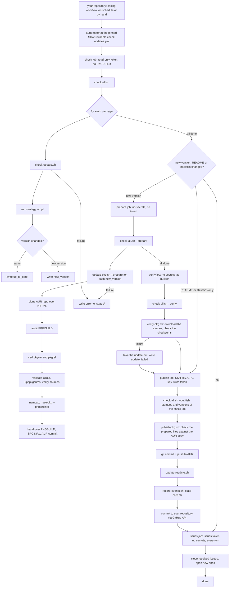

aurtomator updates AUR packages that you already maintain. It sets `pkgver` and `pkgrel` in the PKGBUILD of the AUR, regenerates the checksums and `.SRCINFO`, and pushes the update. It never writes a PKGBUILD of its own.

## How a run works

A run involves two repositories. Your repository, made from the template `staticwire/aurtomator-seed`, holds the package YAMLs, the README with the package table, and two calling workflows, `.github/workflows/check-updates.yml` and `.github/workflows/validate.yml`. aurtomator holds the scripts, the strategies and the reusable workflows, which the calling workflows run at the commit they pin, see [Trigger](/internals/workflow/#trigger). A run pushes the new versions to the AUR and commits the package YAMLs, the README, `stats/` and `aurtomator.sh` to your repository.

## Design

- One YAML per package, so adding or removing a package is one file.
- One script per kind of upstream source. A new source is a new script plus the checks of its fields in `scripts/validate-pkg.sh`.
- The PKGBUILD stays yours. aurtomator changes `pkgver`, `pkgrel`, the checksums, `.SRCINFO`, the line of `upstream.asset_var`, see [Values from release asset names](/features/asset-values/), and the `arch=(...)` line of a version without some arches, see [Versions without some arches](/features/missing-arches/). Build steps, dependencies and install files stay as they are.
- One job of five holds the secrets. A PKGBUILD is code, and an update runs it. `check` runs the strategies with the read-only token and runs no PKGBUILD. `prepare` runs the PKGBUILD of each package in a job of its own, without secrets and without a token, and hands over only the files of that package. `verify` downloads the sources and checks the checksums without secrets, as an unprivileged user. `publish` holds the SSH key, the GPG key and the write token, runs no PKGBUILD, no strategy and no download, and checks the prepared files before it pushes, see [Prepare and publish](/internals/update-process/#prepare-and-publish). `issues` can write issues and nothing else, see [Issues](/features/issues/).
- A broken package does not block the others. Its failure gets a log line and an issue, and a time limit per package stops a package that hangs.

## The steps of an update

1. Clone the AUR repository.
2. Audit the PKGBUILD for what aurtomator cannot update, which blocks the update or warns.
3. Set `pkgver`, and the line of `upstream.asset_var` for a package that has one.
4. Set `pkgrel` to 1, or to the AUR `pkgrel` plus one for a rebuild with a new asset value.
5. Check the source URLs: a `HEAD` request, the HTTP status and the `Content-Type`.
6. Run `updpkgsums`.
7. Run `makepkg --verifysource`.
8. Run `namcap`.
9. Run `makepkg --printsrcinfo`.
10. Check the prepared files against the AUR copy.
11. Commit and push to the AUR.

In the workflow, `prepare` runs steps 1 to 9. `verify` runs step 10, downloads the sources again and compares every checksum. `publish` runs step 10 once more, then step 11. Steps 6 and 7 are skipped when a checksum array holds a `SKIP` other than that of a signature and no remote source has a real checksum, see [Packages with VCS checksums](/supported-packages/#packages-with-vcs-checksums-skip) and [Sources with a signature](/supported-packages/#sources-with-a-signature).

aurtomator does not build packages and does not check runtime dependencies, which needs `ldd` or `readelf` on built binaries. The dependencies stay the work of the maintainer.
