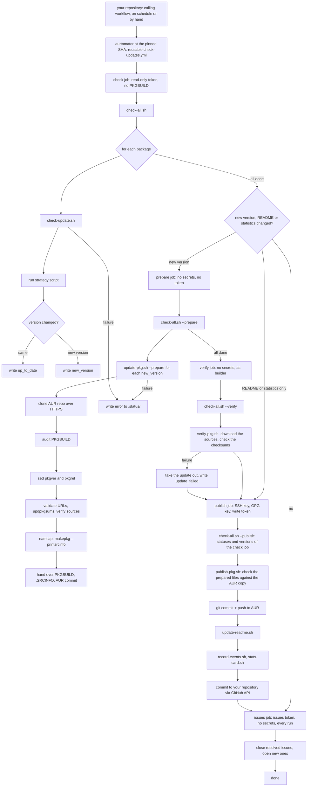

aurtomator bumps the version of AUR packages you already maintain. It does **not** generate PKGBUILDs: it changes `pkgver` and `pkgrel` in the existing PKGBUILD on the AUR, regenerates checksums and `.SRCINFO`, and pushes the update.

## End-to-end flow

A run involves two repositories. Your repository, created from the template `staticwire/aurtomator-seed`, holds the package YAMLs, the README with the package table and two calling workflows, `.github/workflows/check-updates.yml` and `.github/workflows/validate.yml`. aurtomator holds the scripts, the strategies and the reusable workflows `check-updates.yml`, `notify-failure.yml` and `validate.yml`, and the calling workflows run them at the SHA they pin, see [Trigger](/aurtomator/internals/workflow/#trigger). A run pushes the new versions to the AUR and commits the changed package YAMLs, the README, the files of `stats/` and `aurtomator.sh` to your repository.

## Key design decisions

- **One YAML per package.** Adding or removing a package is one file.
- **Strategy-based version detection.** Each type of upstream source has its own script. A new source is a new script plus the checks of its fields in `scripts/validate-pkg.sh`.
- **Patch, do not generate.** aurtomator trusts your PKGBUILD and changes only `pkgver`, `pkgrel`, checksums, `.SRCINFO`, for a package with `upstream.asset_var` the line of that variable, see [Values from release asset names](/aurtomator/features/asset-values/), and for a version whose release lacks the archive of some arches the `arch=(...)` line, see [Versions without some arches](/aurtomator/features/missing-arches/). Build steps, dependencies and install files stay untouched.
- **Five jobs, one with secrets.** A PKGBUILD is code, and an update executes it from the audit to `makepkg --printsrcinfo`. `check` runs the strategies with the read-only workflow token, executes no PKGBUILD and decides what the run does. The jobs after it take the status of every package from `check`. `prepare` runs the PKGBUILD steps in a job of its own for each package, without secrets and without a token, and hands over only the prepared files and the update failure of that package, so code from a PKGBUILD reaches the files of its own package alone. `verify` downloads the sources of each prepared update and checks its checksums, without secrets and as an unprivileged user, in a job where no PKGBUILD runs. `publish` holds the SSH key, the GPG key and the write token, never executes a PKGBUILD, runs no strategy and never downloads a source, and checks what `verify` passes on before it pushes. See [Prepare and publish](/aurtomator/internals/update-process/#prepare-and-publish). `issues` opens and closes the issues in every run, with a token that writes issues and nothing else, see [Issues](/aurtomator/features/issues/).
- **Failure isolation.** A broken package does not block the others. Each failure is logged for its package, and a package that starts failing gets a GitHub Issue, see [Issues](/aurtomator/features/issues/). Each package has a time budget, so one that hangs does not hold up the run either.

## How aurtomator updates packages

For every update, aurtomator does this:

1. Clone the existing AUR git repo
2. **Audit the PKGBUILD** for unsupported features (blocks or warns)
3. `sed` replaces `pkgver=` with the new version, and the line of `upstream.asset_var`, for a package that sets it, with the value from the release asset name
4. Set `pkgrel=1`, or the AUR `pkgrel` plus one for a rebuild with a new asset value
5. **Validate source URLs** (HEAD request, HTTP status and `Content-Type` check)
6. Run `updpkgsums`
7. Run `makepkg --verifysource` to verify checksums
8. **Lint with `namcap`**
9. Run `makepkg --printsrcinfo` to regenerate `.SRCINFO`
10. **Check the prepared files** against the AUR copy
11. Commit and push to the AUR

In the workflow, the prepare job runs steps 1 to 9. The verify job runs step 10, downloads the sources again and compares every checksum. The publish job runs step 10 once more and then step 11.

Steps 6 and 7 are skipped when a checksum array holds a `SKIP` other than that of a signature and no remote source has a real checksum, see [Packages with VCS checksums](/aurtomator/supported-packages/#packages-with-vcs-checksums-skip) and [Sources with a signature](/aurtomator/supported-packages/#sources-with-a-signature).

aurtomator does not build packages and does not check runtime dependencies. That needs `ldd` or `readelf` on built binaries and is out of scope. Dependency correctness is the maintainer's responsibility.
